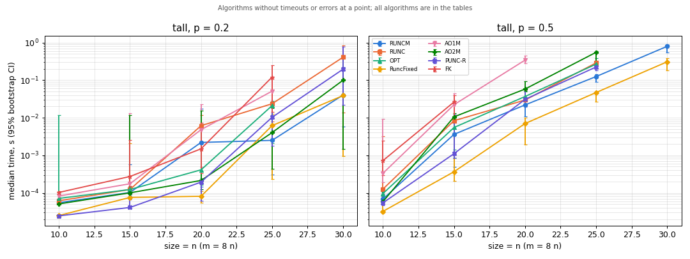
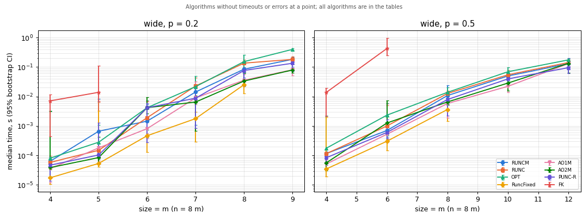
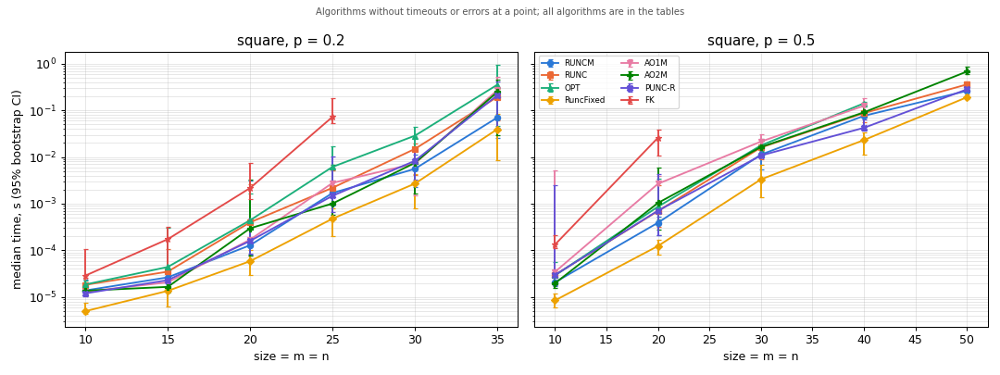

# Benchmark report 2026-10-23

Generated by `benchmarks/run_benchmarks.py` (see `benchmarks/README.md` for how to read it).

## Notes (written by hand after the run)

- **Noisy machine.** Other builds and agents were running (load average about 24 on 8 logical
  CPUs), so absolute times are inflated and the intervals wide; an earlier run of the same
  configuration at load about 15 gave the same winners. Regenerate on an idle machine for numbers
  to quote.
- **RuncFixed wins almost everywhere it applies** (n <= 64): in every regime it is 1.3-3x faster
  than the next algorithm at the larger sizes. Its rows are machine words, so it is out for
  n > 64, i.e. for the larger `wide` matrices.
- **m >> n (`tall`):** after RuncFixed, RUNCM is the best general algorithm (2.5x slower than
  RuncFixed at 240 x 30, p = 0.5); the AO family without row removal (AO1, AO1K) and FK drop out
  early; on tiny outputs (1-2 covers) the PUNC variants with row ordering are fastest.
- **m << n (`wide`):** beyond 64 columns the AOT1 M/K variants and PUNC beat RUNCM by up to
  about 2x (9 x 72, p = 0.2: AO2M 79 ms, PUNC-RC 74 ms, RUNCM 182 ms; at 12 x 96, p = 0.5, PUNC
  84 ms vs RUNCM 131 ms), with overlapping CIs at some points.
- **m ~ n (`square`):** RuncFixed, then RUNCM, PUNC-R and AO2M within a factor of about 2.
- **Time per cover** (median over all completed runs): RuncFixed 0.6 us, PUNC-R 1.0 us, RUNCM
  1.2 us, OPT 2.5 us, AO2 6.3 us, FK 50 us. All algorithms agree on the number of covers.
- **FK numbers predate the FK speed-up (#45)**; FK is 40-80x slower per cover than RUNCM here and
  times out at about 10^4 covers. Regenerate this report after #45 lands.

## Setup

- Machine: Intel(R) Xeon(R) CPU @ 2.20GHz, 8 logical CPUs, 64301 MiB RAM; Linux-6.8.0-1064-gcp-x86_64-with-glibc2.35
- Load average (1 min) before / after the run: 24.0 / 24.5 (other processes were running if it is well above 0)
- Build: {"compiler": "gcc 11.4.0", "assertions": "off", "pointer_bits": 64}; commit `4104a31`
- Configuration `default`: 5 random matrices per point, time limit 1.0 s per run, 2000 bootstrap resamples, seed 48; runs one at a time; total wall time 4.3 min
- Matrices: every cell is 1 with probability p (a zero row gets one random 1); regimes `tall`: size = n (m = 8 n); `wide`: size = m (n = 8 m); `square`: size = m = n
- Time: median and mean over the matrices of a point with 95% percentile bootstrap CIs; a timed-out run counts with the time at which it stopped (at least the limit), so cells with timeouts (marked `>=`) are lower bounds. Once more than half of an algorithm's runs at a point time out or fail (RuncFixed takes at most 64 columns), its remaining runs there and all larger sizes of that regime and density are skipped.

All completed runs on the same matrix reported the same number of covers.

## Fastest algorithm per point

By median time over completed runs only; ties within 5% are listed together.

| regime | m | n | p | covers (median) | fastest | median time | runner-up | median time |
|---|---:|---:|---:|---:|---|---:|---|---:|
| tall | 80 | 10 | 0.2 | 1 | PUNC-RC | 22.6 us | PUNC-R | 24.4 us |
| tall | 120 | 15 | 0.2 | 2 | PUNC-RC, PUNC-R | 39.0 us | RuncFixed | 75.5 us |
| tall | 160 | 20 | 0.2 | 26 | RuncFixed | 81.0 us | PUNC-RC | 150.3 us |
| tall | 200 | 25 | 0.2 | 631 | RUNCM | 2.5 ms | AO2M | 4.0 ms |
| tall | 240 | 30 | 0.2 | 14973 | RuncFixed, RUNCM | 38.8 ms | AO2M | 99.7 ms |
| tall | 80 | 10 | 0.5 | 19 | RuncFixed | 32.1 us | PUNC-RC | 50.2 us |
| tall | 120 | 15 | 0.5 | 414 | RuncFixed | 364.9 us | PUNC-R | 1.1 ms |
| tall | 160 | 20 | 0.5 | 4554 | RuncFixed | 7.0 ms | RUNCM | 21.9 ms |
| tall | 200 | 25 | 0.5 | 27792 | RuncFixed | 46.9 ms | RUNCM | 124.5 ms |
| tall | 240 | 30 | 0.5 | 154803 | RuncFixed | 307.6 ms | RUNCM | 794.7 ms |
| wide | 4 | 32 | 0.2 | 158 | RuncFixed | 17.5 us | AO1K | 31.6 us |
| wide | 5 | 40 | 0.2 | 423 | RuncFixed | 53.7 us | AO2M | 84.6 us |
| wide | 6 | 48 | 0.2 | 4962 | RuncFixed | 466.9 us | AO1M | 811.7 us |
| wide | 7 | 56 | 0.2 | 15975 | RuncFixed | 1.8 ms | AO2K | 2.3 ms |
| wide | 8 | 64 | 0.2 | 117315 | RuncFixed | 25.1 ms | AO2M | 33.5 ms |
| wide | 9 | 72 | 0.2 | 234851 | PUNC-RC | 73.7 ms | AO2M | 79.3 ms |
| wide | 4 | 32 | 0.5 | 375 | RuncFixed | 34.9 us | AO1M | 51.5 us |
| wide | 6 | 48 | 0.5 | 2218 | RuncFixed | 303.7 us | AO1K | 412.6 us |
| wide | 8 | 64 | 0.5 | 12301 | RuncFixed | 3.6 ms | AO1M | 5.8 ms |
| wide | 10 | 80 | 0.5 | 53016 | AO1M | 22.3 ms | AO1K | 25.6 ms |
| wide | 12 | 96 | 0.5 | 236409 | PUNC | 84.2 ms | PUNC-RC | 93.2 ms |
| square | 10 | 10 | 0.2 | 2 | RuncFixed | 5.0 us | AO2K | 11.7 us |
| square | 15 | 15 | 0.2 | 12 | RuncFixed | 13.5 us | AO2M | 16.5 us |
| square | 20 | 20 | 0.2 | 181 | RuncFixed | 58.6 us | RUNCM | 128.7 us |
| square | 25 | 25 | 0.2 | 1467 | RuncFixed | 477.0 us | AO2M | 1.0 ms |
| square | 30 | 30 | 0.2 | 9062 | RuncFixed | 2.7 ms | AO2K | 5.4 ms |
| square | 35 | 35 | 0.2 | 67503 | RuncFixed | 39.4 ms | RUNCM | 70.0 ms |
| square | 10 | 10 | 0.5 | 17 | RuncFixed | 8.4 us | AO2M | 19.7 us |
| square | 20 | 20 | 0.5 | 625 | RuncFixed | 123.8 us | RUNCM | 390.7 us |
| square | 30 | 30 | 0.5 | 7428 | RuncFixed | 3.3 ms | PUNC-R | 10.8 ms |
| square | 40 | 40 | 0.5 | 54727 | RuncFixed | 23.1 ms | PUNC-R | 42.2 ms |
| square | 50 | 50 | 0.5 | 350175 | RuncFixed | 190.9 ms | RUNCM | 261.4 ms |

## Regime `tall`

### p = 0.2

| m | n | algorithm | runs | timeouts | errors | covers (median) | median time [95% CI] | mean time [95% CI] | median time per cover [95% CI] |
|---:|---:|---|---:|---:|---:|---:|---:|---:|---:|
| 80 | 10 | AO1 | 3 | 3 | 0 | - | >= 1.00 s [1.00 s, 1.01 s] | >= 1.00 s [1.00 s, 1.01 s] | - |
| 80 | 10 | AO1K | 5 | 0 | 0 | 1 | 64.9 ms [10.7 ms, 737.7 ms] | 196.2 ms [39.9 ms, 468.2 ms] | 64.9 ms [10.7 ms, 737.7 ms] |
| 80 | 10 | AO1M | 5 | 0 | 0 | 1 | 82.3 us [77.7 us, 84.0 us] | 81.8 us [79.6 us, 83.3 us] | 82.3 us [77.7 us, 84.0 us] |
| 80 | 10 | AO2 | 5 | 0 | 0 | 1 | 81.3 us [73.7 us, 16.1 ms] | 3.3 ms [75.2 us, 9.7 ms] | 81.3 us [73.7 us, 16.1 ms] |
| 80 | 10 | AO2K | 5 | 0 | 0 | 1 | 52.5 us [41.6 us, 307.9 us] | 102.7 us [47.4 us, 205.7 us] | 52.5 us [41.6 us, 307.9 us] |
| 80 | 10 | AO2M | 5 | 0 | 0 | 1 | 50.7 us [48.4 us, 52.3 us] | 50.5 us [49.2 us, 51.8 us] | 50.7 us [48.4 us, 52.3 us] |
| 80 | 10 | FK | 5 | 0 | 0 | 1 | 102.6 us [100.3 us, 104.1 us] | 102.4 us [101.2 us, 103.6 us] | 102.6 us [100.3 us, 104.1 us] |
| 80 | 10 | OPT | 5 | 0 | 0 | 1 | 71.1 us [64.8 us, 11.8 ms] | 3.7 ms [67.3 us, 8.4 ms] | 71.1 us [64.8 us, 11.8 ms] |
| 80 | 10 | PUNC | 5 | 0 | 0 | 1 | 54.0 us [41.3 us, 60.7 us] | 53.7 us [47.3 us, 58.5 us] | 54.0 us [41.3 us, 60.7 us] |
| 80 | 10 | PUNC-R | 5 | 0 | 0 | 1 | 24.4 us [23.9 us, 24.9 us] | 24.4 us [24.1 us, 24.7 us] | 24.4 us [23.9 us, 24.9 us] |
| 80 | 10 | PUNC-RC | 5 | 0 | 0 | 1 | 22.6 us [22.4 us, 23.7 us] | 22.9 us [22.5 us, 23.4 us] | 22.6 us [22.4 us, 23.7 us] |
| 80 | 10 | RUNC | 5 | 0 | 0 | 1 | 61.5 us [52.1 us, 111.7 us] | 68.7 us [55.6 us, 90.5 us] | 61.5 us [52.1 us, 111.7 us] |
| 80 | 10 | RUNCM | 5 | 0 | 0 | 1 | 54.7 us [50.3 us, 55.9 us] | 54.1 us [52.1 us, 55.5 us] | 54.7 us [50.3 us, 55.9 us] |
| 80 | 10 | RuncFixed | 5 | 0 | 0 | 1 | 24.9 us [23.0 us, 27.1 us] | 24.9 us [23.7 us, 26.0 us] | 24.9 us [23.0 us, 27.1 us] |
| 120 | 15 | AO1K | 3 | 3 | 0 | - | >= 1.00 s [1.00 s, 1.01 s] | >= 1.00 s [1.00 s, 1.01 s] | - |
| 120 | 15 | AO1M | 5 | 0 | 0 | 2 | 174.6 us [149.1 us, 13.2 ms] | 4.1 ms [159.3 us, 9.3 ms] | 79.2 us [58.2 us, 13.2 ms] |
| 120 | 15 | AO2 | 5 | 0 | 0 | 2 | 169.1 us [127.8 us, 3.2 ms] | 1.2 ms [143.1 us, 2.4 ms] | 145.5 us [42.6 us, 1.6 ms] |
| 120 | 15 | AO2K | 5 | 0 | 0 | 2 | 88.0 us [71.1 us, 123.4 us] | 94.3 us [80.8 us, 111.9 us] | 43.6 us [20.3 us, 123.4 us] |
| 120 | 15 | AO2M | 5 | 0 | 0 | 2 | 100.1 us [91.1 us, 11.9 ms] | 2.8 ms [93.4 us, 7.6 ms] | 93.5 us [45.6 us, 4.0 ms] |
| 120 | 15 | FK | 5 | 0 | 0 | 2 | 272.4 us [150.5 us, 2.6 ms] | 719.8 us [182.4 us, 1.6 ms] | 81.5 us [54.5 us, 2.6 ms] |
| 120 | 15 | OPT | 5 | 0 | 0 | 2 | 122.5 us [116.5 us, 147.6 us] | 131.1 us [119.6 us, 142.5 us] | 60.6 us [29.5 us, 122.5 us] |
| 120 | 15 | PUNC | 5 | 0 | 0 | 2 | 222.1 us [133.6 us, 4.3 ms] | 1.0 ms [169.6 us, 2.7 ms] | 157.6 us [35.9 us, 2.2 ms] |
| 120 | 15 | PUNC-R | 5 | 0 | 0 | 2 | 40.8 us [39.0 us, 65.5 us] | 45.5 us [39.4 us, 55.6 us] | 19.5 us [13.1 us, 39.0 us] |
| 120 | 15 | PUNC-RC | 5 | 0 | 0 | 2 | 39.0 us [37.3 us, 56.5 us] | 42.8 us [38.1 us, 49.9 us] | 18.7 us [11.3 us, 39.0 us] |
| 120 | 15 | RUNC | 5 | 0 | 0 | 2 | 122.8 us [102.4 us, 152.8 us] | 122.7 us [109.9 us, 138.6 us] | 55.9 us [30.6 us, 102.4 us] |
| 120 | 15 | RUNCM | 5 | 0 | 0 | 2 | 102.2 us [84.2 us, 579.6 us] | 211.3 us [91.4 us, 405.9 us] | 51.1 us [19.1 us, 289.8 us] |
| 120 | 15 | RuncFixed | 5 | 0 | 0 | 2 | 75.5 us [43.2 us, 2.1 ms] | 646.1 us [50.3 us, 1.5 ms] | 75.5 us [8.9 us, 697.8 us] |
| 160 | 20 | AO1M | 5 | 0 | 0 | 26 | 4.8 ms [484.5 us, 22.5 ms] | 8.3 ms [1.7 ms, 16.2 ms] | 108.9 us [36.9 us, 4.2 ms] |
| 160 | 20 | AO2 | 5 | 0 | 0 | 26 | 1.5 ms [306.6 us, 8.4 ms] | 3.1 ms [747.6 us, 6.0 ms] | 103.4 us [39.7 us, 191.4 us] |
| 160 | 20 | AO2K | 5 | 0 | 0 | 26 | 283.1 us [167.7 us, 3.2 ms] | 840.7 us [217.9 us, 2.0 ms] | 9.3 us [7.7 us, 1.1 ms] |
| 160 | 20 | AO2M | 5 | 0 | 0 | 26 | 213.4 us [126.2 us, 15.2 ms] | 3.2 ms [175.5 us, 9.2 ms] | 8.2 us [5.6 us, 1.9 ms] |
| 160 | 20 | FK | 5 | 0 | 0 | 26 | 1.5 ms [326.2 us, 7.3 ms] | 2.7 ms [733.4 us, 5.1 ms] | 108.7 us [29.4 us, 434.9 us] |
| 160 | 20 | OPT | 5 | 0 | 0 | 26 | 409.2 us [165.5 us, 6.7 ms] | 1.6 ms [254.0 us, 4.2 ms] | 33.1 us [10.8 us, 181.6 us] |
| 160 | 20 | PUNC | 5 | 0 | 0 | 26 | 13.2 ms [7.3 ms, 36.5 ms] | 18.3 ms [8.5 ms, 28.8 ms] | 906.3 us [355.7 us, 2.5 ms] |
| 160 | 20 | PUNC-R | 5 | 0 | 0 | 26 | 192.9 us [60.3 us, 240.9 us] | 155.0 us [95.7 us, 214.4 us] | 7.4 us [5.4 us, 20.1 us] |
| 160 | 20 | PUNC-RC | 5 | 0 | 0 | 26 | 150.3 us [50.1 us, 194.8 us] | 130.0 us [85.2 us, 174.8 us] | 5.8 us [4.4 us, 16.7 us] |
| 160 | 20 | RUNC | 5 | 0 | 0 | 26 | 6.1 ms [178.4 us, 11.7 ms] | 5.8 ms [1.5 ms, 10.1 ms] | 235.8 us [8.9 us, 1.5 ms] |
| 160 | 20 | RUNCM | 5 | 0 | 0 | 26 | 2.2 ms [146.2 us, 17.2 ms] | 4.4 ms [561.5 us, 10.8 ms] | 49.9 us [4.3 us, 5.7 ms] |
| 160 | 20 | RuncFixed | 5 | 0 | 0 | 26 | 81.0 us [55.3 us, 111.4 us] | 82.9 us [64.4 us, 101.3 us] | 3.1 us [2.3 us, 18.4 us] |
| 200 | 25 | AO1M | 5 | 0 | 0 | 631 | 50.9 ms [19.6 ms, 111.2 ms] | 58.6 ms [30.3 ms, 89.0 ms] | 117.8 us [31.6 us, 133.5 us] |
| 200 | 25 | AO2 | 5 | 0 | 0 | 631 | 217.7 ms [70.1 ms, 630.5 ms] | 297.9 ms [104.2 ms, 492.5 ms] | 491.9 us [152.1 us, 737.5 us] |
| 200 | 25 | AO2K | 5 | 0 | 0 | 631 | 11.4 ms [6.9 ms, 32.5 ms] | 18.0 ms [8.3 ms, 27.9 ms] | 34.4 us [10.9 us, 68.6 us] |
| 200 | 25 | AO2M | 5 | 0 | 0 | 631 | 4.0 ms [440.1 us, 17.7 ms] | 6.9 ms [1.9 ms, 13.1 ms] | 8.7 us [2.6 us, 28.1 us] |
| 200 | 25 | FK | 5 | 0 | 0 | 631 | 120.4 ms [14.1 ms, 250.6 ms] | 122.9 ms [45.3 ms, 200.5 ms] | 190.9 us [84.6 us, 265.4 us] |
| 200 | 25 | OPT | 5 | 0 | 0 | 631 | 21.0 ms [2.1 ms, 27.8 ms] | 18.3 ms [9.4 ms, 25.8 ms] | 32.5 us [12.5 us, 45.5 us] |
| 200 | 25 | PUNC | 5 | 0 | 0 | 631 | 141.2 ms [31.6 ms, 227.5 ms] | 126.0 ms [64.9 ms, 187.8 ms] | 349.9 us [37.0 us, 411.0 us] |
| 200 | 25 | PUNC-R | 5 | 0 | 0 | 631 | 10.2 ms [1.8 ms, 25.9 ms] | 10.9 ms [4.1 ms, 18.6 ms] | 15.5 us [3.9 us, 61.7 us] |
| 200 | 25 | PUNC-RC | 5 | 0 | 0 | 631 | 6.1 ms [855.8 us, 14.3 ms] | 6.6 ms [2.8 ms, 10.9 ms] | 8.1 us [4.6 us, 31.0 us] |
| 200 | 25 | RUNC | 5 | 0 | 0 | 631 | 23.5 ms [7.8 ms, 56.8 ms] | 28.8 ms [13.4 ms, 44.7 ms] | 44.1 us [27.5 us, 90.0 us] |
| 200 | 25 | RUNCM | 5 | 0 | 0 | 631 | 2.5 ms [305.5 us, 11.3 ms] | 4.8 ms [843.5 us, 8.7 ms] | 3.9 us [1.2 us, 11.9 us] |
| 200 | 25 | RuncFixed | 5 | 0 | 0 | 631 | 6.2 ms [233.7 us, 12.5 ms] | 6.3 ms [2.9 ms, 9.7 ms] | 7.2 us [1.4 us, 27.1 us] |
| 240 | 30 | AO1M | 4 | 3 | 0 | 3340 | >= 1.01 s [537.6 ms, 1.01 s] | >= 888.6 ms [654.6 ms, 1.01 s] | 161.0 us [161.0 us, 161.0 us] |
| 240 | 30 | AO2 | 3 | 3 | 0 | - | >= 1.00 s [1.00 s, 1.00 s] | >= 1.00 s [1.00 s, 1.00 s] | - |
| 240 | 30 | AO2K | 5 | 1 | 0 | 9156.5 | >= 374.0 ms [19.6 ms, 1.00 s] | >= 450.3 ms [99.6 ms, 801.0 ms] | 19.1 us [12.7 us, 54.4 us] |
| 240 | 30 | AO2M | 5 | 0 | 0 | 14973 | 99.7 ms [1.5 ms, 455.4 ms] | 159.0 ms [25.5 ms, 318.7 ms] | 6.5 us [1.0 us, 15.1 us] |
| 240 | 30 | FK | 3 | 3 | 0 | - | >= 1.74 s [1.70 s, 1.88 s] | >= 1.78 s [1.70 s, 1.88 s] | - |
| 240 | 30 | OPT | 5 | 1 | 0 | 9156.5 | >= 529.2 ms [23.8 ms, 1.01 s] | >= 478.5 ms [183.4 ms, 771.1 ms] | 35.4 us [16.7 us, 86.8 us] |
| 240 | 30 | PUNC | 3 | 3 | 0 | - | >= 1.00 s [1.00 s, 1.01 s] | >= 1.01 s [1.00 s, 1.01 s] | - |
| 240 | 30 | PUNC-R | 5 | 0 | 0 | 14973 | 196.0 ms [21.9 ms, 766.4 ms] | 265.6 ms [69.5 ms, 528.6 ms] | 16.1 us [12.8 us, 20.1 us] |
| 240 | 30 | PUNC-RC | 5 | 0 | 0 | 14973 | 222.4 ms [22.1 ms, 629.4 ms] | 228.1 ms [62.9 ms, 430.7 ms] | 15.5 us [7.2 us, 16.5 us] |
| 240 | 30 | RUNC | 5 | 0 | 0 | 14973 | 408.4 ms [13.9 ms, 848.4 ms] | 428.6 ms [182.8 ms, 672.4 ms] | 26.7 us [9.8 us, 110.0 us] |
| 240 | 30 | RUNCM | 5 | 0 | 0 | 14973 | 40.3 ms [5.7 ms, 218.0 ms] | 69.0 ms [13.0 ms, 146.9 ms] | 4.0 us [2.0 us, 5.7 us] |
| 240 | 30 | RuncFixed | 5 | 0 | 0 | 14973 | 38.8 ms [949.0 us, 101.0 ms] | 40.4 ms [9.2 ms, 72.8 ms] | 2.6 us [667 ns, 3.8 us] |

Skipped: AO1 (size 10, 15, 20, 25, 30); AO1K (size 15, 20, 25, 30); AO1M (size 30); AO2 (size 30); FK (size 30); PUNC (size 30)

### p = 0.5

| m | n | algorithm | runs | timeouts | errors | covers (median) | median time [95% CI] | mean time [95% CI] | median time per cover [95% CI] |
|---:|---:|---|---:|---:|---:|---:|---:|---:|---:|
| 80 | 10 | AO1 | 5 | 0 | 0 | 19 | 228.4 ms [122.5 ms, 343.0 ms] | 232.4 ms [160.9 ms, 303.9 ms] | 9.8 ms [6.4 ms, 14.4 ms] |
| 80 | 10 | AO1K | 5 | 0 | 0 | 19 | 71.0 ms [35.1 ms, 105.8 ms] | 73.1 ms [51.8 ms, 91.6 ms] | 3.9 ms [2.0 ms, 5.0 ms] |
| 80 | 10 | AO1M | 5 | 0 | 0 | 19 | 331.4 us [187.7 us, 9.2 ms] | 2.1 ms [229.2 us, 5.7 ms] | 12.9 us [11.0 us, 438.5 us] |
| 80 | 10 | AO2 | 5 | 0 | 0 | 19 | 143.4 us [134.0 us, 13.2 ms] | 3.6 ms [136.0 us, 8.0 ms] | 8.4 us [6.4 us, 734.4 us] |
| 80 | 10 | AO2K | 5 | 0 | 0 | 19 | 70.1 us [56.8 us, 120.9 us] | 80.0 us [63.1 us, 101.2 us] | 3.5 us [3.2 us, 4.6 us] |
| 80 | 10 | AO2M | 5 | 0 | 0 | 19 | 58.5 us [56.0 us, 110.8 us] | 68.4 us [56.5 us, 89.8 us] | 3.1 us [2.9 us, 3.3 us] |
| 80 | 10 | FK | 5 | 0 | 0 | 19 | 721.9 us [294.7 us, 2.4 ms] | 946.3 us [387.2 us, 1.7 ms] | 27.8 us [17.3 us, 114.9 us] |
| 80 | 10 | OPT | 5 | 0 | 0 | 19 | 95.8 us [81.1 us, 136.9 us] | 100.4 us [86.2 us, 119.8 us] | 4.8 us [3.9 us, 5.6 us] |
| 80 | 10 | PUNC | 5 | 0 | 0 | 19 | 120.0 us [96.9 us, 9.3 ms] | 2.0 ms [109.5 us, 5.6 ms] | 6.3 us [4.5 us, 515.0 us] |
| 80 | 10 | PUNC-R | 5 | 0 | 0 | 19 | 54.2 us [46.5 us, 94.8 us] | 60.7 us [49.6 us, 78.4 us] | 2.7 us [2.6 us, 3.1 us] |
| 80 | 10 | PUNC-RC | 5 | 0 | 0 | 19 | 50.2 us [45.5 us, 90.4 us] | 57.2 us [47.4 us, 74.1 us] | 2.7 us [2.2 us, 3.0 us] |
| 80 | 10 | RUNC | 5 | 0 | 0 | 19 | 126.0 us [80.7 us, 3.2 ms] | 726.9 us [102.0 us, 2.0 ms] | 6.6 us [3.8 us, 176.1 us] |
| 80 | 10 | RUNCM | 5 | 0 | 0 | 19 | 68.2 us [50.8 us, 105.9 us] | 73.5 us [57.8 us, 90.9 us] | 2.8 us [2.4 us, 6.2 us] |
| 80 | 10 | RuncFixed | 5 | 0 | 0 | 19 | 32.1 us [28.9 us, 49.9 us] | 36.7 us [29.9 us, 44.9 us] | 1.7 us [1.4 us, 2.0 us] |
| 120 | 15 | AO1 | 3 | 3 | 0 | - | >= 1.00 s [1.00 s, 1.01 s] | >= 1.00 s [1.00 s, 1.01 s] | - |
| 120 | 15 | AO1K | 3 | 3 | 0 | - | >= 1.00 s [1.00 s, 1.00 s] | >= 1.00 s [1.00 s, 1.00 s] | - |
| 120 | 15 | AO1M | 5 | 0 | 0 | 414 | 22.2 ms [7.4 ms, 43.6 ms] | 23.4 ms [13.2 ms, 34.9 ms] | 46.8 us [17.8 us, 85.5 us] |
| 120 | 15 | AO2 | 5 | 0 | 0 | 414 | 16.8 ms [11.1 ms, 27.0 ms] | 18.3 ms [13.3 ms, 23.4 ms] | 49.4 us [28.7 us, 55.5 us] |
| 120 | 15 | AO2K | 5 | 0 | 0 | 414 | 1.9 ms [1.3 ms, 5.6 ms] | 3.1 ms [1.6 ms, 4.7 ms] | 4.6 us [3.7 us, 11.0 us] |
| 120 | 15 | AO2M | 5 | 0 | 0 | 414 | 10.5 ms [843.7 us, 13.1 ms] | 7.5 ms [2.9 ms, 12.1 ms] | 22.2 us [2.4 us, 38.6 us] |
| 120 | 15 | FK | 5 | 0 | 0 | 414 | 26.2 ms [10.2 ms, 40.2 ms] | 24.1 ms [14.9 ms, 33.1 ms] | 58.0 us [21.5 us, 97.0 us] |
| 120 | 15 | OPT | 5 | 0 | 0 | 414 | 5.5 ms [1.4 ms, 9.9 ms] | 5.3 ms [2.4 ms, 8.3 ms] | 13.3 us [2.8 us, 27.9 us] |
| 120 | 15 | PUNC | 5 | 0 | 0 | 414 | 1.4 ms [1.2 ms, 10.9 ms] | 4.5 ms [1.2 ms, 8.3 ms] | 3.4 us [2.8 us, 22.4 us] |
| 120 | 15 | PUNC-R | 5 | 0 | 0 | 414 | 1.1 ms [835.0 us, 12.4 ms] | 3.8 ms [979.4 us, 8.3 ms] | 2.3 us [2.0 us, 35.0 us] |
| 120 | 15 | PUNC-RC | 5 | 0 | 0 | 414 | 2.0 ms [707.3 us, 2.3 ms] | 1.6 ms [989.1 us, 2.2 ms] | 4.2 us [1.9 us, 6.1 us] |
| 120 | 15 | RUNC | 5 | 0 | 0 | 414 | 8.3 ms [1.1 ms, 10.0 ms] | 6.0 ms [2.7 ms, 9.2 ms] | 16.3 us [2.8 us, 28.4 us] |
| 120 | 15 | RUNCM | 5 | 0 | 0 | 414 | 3.6 ms [495.1 us, 7.7 ms] | 3.2 ms [1.1 ms, 5.5 ms] | 8.7 us [1.2 us, 15.1 us] |
| 120 | 15 | RuncFixed | 5 | 0 | 0 | 414 | 364.9 us [204.9 us, 11.3 ms] | 3.7 ms [245.6 us, 8.1 ms] | 715 ns [601 ns, 27.4 us] |
| 160 | 20 | AO1M | 5 | 0 | 0 | 4554 | 341.5 ms [275.1 ms, 447.1 ms] | 370.1 ms [314.5 ms, 425.6 ms] | 76.4 us [72.9 us, 95.5 us] |
| 160 | 20 | AO2 | 5 | 0 | 0 | 4554 | 304.8 ms [269.7 ms, 370.2 ms] | 305.2 ms [277.0 ms, 338.4 ms] | 66.4 us [57.6 us, 83.1 us] |
| 160 | 20 | AO2K | 5 | 0 | 0 | 4554 | 133.4 ms [117.8 ms, 211.4 ms] | 144.7 ms [121.4 ms, 179.0 ms] | 31.1 us [25.4 us, 45.1 us] |
| 160 | 20 | AO2M | 5 | 0 | 0 | 4554 | 57.9 ms [50.4 ms, 94.2 ms] | 63.3 ms [52.8 ms, 78.9 ms] | 13.4 us [11.3 us, 20.1 us] |
| 160 | 20 | FK | 5 | 2 | 0 | 4457 | >= 1.04 s [791.4 ms, 1.13 s] | >= 1.00 s [886.2 ms, 1.09 s] | 209.8 us [208.1 us, 233.9 us] |
| 160 | 20 | OPT | 5 | 0 | 0 | 4554 | 36.7 ms [29.3 ms, 51.9 ms] | 38.2 ms [32.2 ms, 45.2 ms] | 8.7 us [6.6 us, 11.1 us] |
| 160 | 20 | PUNC | 5 | 0 | 0 | 4554 | 43.3 ms [37.9 ms, 48.4 ms] | 43.5 ms [40.3 ms, 46.5 ms] | 9.2 us [8.3 us, 12.8 us] |
| 160 | 20 | PUNC-R | 5 | 0 | 0 | 4554 | 30.8 ms [19.1 ms, 57.1 ms] | 34.5 ms [24.5 ms, 45.9 ms] | 6.6 us [5.1 us, 12.2 us] |
| 160 | 20 | PUNC-RC | 5 | 0 | 0 | 4554 | 32.7 ms [30.3 ms, 39.8 ms] | 34.4 ms [31.3 ms, 37.5 ms] | 8.4 us [6.6 us, 8.5 us] |
| 160 | 20 | RUNC | 5 | 0 | 0 | 4554 | 29.5 ms [20.7 ms, 53.9 ms] | 34.8 ms [24.2 ms, 46.3 ms] | 6.6 us [5.3 us, 11.5 us] |
| 160 | 20 | RUNCM | 5 | 0 | 0 | 4554 | 21.9 ms [10.9 ms, 33.6 ms] | 21.4 ms [14.6 ms, 28.0 ms] | 4.7 us [2.3 us, 7.4 us] |
| 160 | 20 | RuncFixed | 5 | 0 | 0 | 4554 | 7.0 ms [1.9 ms, 9.8 ms] | 6.8 ms [4.2 ms, 9.0 ms] | 1.6 us [514 ns, 2.1 us] |
| 200 | 25 | AO1M | 3 | 3 | 0 | - | >= 1.00 s [1.00 s, 1.00 s] | >= 1.00 s [1.00 s, 1.00 s] | - |
| 200 | 25 | AO2 | 3 | 3 | 0 | - | >= 1.00 s [1.00 s, 1.01 s] | >= 1.00 s [1.00 s, 1.01 s] | - |
| 200 | 25 | AO2K | 4 | 3 | 0 | 25591 | >= 1.00 s [704.8 ms, 1.00 s] | >= 927.6 ms [779.0 ms, 1.00 s] | 27.5 us [27.5 us, 27.5 us] |
| 200 | 25 | AO2M | 5 | 0 | 0 | 27792 | 550.7 ms [278.9 ms, 579.8 ms] | 501.4 ms [387.6 ms, 568.8 ms] | 19.6 us [10.9 us, 20.4 us] |
| 200 | 25 | FK | 3 | 3 | 0 | - | >= 1.56 s [1.32 s, 1.78 s] | >= 1.56 s [1.32 s, 1.78 s] | - |
| 200 | 25 | OPT | 5 | 0 | 0 | 27792 | 266.3 ms [201.9 ms, 377.0 ms] | 273.6 ms [225.7 ms, 330.8 ms] | 9.9 us [6.9 us, 13.9 us] |
| 200 | 25 | PUNC | 5 | 0 | 0 | 27792 | 314.2 ms [237.5 ms, 335.9 ms] | 297.8 ms [262.8 ms, 329.8 ms] | 11.5 us [8.1 us, 11.9 us] |
| 200 | 25 | PUNC-R | 5 | 0 | 0 | 27792 | 224.1 ms [184.9 ms, 264.4 ms] | 227.7 ms [200.8 ms, 252.7 ms] | 8.1 us [7.2 us, 9.0 us] |
| 200 | 25 | PUNC-RC | 5 | 0 | 0 | 27792 | 236.2 ms [233.6 ms, 276.8 ms] | 244.2 ms [234.4 ms, 260.8 ms] | 8.4 us [8.0 us, 10.8 us] |
| 200 | 25 | RUNC | 5 | 0 | 0 | 27792 | 288.5 ms [247.9 ms, 322.4 ms] | 288.6 ms [264.1 ms, 312.8 ms] | 9.9 us [9.7 us, 11.9 us] |
| 200 | 25 | RUNCM | 5 | 0 | 0 | 27792 | 124.5 ms [91.5 ms, 143.7 ms] | 124.2 ms [107.1 ms, 137.3 ms] | 4.6 us [3.6 us, 5.2 us] |
| 200 | 25 | RuncFixed | 5 | 0 | 0 | 27792 | 46.9 ms [26.2 ms, 49.8 ms] | 41.9 ms [33.1 ms, 48.5 ms] | 1.7 us [1.0 us, 1.7 us] |
| 240 | 30 | AO2M | 3 | 3 | 0 | - | >= 1.00 s [1.00 s, 1.01 s] | >= 1.00 s [1.00 s, 1.01 s] | - |
| 240 | 30 | OPT | 3 | 3 | 0 | - | >= 1.00 s [1.00 s, 1.00 s] | >= 1.00 s [1.00 s, 1.00 s] | - |
| 240 | 30 | PUNC | 3 | 3 | 0 | - | >= 1.01 s [1.00 s, 1.01 s] | >= 1.00 s [1.00 s, 1.01 s] | - |
| 240 | 30 | PUNC-R | 3 | 3 | 0 | - | >= 1.00 s [1.00 s, 1.00 s] | >= 1.00 s [1.00 s, 1.00 s] | - |
| 240 | 30 | PUNC-RC | 3 | 3 | 0 | - | >= 1.00 s [1.00 s, 1.00 s] | >= 1.00 s [1.00 s, 1.00 s] | - |
| 240 | 30 | RUNC | 3 | 3 | 0 | - | >= 1.00 s [1.00 s, 1.00 s] | >= 1.00 s [1.00 s, 1.00 s] | - |
| 240 | 30 | RUNCM | 5 | 0 | 0 | 154803 | 794.7 ms [544.0 ms, 888.4 ms] | 744.0 ms [640.2 ms, 846.8 ms] | 5.1 us [3.8 us, 5.5 us] |
| 240 | 30 | RuncFixed | 5 | 0 | 0 | 154803 | 307.6 ms [184.2 ms, 377.8 ms] | 304.5 ms [241.1 ms, 356.5 ms] | 2.1 us [1.2 us, 2.3 us] |

Skipped: AO1 (size 15, 20, 25, 30); AO1K (size 15, 20, 25, 30); AO1M (size 25, 30); AO2 (size 25, 30); AO2K (size 25, 30); AO2M (size 30); FK (size 25, 30); OPT (size 30); PUNC (size 30); PUNC-R (size 30); PUNC-RC (size 30); RUNC (size 30)

## Regime `wide`

### p = 0.2

| m | n | algorithm | runs | timeouts | errors | covers (median) | median time [95% CI] | mean time [95% CI] | median time per cover [95% CI] |
|---:|---:|---|---:|---:|---:|---:|---:|---:|---:|
| 4 | 32 | AO1 | 5 | 0 | 0 | 158 | 91.2 us [42.7 us, 326.1 us] | 123.2 us [53.5 us, 226.3 us] | 533 ns [285 ns, 2.1 us] |
| 4 | 32 | AO1K | 5 | 0 | 0 | 158 | 31.6 us [10.5 us, 55.9 us] | 32.7 us [18.1 us, 47.3 us] | 233 ns [120 ns, 309 ns] |
| 4 | 32 | AO1M | 5 | 0 | 0 | 158 | 35.8 us [12.3 us, 59.5 us] | 34.8 us [18.1 us, 50.4 us] | 222 ns [153 ns, 361 ns] |
| 4 | 32 | AO2 | 5 | 0 | 0 | 158 | 70.2 us [28.1 us, 133.3 us] | 73.2 us [44.9 us, 106.9 us] | 444 ns [344 ns, 827 ns] |
| 4 | 32 | AO2K | 5 | 0 | 0 | 158 | 35.4 us [12.1 us, 51.0 us] | 34.6 us [22.8 us, 45.5 us] | 224 ns [131 ns, 375 ns] |
| 4 | 32 | AO2M | 5 | 0 | 0 | 158 | 38.9 us [18.0 us, 3.1 ms] | 649.5 us [28.4 us, 1.9 ms] | 246 ns [161 ns, 12.9 us] |
| 4 | 32 | FK | 5 | 0 | 0 | 158 | 7.1 ms [454.5 us, 11.8 ms] | 5.7 ms [2.3 ms, 9.1 ms] | 30.3 us [5.7 us, 51.1 us] |
| 4 | 32 | OPT | 5 | 0 | 0 | 158 | 81.1 us [32.8 us, 3.2 ms] | 706.7 us [52.2 us, 2.0 ms] | 898 ns [423 ns, 8.4 us] |
| 4 | 32 | PUNC | 5 | 0 | 0 | 158 | 62.1 us [27.6 us, 116.9 us] | 71.5 us [43.8 us, 99.1 us] | 487 ns [258 ns, 811 ns] |
| 4 | 32 | PUNC-R | 5 | 0 | 0 | 158 | 46.9 us [13.9 us, 83.5 us] | 49.3 us [25.2 us, 73.3 us] | 318 ns [215 ns, 408 ns] |
| 4 | 32 | PUNC-RC | 5 | 0 | 0 | 158 | 54.3 us [14.7 us, 85.2 us] | 48.5 us [26.4 us, 70.4 us] | 344 ns [220 ns, 433 ns] |
| 4 | 32 | RUNC | 5 | 0 | 0 | 158 | 58.2 us [33.2 us, 95.4 us] | 60.5 us [38.2 us, 82.9 us] | 368 ns [246 ns, 977 ns] |
| 4 | 32 | RUNCM | 5 | 0 | 0 | 158 | 63.5 us [16.9 us, 88.9 us] | 56.5 us [33.6 us, 75.9 us] | 432 ns [229 ns, 560 ns] |
| 4 | 32 | RuncFixed | 5 | 0 | 0 | 158 | 17.5 us [10.6 us, 34.7 us] | 21.7 us [13.9 us, 29.9 us] | 98 ns [73 ns, 1.0 us] |
| 5 | 40 | AO1 | 5 | 0 | 0 | 423 | 233.6 us [193.9 us, 882.0 us] | 434.4 us [207.3 us, 701.7 us] | 552 ns [393 ns, 700 ns] |
| 5 | 40 | AO1K | 5 | 0 | 0 | 423 | 205.5 us [81.2 us, 325.8 us] | 183.2 us [107.5 us, 259.4 us] | 192 ns [145 ns, 742 ns] |
| 5 | 40 | AO1M | 5 | 0 | 0 | 423 | 181.0 us [66.1 us, 750.3 us] | 268.6 us [92.1 us, 519.3 us] | 192 ns [118 ns, 2.2 us] |
| 5 | 40 | AO2 | 5 | 0 | 0 | 423 | 928.7 us [223.9 us, 4.1 ms] | 1.4 ms [372.7 us, 2.8 ms] | 855 ns [413 ns, 3.3 us] |
| 5 | 40 | AO2K | 5 | 0 | 0 | 423 | 88.5 us [68.5 us, 554.4 us] | 218.9 us [76.5 us, 409.3 us] | 242 ns [209 ns, 247 ns] |
| 5 | 40 | AO2M | 5 | 0 | 0 | 423 | 84.6 us [57.4 us, 433.7 us] | 195.6 us [68.2 us, 338.3 us] | 200 ns [148 ns, 348 ns] |
| 5 | 40 | FK | 5 | 0 | 0 | 423 | 13.9 ms [6.9 ms, 111.8 ms] | 44.1 ms [10.4 ms, 83.6 ms] | 35.6 us [24.9 us, 60.6 us] |
| 5 | 40 | OPT | 5 | 0 | 0 | 423 | 281.9 us [200.4 us, 1.1 ms] | 504.5 us [230.1 us, 838.4 us] | 666 ns [479 ns, 724 ns] |
| 5 | 40 | PUNC | 5 | 0 | 0 | 423 | 164.4 us [113.6 us, 7.5 ms] | 1.7 ms [134.7 us, 4.6 ms] | 410 ns [242 ns, 6.0 us] |
| 5 | 40 | PUNC-R | 5 | 0 | 0 | 423 | 104.1 us [74.9 us, 1.3 ms] | 389.5 us [80.8 us, 868.2 us] | 246 ns [181 ns, 1.0 us] |
| 5 | 40 | PUNC-RC | 5 | 0 | 0 | 423 | 277.5 us [91.1 us, 351.9 us] | 230.9 us [141.4 us, 323.7 us] | 272 ns [157 ns, 926 ns] |
| 5 | 40 | RUNC | 5 | 0 | 0 | 423 | 149.5 us [128.8 us, 6.5 ms] | 1.6 ms [140.4 us, 4.1 ms] | 429 ns [353 ns, 5.2 us] |
| 5 | 40 | RUNCM | 5 | 0 | 0 | 423 | 665.5 us [133.1 us, 8.2 ms] | 2.3 ms [411.6 us, 5.5 ms] | 387 ns [296 ns, 19.4 us] |
| 5 | 40 | RuncFixed | 5 | 0 | 0 | 423 | 53.7 us [42.0 us, 3.3 ms] | 823.3 us [44.6 us, 2.1 ms] | 154 ns [122 ns, 1.5 us] |
| 6 | 48 | AO1 | 5 | 0 | 0 | 4962 | 7.6 ms [5.2 ms, 12.5 ms] | 8.5 ms [6.1 ms, 10.9 ms] | 1.6 us [1.0 us, 4.2 us] |
| 6 | 48 | AO1K | 5 | 0 | 0 | 4962 | 1.9 ms [279.6 us, 4.5 ms] | 2.2 ms [854.5 us, 3.6 ms] | 391 ns [127 ns, 1.1 us] |
| 6 | 48 | AO1M | 5 | 0 | 0 | 4962 | 811.7 us [378.8 us, 7.2 ms] | 2.6 ms [595.1 us, 5.1 ms] | 255 ns [116 ns, 1.4 us] |
| 6 | 48 | AO2 | 5 | 0 | 0 | 4962 | 6.8 ms [3.6 ms, 10.6 ms] | 6.6 ms [4.7 ms, 8.7 ms] | 1.4 us [1.2 us, 2.4 us] |
| 6 | 48 | AO2K | 5 | 0 | 0 | 4962 | 4.6 ms [245.5 us, 6.9 ms] | 3.5 ms [1.3 ms, 5.6 ms] | 992 ns [131 ns, 1.4 us] |
| 6 | 48 | AO2M | 5 | 0 | 0 | 4962 | 4.2 ms [2.6 ms, 9.3 ms] | 5.2 ms [3.4 ms, 7.3 ms] | 927 ns [374 ns, 6.2 us] |
| 6 | 48 | FK | 5 | 3 | 0 | 3267.5 | >= 1.09 s [141.4 ms, 1.21 s] | >= 844.9 ms [446.7 ms, 1.18 s] | 106.4 us [95.0 us, 117.9 us] |
| 6 | 48 | OPT | 5 | 0 | 0 | 4962 | 4.2 ms [730.4 us, 7.4 ms] | 4.4 ms [2.1 ms, 6.6 ms] | 1.0 us [491 ns, 1.4 us] |
| 6 | 48 | PUNC | 5 | 0 | 0 | 4962 | 3.3 ms [474.7 us, 9.6 ms] | 4.5 ms [1.8 ms, 7.2 ms] | 656 ns [319 ns, 1.4 us] |
| 6 | 48 | PUNC-R | 5 | 0 | 0 | 4962 | 4.2 ms [284.9 us, 5.9 ms] | 3.4 ms [1.5 ms, 5.2 ms] | 724 ns [191 ns, 1.5 us] |
| 6 | 48 | PUNC-RC | 5 | 0 | 0 | 4962 | 4.5 ms [1.6 ms, 7.3 ms] | 4.4 ms [2.5 ms, 6.3 ms] | 1.4 us [228 ns, 1.7 us] |
| 6 | 48 | RUNC | 5 | 0 | 0 | 4962 | 1.9 ms [546.0 us, 6.8 ms] | 2.7 ms [1.1 ms, 4.8 ms] | 378 ns [287 ns, 1.4 us] |
| 6 | 48 | RUNCM | 5 | 0 | 0 | 4962 | 1.5 ms [407.8 us, 5.5 ms] | 2.3 ms [1.0 ms, 4.0 ms] | 358 ns [274 ns, 1.1 us] |
| 6 | 48 | RuncFixed | 5 | 0 | 0 | 4962 | 466.9 us [128.9 us, 3.7 ms] | 1.3 ms [277.9 us, 2.6 ms] | 94 ns [81 ns, 742 ns] |
| 7 | 56 | AO1 | 5 | 0 | 0 | 15975 | 41.3 ms [17.5 ms, 106.2 ms] | 48.2 ms [25.7 ms, 80.3 ms] | 3.3 us [2.5 us, 5.2 us] |
| 7 | 56 | AO1K | 5 | 0 | 0 | 15975 | 6.2 ms [834.2 us, 7.4 ms] | 4.9 ms [2.6 ms, 6.7 ms] | 370 ns [218 ns, 463 ns] |
| 7 | 56 | AO1M | 5 | 0 | 0 | 15975 | 9.0 ms [5.5 ms, 32.7 ms] | 13.4 ms [6.4 ms, 23.5 ms] | 547 ns [491 ns, 2.0 us] |
| 7 | 56 | AO2 | 5 | 0 | 0 | 15975 | 36.0 ms [5.9 ms, 65.2 ms] | 33.3 ms [15.4 ms, 50.7 ms] | 2.1 us [1.8 us, 2.6 us] |
| 7 | 56 | AO2K | 5 | 0 | 0 | 15975 | 2.3 ms [663.9 us, 11.5 ms] | 5.2 ms [1.6 ms, 9.0 ms] | 210 ns [135 ns, 599 ns] |
| 7 | 56 | AO2M | 5 | 0 | 0 | 15975 | 6.5 ms [682.4 us, 10.8 ms] | 6.6 ms [3.2 ms, 9.7 ms] | 406 ns [203 ns, 604 ns] |
| 7 | 56 | OPT | 5 | 0 | 0 | 15975 | 21.6 ms [6.7 ms, 50.4 ms] | 23.7 ms [12.6 ms, 38.2 ms] | 1.5 us [1.4 us, 2.0 us] |
| 7 | 56 | PUNC | 5 | 0 | 0 | 15975 | 12.3 ms [7.6 ms, 14.1 ms] | 11.8 ms [9.5 ms, 13.4 ms] | 884 ns [463 ns, 2.3 us] |
| 7 | 56 | PUNC-R | 5 | 0 | 0 | 15975 | 8.8 ms [830.3 us, 20.9 ms] | 10.7 ms [4.6 ms, 17.1 ms] | 637 ns [247 ns, 981 ns] |
| 7 | 56 | PUNC-RC | 5 | 0 | 0 | 15975 | 14.3 ms [9.2 ms, 20.4 ms] | 15.2 ms [11.9 ms, 18.6 ms] | 1.1 us [718 ns, 2.7 us] |
| 7 | 56 | RUNC | 5 | 0 | 0 | 15975 | 22.6 ms [7.4 ms, 44.4 ms] | 24.4 ms [14.0 ms, 35.7 ms] | 1.6 us [1.3 us, 2.7 us] |
| 7 | 56 | RUNCM | 5 | 0 | 0 | 15975 | 14.2 ms [1.1 ms, 16.0 ms] | 11.4 ms [5.8 ms, 15.0 ms] | 866 ns [318 ns, 1.1 us] |
| 7 | 56 | RuncFixed | 5 | 0 | 0 | 15975 | 1.8 ms [290.2 us, 3.0 ms] | 1.9 ms [1.0 ms, 2.5 ms] | 106 ns [86 ns, 300 ns] |
| 8 | 64 | AO1 | 5 | 0 | 0 | 117315 | 319.5 ms [204.7 ms, 406.8 ms] | 292.1 ms [228.5 ms, 354.9 ms] | 3.0 us [1.7 us, 4.4 us] |
| 8 | 64 | AO1K | 5 | 0 | 0 | 117315 | 37.4 ms [16.4 ms, 73.4 ms] | 40.3 ms [24.4 ms, 58.9 ms] | 347 ns [303 ns, 538 ns] |
| 8 | 64 | AO1M | 5 | 0 | 0 | 117315 | 35.8 ms [31.4 ms, 55.3 ms] | 39.3 ms [32.3 ms, 48.0 ms] | 406 ns [269 ns, 667 ns] |
| 8 | 64 | AO2 | 5 | 0 | 0 | 117315 | 185.4 ms [119.2 ms, 270.3 ms] | 193.9 ms [150.4 ms, 241.1 ms] | 2.0 us [1.5 us, 2.5 us] |
| 8 | 64 | AO2K | 5 | 0 | 0 | 117315 | 41.0 ms [22.5 ms, 45.3 ms] | 35.7 ms [27.4 ms, 44.2 ms] | 350 ns [277 ns, 526 ns] |
| 8 | 64 | AO2M | 5 | 0 | 0 | 117315 | 33.5 ms [23.0 ms, 65.0 ms] | 39.2 ms [28.2 ms, 52.4 ms] | 376 ns [271 ns, 489 ns] |
| 8 | 64 | OPT | 5 | 0 | 0 | 117315 | 152.8 ms [60.9 ms, 254.8 ms] | 158.4 ms [97.7 ms, 223.2 ms] | 1.3 us [1.2 us, 1.9 us] |
| 8 | 64 | PUNC | 5 | 0 | 0 | 117315 | 65.5 ms [29.9 ms, 86.4 ms] | 60.0 ms [41.6 ms, 77.4 ms] | 633 ns [481 ns, 700 ns] |
| 8 | 64 | PUNC-R | 5 | 0 | 0 | 117315 | 76.6 ms [22.3 ms, 96.1 ms] | 66.8 ms [41.2 ms, 91.1 ms] | 621 ns [473 ns, 796 ns] |
| 8 | 64 | PUNC-RC | 5 | 0 | 0 | 117315 | 57.9 ms [23.8 ms, 88.3 ms] | 56.7 ms [37.0 ms, 75.7 ms] | 562 ns [469 ns, 648 ns] |
| 8 | 64 | RUNC | 5 | 0 | 0 | 117315 | 135.9 ms [62.4 ms, 180.3 ms] | 133.9 ms [95.6 ms, 166.3 ms] | 1.3 us [1.2 us, 1.5 us] |
| 8 | 64 | RUNCM | 5 | 0 | 0 | 117315 | 84.4 ms [43.9 ms, 137.9 ms] | 91.3 ms [60.5 ms, 123.3 ms] | 932 ns [684 ns, 1.1 us] |
| 8 | 64 | RuncFixed | 5 | 0 | 0 | 117315 | 25.1 ms [12.8 ms, 36.9 ms] | 25.0 ms [16.9 ms, 33.1 ms] | 271 ns [204 ns, 283 ns] |
| 9 | 72 | AO1 | 5 | 0 | 0 | 234851 | 666.9 ms [498.6 ms, 783.3 ms] | 644.5 ms [553.9 ms, 729.1 ms] | 2.8 us [2.4 us, 3.1 us] |
| 9 | 72 | AO1K | 5 | 0 | 0 | 234851 | 90.8 ms [51.2 ms, 115.5 ms] | 85.4 ms [64.6 ms, 103.6 ms] | 382 ns [259 ns, 492 ns] |
| 9 | 72 | AO1M | 5 | 0 | 0 | 234851 | 80.7 ms [51.2 ms, 93.8 ms] | 78.9 ms [63.0 ms, 90.1 ms] | 340 ns [258 ns, 387 ns] |
| 9 | 72 | AO2 | 5 | 0 | 0 | 234851 | 546.6 ms [361.1 ms, 661.0 ms] | 529.9 ms [435.3 ms, 607.3 ms] | 2.3 us [1.8 us, 2.8 us] |
| 9 | 72 | AO2K | 5 | 0 | 0 | 234851 | 83.2 ms [56.4 ms, 118.7 ms] | 85.0 ms [65.9 ms, 104.5 ms] | 327 ns [280 ns, 519 ns] |
| 9 | 72 | AO2M | 5 | 0 | 0 | 234851 | 79.3 ms [63.8 ms, 91.5 ms] | 76.1 ms [67.3 ms, 85.3 ms] | 346 ns [254 ns, 385 ns] |
| 9 | 72 | OPT | 5 | 0 | 0 | 234851 | 397.8 ms [369.6 ms, 437.2 ms] | 401.1 ms [378.1 ms, 424.1 ms] | 1.8 us [1.5 us, 1.9 us] |
| 9 | 72 | PUNC | 5 | 0 | 0 | 234851 | 160.9 ms [100.0 ms, 175.4 ms] | 148.0 ms [123.0 ms, 168.3 ms] | 676 ns [505 ns, 767 ns] |
| 9 | 72 | PUNC-R | 5 | 0 | 0 | 234851 | 134.3 ms [71.2 ms, 158.2 ms] | 125.5 ms [95.5 ms, 151.4 ms] | 621 ns [300 ns, 678 ns] |
| 9 | 72 | PUNC-RC | 5 | 0 | 0 | 234851 | 73.7 ms [61.0 ms, 89.8 ms] | 74.3 ms [65.5 ms, 83.2 ms] | 332 ns [267 ns, 378 ns] |
| 9 | 72 | RUNC | 5 | 0 | 0 | 234851 | 181.7 ms [89.9 ms, 232.1 ms] | 174.3 ms [126.6 ms, 222.0 ms] | 714 ns [378 ns, 1.0 us] |
| 9 | 72 | RUNCM | 5 | 0 | 0 | 234851 | 182.2 ms [102.7 ms, 216.3 ms] | 175.5 ms [136.8 ms, 205.0 ms] | 847 ns [432 ns, 895 ns] |
| 9 | 72 | RuncFixed | 3 | 0 | 3 | - | - | - | - |

Skipped: FK (size 7, 8, 9); RuncFixed (size 9)

### p = 0.5

| m | n | algorithm | runs | timeouts | errors | covers (median) | median time [95% CI] | mean time [95% CI] | median time per cover [95% CI] |
|---:|---:|---|---:|---:|---:|---:|---:|---:|---:|
| 4 | 32 | AO1 | 5 | 0 | 0 | 375 | 118.7 us [79.6 us, 134.2 us] | 115.7 us [97.4 us, 129.7 us] | 339 ns [317 ns, 539 ns] |
| 4 | 32 | AO1K | 5 | 0 | 0 | 375 | 63.2 us [34.2 us, 3.1 ms] | 659.0 us [41.0 us, 1.9 ms] | 168 ns [158 ns, 8.2 us] |
| 4 | 32 | AO1M | 5 | 0 | 0 | 375 | 51.5 us [32.9 us, 71.2 us] | 49.7 us [39.0 us, 61.3 us] | 152 ns [137 ns, 180 ns] |
| 4 | 32 | AO2 | 5 | 0 | 0 | 375 | 126.7 us [76.9 us, 146.2 us] | 116.3 us [92.4 us, 137.6 us] | 351 ns [338 ns, 450 ns] |
| 4 | 32 | AO2K | 5 | 0 | 0 | 375 | 66.0 us [37.0 us, 75.5 us] | 57.4 us [44.1 us, 70.6 us] | 181 ns [171 ns, 191 ns] |
| 4 | 32 | AO2M | 5 | 0 | 0 | 375 | 56.4 us [31.2 us, 88.0 us] | 57.7 us [41.4 us, 74.1 us] | 173 ns [144 ns, 222 ns] |
| 4 | 32 | FK | 5 | 0 | 0 | 375 | 13.9 ms [2.1 ms, 19.4 ms] | 13.0 ms [7.2 ms, 17.5 ms] | 37.0 us [9.8 us, 79.5 us] |
| 4 | 32 | OPT | 5 | 0 | 0 | 375 | 176.8 us [93.8 us, 2.2 ms] | 562.9 us [121.6 us, 1.4 ms] | 449 ns [325 ns, 10.4 us] |
| 4 | 32 | PUNC | 5 | 0 | 0 | 375 | 98.6 us [57.1 us, 113.7 us] | 88.6 us [68.5 us, 108.7 us] | 287 ns [257 ns, 300 ns] |
| 4 | 32 | PUNC-R | 5 | 0 | 0 | 375 | 84.1 us [47.0 us, 88.6 us] | 72.7 us [57.0 us, 87.6 us] | 230 ns [212 ns, 254 ns] |
| 4 | 32 | PUNC-RC | 5 | 0 | 0 | 375 | 97.1 us [58.9 us, 2.2 ms] | 515.2 us [75.3 us, 1.4 ms] | 276 ns [259 ns, 5.8 us] |
| 4 | 32 | RUNC | 5 | 0 | 0 | 375 | 115.4 us [61.6 us, 130.9 us] | 99.1 us [74.5 us, 122.0 us] | 311 ns [285 ns, 331 ns] |
| 4 | 32 | RUNCM | 5 | 0 | 0 | 375 | 116.4 us [62.5 us, 135.2 us] | 100.7 us [75.4 us, 124.9 us] | 310 ns [289 ns, 352 ns] |
| 4 | 32 | RuncFixed | 5 | 0 | 0 | 375 | 34.9 us [19.0 us, 2.0 ms] | 424.7 us [25.4 us, 1.2 ms] | 91 ns [88 ns, 9.1 us] |
| 6 | 48 | AO1 | 5 | 0 | 0 | 2218 | 2.8 ms [1.5 ms, 3.7 ms] | 2.8 ms [2.1 ms, 3.4 ms] | 1.3 us [441 ns, 2.3 us] |
| 6 | 48 | AO1K | 5 | 0 | 0 | 2218 | 412.6 us [282.5 us, 2.6 ms] | 838.1 us [355.3 us, 1.7 ms] | 180 ns [154 ns, 989 ns] |
| 6 | 48 | AO1M | 5 | 0 | 0 | 2218 | 524.6 us [356.9 us, 5.7 ms] | 2.1 ms [437.0 us, 4.2 ms] | 213 ns [195 ns, 2.1 us] |
| 6 | 48 | AO2 | 5 | 0 | 0 | 2218 | 5.3 ms [1.9 ms, 13.1 ms] | 6.2 ms [3.3 ms, 9.7 ms] | 2.1 us [565 ns, 5.9 us] |
| 6 | 48 | AO2K | 5 | 0 | 0 | 2218 | 568.7 us [339.6 us, 7.4 ms] | 1.9 ms [390.3 us, 4.7 ms] | 221 ns [182 ns, 2.9 us] |
| 6 | 48 | AO2M | 5 | 0 | 0 | 2218 | 1.3 ms [298.2 us, 7.4 ms] | 2.3 ms [581.7 us, 4.9 ms] | 561 ns [187 ns, 4.1 us] |
| 6 | 48 | FK | 5 | 0 | 0 | 2218 | 426.1 ms [245.4 ms, 983.7 ms] | 574.9 ms [302.0 ms, 847.8 ms] | 192.1 us [153.9 us, 356.7 us] |
| 6 | 48 | OPT | 5 | 0 | 0 | 2218 | 2.3 ms [491.1 us, 5.9 ms] | 2.6 ms [1.1 ms, 4.4 ms] | 981 ns [308 ns, 3.2 us] |
| 6 | 48 | PUNC | 5 | 0 | 0 | 2218 | 3.4 ms [501.4 us, 5.9 ms] | 3.2 ms [1.1 ms, 5.2 ms] | 1.7 us [226 ns, 2.2 us] |
| 6 | 48 | PUNC-R | 5 | 0 | 0 | 2218 | 605.1 us [376.4 us, 1.7 ms] | 762.8 us [456.8 us, 1.2 ms] | 253 ns [200 ns, 654 ns] |
| 6 | 48 | PUNC-RC | 5 | 0 | 0 | 2218 | 703.7 us [505.1 us, 2.5 ms] | 1.0 ms [587.2 us, 1.8 ms] | 277 ns [207 ns, 1.6 us] |
| 6 | 48 | RUNC | 5 | 0 | 0 | 2218 | 1.0 ms [482.1 us, 5.0 ms] | 2.4 ms [636.4 us, 4.1 ms] | 387 ns [302 ns, 2.2 us] |
| 6 | 48 | RUNCM | 5 | 0 | 0 | 2218 | 701.8 us [428.4 us, 2.6 ms] | 1.3 ms [586.9 us, 2.1 ms] | 316 ns [266 ns, 1.3 us] |
| 6 | 48 | RuncFixed | 5 | 0 | 0 | 2218 | 303.7 us [147.9 us, 1.1 ms] | 458.5 us [211.0 us, 809.9 us] | 103 ns [89 ns, 627 ns] |
| 8 | 64 | AO1 | 5 | 0 | 0 | 12301 | 16.1 ms [12.0 ms, 26.7 ms] | 18.1 ms [14.3 ms, 22.6 ms] | 1.4 us [1.3 us, 1.6 us] |
| 8 | 64 | AO1K | 5 | 0 | 0 | 12301 | 7.8 ms [6.1 ms, 10.3 ms] | 8.4 ms [7.0 ms, 9.7 ms] | 583 ns [514 ns, 1.3 us] |
| 8 | 64 | AO1M | 5 | 0 | 0 | 12301 | 5.8 ms [1.9 ms, 10.2 ms] | 6.1 ms [3.6 ms, 8.4 ms] | 471 ns [226 ns, 597 ns] |
| 8 | 64 | AO2 | 5 | 0 | 0 | 12301 | 17.9 ms [7.9 ms, 24.3 ms] | 16.0 ms [10.7 ms, 20.7 ms] | 1.3 us [954 ns, 1.5 us] |
| 8 | 64 | AO2K | 5 | 0 | 0 | 12301 | 7.1 ms [3.6 ms, 12.1 ms] | 7.2 ms [4.9 ms, 9.9 ms] | 512 ns [436 ns, 708 ns] |
| 8 | 64 | AO2M | 5 | 0 | 0 | 12301 | 6.5 ms [5.1 ms, 10.7 ms] | 7.3 ms [5.7 ms, 9.1 ms] | 621 ns [382 ns, 778 ns] |
| 8 | 64 | FK | 3 | 3 | 0 | - | >= 1.26 s [1.20 s, 1.54 s] | >= 1.33 s [1.20 s, 1.54 s] | - |
| 8 | 64 | OPT | 5 | 0 | 0 | 12301 | 13.9 ms [7.6 ms, 20.0 ms] | 13.7 ms [10.1 ms, 17.3 ms] | 1.1 us [924 ns, 1.2 us] |
| 8 | 64 | PUNC | 5 | 0 | 0 | 12301 | 8.1 ms [3.4 ms, 10.5 ms] | 7.8 ms [5.4 ms, 10.0 ms] | 614 ns [280 ns, 890 ns] |
| 8 | 64 | PUNC-R | 5 | 0 | 0 | 12301 | 7.9 ms [2.3 ms, 11.0 ms] | 7.3 ms [4.7 ms, 9.7 ms] | 574 ns [273 ns, 717 ns] |
| 8 | 64 | PUNC-RC | 5 | 0 | 0 | 12301 | 9.0 ms [3.3 ms, 17.2 ms] | 8.5 ms [4.5 ms, 13.0 ms] | 698 ns [304 ns, 1.0 us] |
| 8 | 64 | RUNC | 5 | 0 | 0 | 12301 | 12.7 ms [5.3 ms, 15.9 ms] | 11.6 ms [8.0 ms, 15.2 ms] | 912 ns [383 ns, 1.9 us] |
| 8 | 64 | RUNCM | 5 | 0 | 0 | 12301 | 10.8 ms [5.5 ms, 24.5 ms] | 12.2 ms [6.7 ms, 18.8 ms] | 877 ns [496 ns, 1.4 us] |
| 8 | 64 | RuncFixed | 5 | 0 | 0 | 12301 | 3.6 ms [1.5 ms, 7.3 ms] | 3.6 ms [2.0 ms, 5.5 ms] | 295 ns [104 ns, 613 ns] |
| 10 | 80 | AO1 | 5 | 0 | 0 | 53016 | 90.8 ms [52.9 ms, 103.9 ms] | 83.0 ms [64.8 ms, 97.5 ms] | 1.5 us [765 ns, 1.8 us] |
| 10 | 80 | AO1K | 5 | 0 | 0 | 53016 | 25.6 ms [14.5 ms, 47.5 ms] | 28.1 ms [17.8 ms, 40.4 ms] | 370 ns [281 ns, 690 ns] |
| 10 | 80 | AO1M | 5 | 0 | 0 | 53016 | 22.3 ms [13.8 ms, 40.9 ms] | 26.5 ms [16.9 ms, 35.6 ms] | 328 ns [266 ns, 736 ns] |
| 10 | 80 | AO2 | 5 | 0 | 0 | 53016 | 118.8 ms [46.8 ms, 143.8 ms] | 101.9 ms [68.1 ms, 131.1 ms] | 1.7 us [904 ns, 2.3 us] |
| 10 | 80 | AO2K | 5 | 0 | 0 | 53016 | 35.6 ms [25.9 ms, 43.3 ms] | 34.9 ms [29.1 ms, 40.6 ms] | 571 ns [500 ns, 672 ns] |
| 10 | 80 | AO2M | 5 | 0 | 0 | 53016 | 28.7 ms [15.6 ms, 50.7 ms] | 33.7 ms [22.6 ms, 45.1 ms] | 553 ns [294 ns, 733 ns] |
| 10 | 80 | OPT | 5 | 0 | 0 | 53016 | 69.5 ms [32.5 ms, 99.7 ms] | 67.0 ms [47.5 ms, 85.3 ms] | 1.1 us [613 ns, 1.4 us] |
| 10 | 80 | PUNC | 5 | 0 | 0 | 53016 | 29.9 ms [23.0 ms, 38.1 ms] | 31.1 ms [26.7 ms, 35.4 ms] | 551 ns [332 ns, 736 ns] |
| 10 | 80 | PUNC-R | 5 | 0 | 0 | 53016 | 39.7 ms [28.7 ms, 45.8 ms] | 38.5 ms [33.1 ms, 42.8 ms] | 647 ns [556 ns, 748 ns] |
| 10 | 80 | PUNC-RC | 5 | 0 | 0 | 53016 | 42.1 ms [36.4 ms, 57.2 ms] | 45.3 ms [38.0 ms, 52.5 ms] | 751 ns [703 ns, 827 ns] |
| 10 | 80 | RUNC | 5 | 0 | 0 | 53016 | 54.7 ms [51.3 ms, 79.0 ms] | 59.6 ms [52.1 ms, 70.0 ms] | 999 ns [870 ns, 1.1 us] |
| 10 | 80 | RUNCM | 5 | 0 | 0 | 53016 | 49.9 ms [44.3 ms, 61.9 ms] | 52.8 ms [46.7 ms, 58.9 ms] | 894 ns [854 ns, 966 ns] |
| 10 | 80 | RuncFixed | 3 | 0 | 3 | - | - | - | - |
| 12 | 96 | AO1 | 5 | 0 | 0 | 236409 | 265.2 ms [208.0 ms, 402.9 ms] | 290.1 ms [226.3 ms, 354.0 ms] | 1.3 us [953 ns, 1.5 us] |
| 12 | 96 | AO1K | 5 | 0 | 0 | 236409 | 138.7 ms [113.4 ms, 186.2 ms] | 142.2 ms [118.9 ms, 166.1 ms] | 593 ns [528 ns, 693 ns] |
| 12 | 96 | AO1M | 5 | 0 | 0 | 236409 | 131.7 ms [123.0 ms, 149.8 ms] | 135.9 ms [126.4 ms, 145.4 ms] | 561 ns [550 ns, 666 ns] |
| 12 | 96 | AO2 | 5 | 0 | 0 | 236409 | 339.2 ms [285.5 ms, 473.0 ms] | 356.5 ms [311.3 ms, 416.3 ms] | 1.5 us [1.2 us, 2.0 us] |
| 12 | 96 | AO2K | 5 | 0 | 0 | 236409 | 183.4 ms [139.5 ms, 198.2 ms] | 177.3 ms [157.4 ms, 192.0 ms] | 755 ns [682 ns, 838 ns] |
| 12 | 96 | AO2M | 5 | 0 | 0 | 236409 | 133.9 ms [63.5 ms, 154.7 ms] | 115.4 ms [86.0 ms, 145.9 ms] | 579 ns [317 ns, 619 ns] |
| 12 | 96 | OPT | 5 | 0 | 0 | 236409 | 175.2 ms [135.2 ms, 194.7 ms] | 167.5 ms [145.0 ms, 189.7 ms] | 723 ns [646 ns, 823 ns] |
| 12 | 96 | PUNC | 5 | 0 | 0 | 236409 | 84.2 ms [71.2 ms, 106.5 ms] | 88.1 ms [78.0 ms, 99.6 ms] | 378 ns [356 ns, 396 ns] |
| 12 | 96 | PUNC-R | 5 | 0 | 0 | 236409 | 95.5 ms [60.5 ms, 200.1 ms] | 115.4 ms [80.5 ms, 157.8 ms] | 430 ns [327 ns, 750 ns] |
| 12 | 96 | PUNC-RC | 5 | 0 | 0 | 236409 | 93.2 ms [69.3 ms, 120.8 ms] | 91.8 ms [77.2 ms, 107.7 ms] | 367 ns [349 ns, 511 ns] |
| 12 | 96 | RUNC | 5 | 0 | 0 | 236409 | 142.7 ms [108.4 ms, 174.1 ms] | 142.3 ms [122.3 ms, 159.8 ms] | 604 ns [577 ns, 648 ns] |
| 12 | 96 | RUNCM | 5 | 0 | 0 | 236409 | 131.0 ms [119.1 ms, 174.5 ms] | 137.7 ms [124.5 ms, 157.1 ms] | 606 ns [446 ns, 726 ns] |

Skipped: FK (size 8, 10, 12); RuncFixed (size 10, 12)

## Regime `square`

### p = 0.2

| m | n | algorithm | runs | timeouts | errors | covers (median) | median time [95% CI] | mean time [95% CI] | median time per cover [95% CI] |
|---:|---:|---|---:|---:|---:|---:|---:|---:|---:|
| 10 | 10 | AO1 | 5 | 0 | 0 | 2 | 97.0 us [42.9 us, 130.6 us] | 94.6 us [66.2 us, 117.5 us] | 42.9 us [13.6 us, 130.6 us] |
| 10 | 10 | AO1K | 5 | 0 | 0 | 2 | 13.1 us [11.5 us, 15.9 us] | 13.4 us [12.1 us, 14.8 us] | 5.8 us [2.0 us, 13.1 us] |
| 10 | 10 | AO1M | 5 | 0 | 0 | 2 | 13.0 us [11.8 us, 14.9 us] | 13.3 us [12.3 us, 14.4 us] | 6.3 us [1.8 us, 13.0 us] |
| 10 | 10 | AO2 | 5 | 0 | 0 | 2 | 15.6 us [12.2 us, 29.3 us] | 19.4 us [14.2 us, 25.5 us] | 8.1 us [3.7 us, 15.6 us] |
| 10 | 10 | AO2K | 5 | 0 | 0 | 2 | 11.7 us [10.0 us, 15.3 us] | 12.0 us [10.8 us, 13.8 us] | 5.8 us [1.9 us, 11.2 us] |
| 10 | 10 | AO2M | 5 | 0 | 0 | 2 | 13.6 us [11.3 us, 16.4 us] | 13.9 us [12.2 us, 15.5 us] | 6.8 us [2.0 us, 12.5 us] |
| 10 | 10 | FK | 5 | 0 | 0 | 2 | 28.7 us [25.3 us, 107.5 us] | 59.0 us [26.4 us, 91.5 us] | 25.3 us [13.4 us, 35.8 us] |
| 10 | 10 | OPT | 5 | 0 | 0 | 2 | 18.5 us [12.4 us, 22.5 us] | 17.5 us [14.4 us, 20.4 us] | 7.4 us [2.8 us, 19.1 us] |
| 10 | 10 | PUNC | 5 | 0 | 0 | 2 | 29.7 us [24.0 us, 72.2 us] | 36.5 us [25.3 us, 54.1 us] | 24.0 us [3.7 us, 36.1 us] |
| 10 | 10 | PUNC-R | 5 | 0 | 0 | 2 | 12.0 us [10.5 us, 16.7 us] | 12.6 us [10.9 us, 14.7 us] | 6.5 us [2.1 us, 10.6 us] |
| 10 | 10 | PUNC-RC | 5 | 0 | 0 | 2 | 12.2 us [10.9 us, 16.3 us] | 12.7 us [11.4 us, 14.6 us] | 5.9 us [2.0 us, 12.2 us] |
| 10 | 10 | RUNC | 5 | 0 | 0 | 2 | 18.2 us [13.7 us, 29.7 us] | 20.7 us [16.0 us, 25.4 us] | 9.9 us [3.0 us, 18.2 us] |
| 10 | 10 | RUNCM | 5 | 0 | 0 | 2 | 13.8 us [12.9 us, 23.0 us] | 15.9 us [13.3 us, 19.7 us] | 6.7 us [2.9 us, 16.4 us] |
| 10 | 10 | RuncFixed | 5 | 0 | 0 | 2 | 5.0 us [4.3 us, 7.5 us] | 5.3 us [4.5 us, 6.4 us] | 2.5 us [933 ns, 4.7 us] |
| 15 | 15 | AO1 | 5 | 0 | 0 | 12 | 3.6 ms [2.8 ms, 5.4 ms] | 4.0 ms [3.2 ms, 4.9 ms] | 284.2 us [198.1 us, 2.7 ms] |
| 15 | 15 | AO1K | 5 | 0 | 0 | 12 | 40.3 us [15.2 us, 105.9 us] | 47.9 us [25.3 us, 79.2 us] | 3.4 us [2.4 us, 13.2 us] |
| 15 | 15 | AO1M | 5 | 0 | 0 | 12 | 20.6 us [13.3 us, 31.0 us] | 22.3 us [17.1 us, 27.9 us] | 2.3 us [1.1 us, 6.7 us] |
| 15 | 15 | AO2 | 5 | 0 | 0 | 12 | 70.5 us [25.5 us, 291.7 us] | 111.4 us [49.4 us, 203.2 us] | 5.9 us [5.2 us, 36.5 us] |
| 15 | 15 | AO2K | 5 | 0 | 0 | 12 | 19.2 us [12.1 us, 26.5 us] | 19.2 us [14.9 us, 23.0 us] | 1.8 us [1.4 us, 6.0 us] |
| 15 | 15 | AO2M | 5 | 0 | 0 | 12 | 16.5 us [12.4 us, 23.7 us] | 17.5 us [14.6 us, 21.2 us] | 1.5 us [1.3 us, 6.2 us] |
| 15 | 15 | FK | 5 | 0 | 0 | 12 | 173.3 us [29.6 us, 314.1 us] | 172.5 us [90.6 us, 257.6 us] | 14.8 us [10.6 us, 26.2 us] |
| 15 | 15 | OPT | 5 | 0 | 0 | 12 | 44.0 us [34.9 us, 303.2 us] | 93.9 us [37.6 us, 198.9 us] | 4.4 us [2.8 us, 25.3 us] |
| 15 | 15 | PUNC | 5 | 0 | 0 | 12 | 49.3 us [27.1 us, 59.4 us] | 46.3 us [36.2 us, 54.6 us] | 4.2 us [2.5 us, 13.5 us] |
| 15 | 15 | PUNC-R | 5 | 0 | 0 | 12 | 23.0 us [14.1 us, 30.3 us] | 21.9 us [16.6 us, 27.3 us] | 2.0 us [1.5 us, 7.0 us] |
| 15 | 15 | PUNC-RC | 5 | 0 | 0 | 12 | 20.4 us [12.5 us, 2.6 ms] | 535.0 us [15.7 us, 1.6 ms] | 2.4 us [1.7 us, 144.5 us] |
| 15 | 15 | RUNC | 5 | 0 | 0 | 12 | 34.9 us [22.7 us, 105.1 us] | 49.6 us [25.6 us, 79.9 us] | 3.4 us [2.9 us, 11.3 us] |
| 15 | 15 | RUNCM | 5 | 0 | 0 | 12 | 26.4 us [18.7 us, 28.9 us] | 24.8 us [21.7 us, 27.4 us] | 2.2 us [1.6 us, 9.4 us] |
| 15 | 15 | RuncFixed | 5 | 0 | 0 | 12 | 13.5 us [6.2 us, 16.4 us] | 12.0 us [8.5 us, 14.7 us] | 1.1 us [849 ns, 3.1 us] |
| 20 | 20 | AO1 | 5 | 0 | 0 | 181 | 103.5 ms [55.5 ms, 162.0 ms] | 103.7 ms [74.7 ms, 135.6 ms] | 599.8 us [190.6 us, 1.4 ms] |
| 20 | 20 | AO1K | 5 | 0 | 0 | 181 | 1.4 ms [436.1 us, 2.4 ms] | 1.4 ms [638.0 us, 2.2 ms] | 5.2 us [2.6 us, 12.6 us] |
| 20 | 20 | AO1M | 5 | 0 | 0 | 181 | 169.6 us [78.5 us, 456.7 us] | 214.1 us [113.6 us, 340.5 us] | 937 ns [689 ns, 1.3 us] |
| 20 | 20 | AO2 | 5 | 0 | 0 | 181 | 1.6 ms [717.3 us, 6.7 ms] | 3.0 ms [973.9 us, 5.2 ms] | 10.9 us [6.3 us, 29.4 us] |
| 20 | 20 | AO2K | 5 | 0 | 0 | 181 | 283.6 us [119.3 us, 304.2 us] | 241.3 us [172.4 us, 297.2 us] | 1.4 us [522 ns, 2.7 us] |
| 20 | 20 | AO2M | 5 | 0 | 0 | 181 | 296.6 us [75.7 us, 3.2 ms] | 802.5 us [127.9 us, 2.0 ms] | 1.0 us [546 ns, 16.2 us] |
| 20 | 20 | FK | 5 | 0 | 0 | 181 | 2.2 ms [1.2 ms, 7.4 ms] | 3.1 ms [1.4 ms, 5.4 ms] | 13.7 us [10.9 us, 18.0 us] |
| 20 | 20 | OPT | 5 | 0 | 0 | 181 | 441.1 us [164.9 us, 1.7 ms] | 660.8 us [248.5 us, 1.2 ms] | 2.1 us [1.5 us, 9.2 us] |
| 20 | 20 | PUNC | 5 | 0 | 0 | 181 | 457.9 us [218.9 us, 4.7 ms] | 1.2 ms [269.7 us, 3.0 ms] | 2.5 us [2.0 us, 8.7 us] |
| 20 | 20 | PUNC-R | 5 | 0 | 0 | 181 | 159.4 us [84.8 us, 484.7 us] | 201.9 us [110.9 us, 346.9 us] | 893 ns [844 ns, 1.0 us] |
| 20 | 20 | PUNC-RC | 5 | 0 | 0 | 181 | 331.0 us [75.2 us, 3.7 ms] | 954.6 us [167.0 us, 2.3 ms] | 977 ns [895 ns, 32.4 us] |
| 20 | 20 | RUNC | 5 | 0 | 0 | 181 | 398.7 us [130.9 us, 2.6 ms] | 874.6 us [238.0 us, 1.8 ms] | 2.0 us [1.6 us, 8.6 us] |
| 20 | 20 | RUNCM | 5 | 0 | 0 | 181 | 128.7 us [81.2 us, 3.1 ms] | 966.4 us [103.3 us, 2.2 ms] | 712 ns [623 ns, 37.1 us] |
| 20 | 20 | RuncFixed | 5 | 0 | 0 | 181 | 58.6 us [29.8 us, 102.0 us] | 63.0 us [41.3 us, 85.3 us] | 355 ns [188 ns, 443 ns] |
| 25 | 25 | AO1 | 5 | 3 | 0 | 2229.5 | >= 1.00 s [962.9 ms, 1.00 s] | >= 992.6 ms [977.7 ms, 1.00 s] | 495.2 us [334.1 us, 656.4 us] |
| 25 | 25 | AO1K | 5 | 0 | 0 | 1467 | 19.7 ms [8.8 ms, 36.1 ms] | 22.2 ms [12.3 ms, 32.1 ms] | 11.8 us [6.5 us, 13.5 us] |
| 25 | 25 | AO1M | 5 | 0 | 0 | 1467 | 2.8 ms [965.6 us, 6.0 ms] | 2.9 ms [1.4 ms, 4.5 ms] | 1.2 us [764 ns, 2.0 us] |
| 25 | 25 | AO2 | 5 | 0 | 0 | 1467 | 24.7 ms [7.8 ms, 78.1 ms] | 36.5 ms [13.5 ms, 61.2 ms] | 18.2 us [5.3 us, 26.1 us] |
| 25 | 25 | AO2K | 5 | 0 | 0 | 1467 | 1.2 ms [915.5 us, 4.7 ms] | 2.1 ms [1.0 ms, 3.5 ms] | 896 ns [749 ns, 1.6 us] |
| 25 | 25 | AO2M | 5 | 0 | 0 | 1467 | 1.0 ms [575.2 us, 6.9 ms] | 2.9 ms [747.8 us, 5.4 ms] | 686 ns [538 ns, 2.3 us] |
| 25 | 25 | FK | 5 | 0 | 0 | 1467 | 72.6 ms [54.0 ms, 185.8 ms] | 102.3 ms [58.5 ms, 154.6 ms] | 49.5 us [41.4 us, 62.8 us] |
| 25 | 25 | OPT | 5 | 0 | 0 | 1467 | 6.1 ms [3.1 ms, 17.2 ms] | 7.2 ms [3.8 ms, 12.2 ms] | 3.2 us [2.1 us, 5.7 us] |
| 25 | 25 | PUNC | 5 | 0 | 0 | 1467 | 6.2 ms [5.2 ms, 10.2 ms] | 6.7 ms [5.5 ms, 8.5 ms] | 3.7 us [2.2 us, 6.1 us] |
| 25 | 25 | PUNC-R | 5 | 0 | 0 | 1467 | 1.5 ms [675.3 us, 10.1 ms] | 3.7 ms [1.0 ms, 7.2 ms] | 1.0 us [661 ns, 3.4 us] |
| 25 | 25 | PUNC-RC | 5 | 0 | 0 | 1467 | 2.9 ms [760.2 us, 5.4 ms] | 3.1 ms [1.7 ms, 4.5 ms] | 1.8 us [728 ns, 2.9 us] |
| 25 | 25 | RUNC | 5 | 0 | 0 | 1467 | 2.2 ms [984.5 us, 5.2 ms] | 2.7 ms [1.3 ms, 4.2 ms] | 1.4 us [812 ns, 1.7 us] |
| 25 | 25 | RUNCM | 5 | 0 | 0 | 1467 | 1.7 ms [895.8 us, 2.4 ms] | 1.7 ms [1.2 ms, 2.1 ms] | 877 ns [620 ns, 1.2 us] |
| 25 | 25 | RuncFixed | 5 | 0 | 0 | 1467 | 477.0 us [205.1 us, 781.5 us] | 496.2 us [311.8 us, 680.6 us] | 229 ns [201 ns, 352 ns] |
| 30 | 30 | AO1K | 5 | 0 | 0 | 9062 | 92.6 ms [34.6 ms, 152.6 ms] | 89.9 ms [54.4 ms, 125.5 ms] | 12.7 us [1.9 us, 24.4 us] |
| 30 | 30 | AO1M | 5 | 0 | 0 | 9062 | 7.2 ms [1.5 ms, 13.9 ms] | 7.4 ms [3.8 ms, 11.3 ms] | 799 ns [393 ns, 1.2 us] |
| 30 | 30 | AO2 | 5 | 0 | 0 | 9062 | 143.8 ms [29.8 ms, 340.4 ms] | 151.4 ms [54.6 ms, 252.8 ms] | 15.9 us [7.2 us, 19.0 us] |
| 30 | 30 | AO2K | 5 | 0 | 0 | 9062 | 5.4 ms [1.9 ms, 10.2 ms] | 5.7 ms [2.7 ms, 8.8 ms] | 571 ns [457 ns, 746 ns] |
| 30 | 30 | AO2M | 5 | 0 | 0 | 9062 | 7.5 ms [1.7 ms, 9.3 ms] | 6.2 ms [3.5 ms, 8.9 ms] | 690 ns [442 ns, 825 ns] |
| 30 | 30 | FK | 5 | 2 | 0 | 4801 | >= 882.6 ms [281.6 ms, 1.13 s] | >= 750.8 ms [450.3 ms, 1.03 s] | 94.0 us [74.2 us, 97.4 us] |
| 30 | 30 | OPT | 5 | 0 | 0 | 9062 | 28.6 ms [7.9 ms, 43.6 ms] | 24.0 ms [13.0 ms, 35.0 ms] | 2.4 us [2.1 us, 3.2 us] |
| 30 | 30 | PUNC | 5 | 0 | 0 | 9062 | 19.2 ms [8.7 ms, 28.4 ms] | 19.3 ms [13.3 ms, 24.7 ms] | 2.1 us [1.6 us, 4.0 us] |
| 30 | 30 | PUNC-R | 5 | 0 | 0 | 9062 | 8.3 ms [3.2 ms, 13.6 ms] | 7.6 ms [4.6 ms, 10.9 ms] | 846 ns [756 ns, 913 ns] |
| 30 | 30 | PUNC-RC | 5 | 0 | 0 | 9062 | 6.9 ms [3.2 ms, 12.3 ms] | 7.1 ms [4.6 ms, 10.1 ms] | 755 ns [666 ns, 1.1 us] |
| 30 | 30 | RUNC | 5 | 0 | 0 | 9062 | 14.9 ms [4.1 ms, 19.4 ms] | 12.8 ms [7.6 ms, 17.2 ms] | 1.3 us [861 ns, 2.5 us] |
| 30 | 30 | RUNCM | 5 | 0 | 0 | 9062 | 5.6 ms [2.3 ms, 11.0 ms] | 5.9 ms [3.4 ms, 8.7 ms] | 614 ns [601 ns, 722 ns] |
| 30 | 30 | RuncFixed | 5 | 0 | 0 | 9062 | 2.7 ms [810.8 us, 4.3 ms] | 2.4 ms [1.3 ms, 3.5 ms] | 239 ns [210 ns, 297 ns] |
| 35 | 35 | AO1K | 3 | 3 | 0 | - | >= 1.00 s [1.00 s, 1.01 s] | >= 1.00 s [1.00 s, 1.01 s] | - |
| 35 | 35 | AO1M | 5 | 0 | 0 | 67503 | 270.2 ms [71.6 ms, 518.0 ms] | 310.4 ms [161.3 ms, 455.2 ms] | 4.2 us [3.7 us, 4.4 us] |
| 35 | 35 | AO2 | 4 | 3 | 0 | 16888 | >= 1.00 s [759.5 ms, 1.01 s] | >= 942.5 ms [819.6 ms, 1.01 s] | 45.0 us [45.0 us, 45.0 us] |
| 35 | 35 | AO2K | 5 | 0 | 0 | 67503 | 180.4 ms [86.1 ms, 617.5 ms] | 317.9 ms [140.3 ms, 495.5 ms] | 4.6 us [2.7 us, 5.2 us] |
| 35 | 35 | AO2M | 5 | 0 | 0 | 67503 | 245.6 ms [29.3 ms, 461.2 ms] | 243.5 ms [113.8 ms, 373.0 ms] | 2.9 us [1.7 us, 4.0 us] |
| 35 | 35 | FK | 3 | 3 | 0 | - | >= 1.11 s [1.09 s, 1.37 s] | >= 1.19 s [1.09 s, 1.37 s] | - |
| 35 | 35 | OPT | 5 | 0 | 0 | 67503 | 352.8 ms [45.6 ms, 963.2 ms] | 448.8 ms [189.4 ms, 754.5 ms] | 5.2 us [2.7 us, 8.3 us] |
| 35 | 35 | PUNC | 5 | 0 | 0 | 67503 | 374.2 ms [148.1 ms, 787.3 ms] | 454.4 ms [280.3 ms, 664.9 ms] | 5.4 us [3.2 us, 14.8 us] |
| 35 | 35 | PUNC-R | 5 | 0 | 0 | 67503 | 210.2 ms [43.0 ms, 410.4 ms] | 238.6 ms [122.8 ms, 354.4 ms] | 3.1 us [2.5 us, 3.5 us] |
| 35 | 35 | PUNC-RC | 5 | 0 | 0 | 67503 | 204.9 ms [29.1 ms, 285.1 ms] | 178.5 ms [92.1 ms, 259.8 ms] | 2.3 us [1.7 us, 3.0 us] |
| 35 | 35 | RUNC | 5 | 0 | 0 | 67503 | 193.4 ms [62.1 ms, 283.6 ms] | 190.4 ms [122.5 ms, 252.8 ms] | 2.7 us [1.7 us, 4.4 us] |
| 35 | 35 | RUNCM | 5 | 0 | 0 | 67503 | 70.0 ms [25.0 ms, 196.4 ms] | 101.3 ms [49.8 ms, 160.9 ms] | 1.3 us [954 ns, 1.7 us] |
| 35 | 35 | RuncFixed | 5 | 0 | 0 | 67503 | 39.4 ms [8.4 ms, 83.7 ms] | 44.5 ms [20.9 ms, 68.7 ms] | 565 ns [454 ns, 723 ns] |

Skipped: AO1 (size 30, 35); AO1K (size 35); AO2 (size 35); FK (size 35)

### p = 0.5

| m | n | algorithm | runs | timeouts | errors | covers (median) | median time [95% CI] | mean time [95% CI] | median time per cover [95% CI] |
|---:|---:|---|---:|---:|---:|---:|---:|---:|---:|
| 10 | 10 | AO1 | 5 | 0 | 0 | 17 | 92.6 us [87.8 us, 514.2 us] | 177.6 us [90.6 us, 346.3 us] | 5.9 us [3.9 us, 15.6 us] |
| 10 | 10 | AO1K | 5 | 0 | 0 | 17 | 34.3 us [30.3 us, 60.1 us] | 42.6 us [31.7 us, 53.7 us] | 2.0 us [1.7 us, 3.8 us] |
| 10 | 10 | AO1M | 5 | 0 | 0 | 17 | 34.5 us [18.1 us, 5.1 ms] | 1.0 ms [23.6 us, 3.1 ms] | 2.0 us [1.0 us, 211.0 us] |
| 10 | 10 | AO2 | 5 | 0 | 0 | 17 | 34.6 us [22.9 us, 57.2 us] | 39.9 us [29.4 us, 50.4 us] | 2.1 us [1.7 us, 2.5 us] |
| 10 | 10 | AO2K | 5 | 0 | 0 | 17 | 23.2 us [15.3 us, 99.1 us] | 37.3 us [17.3 us, 69.3 us] | 1.5 us [960 ns, 3.0 us] |
| 10 | 10 | AO2M | 5 | 0 | 0 | 17 | 19.7 us [15.5 us, 32.2 us] | 22.1 us [16.6 us, 28.6 us] | 1.1 us [955 ns, 1.7 us] |
| 10 | 10 | FK | 5 | 0 | 0 | 17 | 133.0 us [112.6 us, 206.5 us] | 147.1 us [117.8 us, 180.2 us] | 7.2 us [6.3 us, 12.5 us] |
| 10 | 10 | OPT | 5 | 0 | 0 | 17 | 28.9 us [22.2 us, 56.2 us] | 33.2 us [25.0 us, 45.1 us] | 1.7 us [1.2 us, 2.5 us] |
| 10 | 10 | PUNC | 5 | 0 | 0 | 17 | 38.3 us [37.6 us, 182.5 us] | 71.9 us [38.0 us, 129.7 us] | 2.2 us [1.6 us, 11.4 us] |
| 10 | 10 | PUNC-R | 5 | 0 | 0 | 17 | 29.7 us [18.2 us, 2.5 ms] | 525.9 us [23.7 us, 1.5 ms] | 1.1 us [899 ns, 280.0 us] |
| 10 | 10 | PUNC-RC | 5 | 0 | 0 | 17 | 27.4 us [18.0 us, 38.3 us] | 28.0 us [22.1 us, 33.7 us] | 1.1 us [925 ns, 3.0 us] |
| 10 | 10 | RUNC | 5 | 0 | 0 | 17 | 29.8 us [21.4 us, 39.2 us] | 30.1 us [24.8 us, 35.5 us] | 1.3 us [1.2 us, 3.3 us] |
| 10 | 10 | RUNCM | 5 | 0 | 0 | 17 | 20.7 us [17.2 us, 34.3 us] | 25.0 us [19.2 us, 31.2 us] | 1.3 us [1.0 us, 1.9 us] |
| 10 | 10 | RuncFixed | 5 | 0 | 0 | 17 | 8.4 us [6.1 us, 12.1 us] | 9.0 us [7.0 us, 11.0 us] | 430 ns [338 ns, 756 ns] |
| 20 | 20 | AO1 | 5 | 0 | 0 | 625 | 13.3 ms [9.2 ms, 22.1 ms] | 14.0 ms [10.6 ms, 18.2 ms] | 24.3 us [17.8 us, 31.3 us] |
| 20 | 20 | AO1K | 5 | 0 | 0 | 625 | 4.8 ms [588.6 us, 5.7 ms] | 3.9 ms [2.0 ms, 5.4 ms] | 7.6 us [1.5 us, 7.8 us] |
| 20 | 20 | AO1M | 5 | 0 | 0 | 625 | 2.7 ms [370.3 us, 4.0 ms] | 2.3 ms [1.1 ms, 3.5 ms] | 3.8 us [802 ns, 8.6 us] |
| 20 | 20 | AO2 | 5 | 0 | 0 | 625 | 4.1 ms [835.7 us, 6.7 ms] | 4.4 ms [2.6 ms, 6.1 ms] | 8.7 us [1.8 us, 10.7 us] |
| 20 | 20 | AO2K | 5 | 0 | 0 | 625 | 900.8 us [262.2 us, 3.9 ms] | 1.3 ms [396.6 us, 2.6 ms] | 1.4 us [604 ns, 5.4 us] |
| 20 | 20 | AO2M | 5 | 0 | 0 | 625 | 1.0 ms [282.5 us, 5.8 ms] | 2.2 ms [576.0 us, 4.2 ms] | 1.4 us [612 ns, 8.6 us] |
| 20 | 20 | FK | 5 | 0 | 0 | 625 | 25.9 ms [10.8 ms, 38.8 ms] | 26.7 ms [16.8 ms, 35.7 ms] | 43.9 us [28.3 us, 54.8 us] |
| 20 | 20 | OPT | 5 | 0 | 0 | 625 | 862.4 us [456.2 us, 3.4 ms] | 1.4 ms [549.3 us, 2.5 ms] | 1.2 us [1.1 us, 4.8 us] |
| 20 | 20 | PUNC | 5 | 0 | 0 | 625 | 529.1 us [261.8 us, 4.4 ms] | 1.3 ms [388.0 us, 2.8 ms] | 837 ns [687 ns, 9.5 us] |
| 20 | 20 | PUNC-R | 5 | 0 | 0 | 625 | 707.9 us [214.8 us, 4.4 ms] | 1.8 ms [446.4 us, 3.4 ms] | 1000 ns [564 ns, 7.1 us] |
| 20 | 20 | PUNC-RC | 5 | 0 | 0 | 625 | 444.0 us [273.4 us, 1.9 ms] | 900.1 us [368.2 us, 1.5 ms] | 627 ns [567 ns, 3.8 us] |
| 20 | 20 | RUNC | 5 | 0 | 0 | 625 | 695.9 us [314.7 us, 2.4 ms] | 1.3 ms [494.9 us, 2.1 ms] | 929 ns [826 ns, 5.3 us] |
| 20 | 20 | RUNCM | 5 | 0 | 0 | 625 | 390.7 us [214.2 us, 522.4 us] | 365.9 us [255.8 us, 469.7 us] | 625 ns [487 ns, 697 ns] |
| 20 | 20 | RuncFixed | 5 | 0 | 0 | 625 | 123.8 us [79.7 us, 164.4 us] | 120.1 us [89.6 us, 150.6 us] | 209 ns [178 ns, 219 ns] |
| 30 | 30 | AO1 | 5 | 0 | 0 | 7428 | 219.9 ms [133.3 ms, 278.2 ms] | 219.2 ms [173.0 ms, 259.2 ms] | 29.3 us [18.0 us, 35.7 us] |
| 30 | 30 | AO1K | 5 | 0 | 0 | 7428 | 52.1 ms [44.3 ms, 68.6 ms] | 53.4 ms [46.4 ms, 61.5 ms] | 7.4 us [5.4 us, 7.8 us] |
| 30 | 30 | AO1M | 5 | 0 | 0 | 7428 | 21.4 ms [18.4 ms, 30.9 ms] | 23.8 ms [20.0 ms, 27.9 ms] | 2.9 us [2.2 us, 4.2 us] |
| 30 | 30 | AO2 | 5 | 0 | 0 | 7428 | 70.2 ms [51.4 ms, 74.8 ms] | 66.5 ms [58.9 ms, 72.2 ms] | 8.2 us [7.3 us, 9.7 us] |
| 30 | 30 | AO2K | 5 | 0 | 0 | 7428 | 19.7 ms [17.1 ms, 26.4 ms] | 21.6 ms [18.4 ms, 24.7 ms] | 2.8 us [2.3 us, 3.4 us] |
| 30 | 30 | AO2M | 5 | 0 | 0 | 7428 | 16.4 ms [13.0 ms, 21.8 ms] | 17.6 ms [14.5 ms, 20.7 ms] | 2.3 us [1.8 us, 2.9 us] |
| 30 | 30 | FK | 5 | 3 | 0 | 7137.5 | >= 1.25 s [975.4 ms, 1.52 s] | >= 1.23 s [1.07 s, 1.40 s] | 156.4 us [134.3 us, 178.5 us] |
| 30 | 30 | OPT | 5 | 0 | 0 | 7428 | 17.7 ms [13.7 ms, 24.0 ms] | 18.8 ms [15.1 ms, 22.4 ms] | 2.5 us [1.9 us, 2.8 us] |
| 30 | 30 | PUNC | 5 | 0 | 0 | 7428 | 13.1 ms [9.6 ms, 17.7 ms] | 13.3 ms [10.7 ms, 15.9 ms] | 1.7 us [1.3 us, 2.1 us] |
| 30 | 30 | PUNC-R | 5 | 0 | 0 | 7428 | 10.8 ms [10.3 ms, 15.1 ms] | 11.7 ms [10.4 ms, 13.5 ms] | 1.4 us [1.2 us, 2.1 us] |
| 30 | 30 | PUNC-RC | 5 | 0 | 0 | 7428 | 11.2 ms [7.8 ms, 14.3 ms] | 11.2 ms [9.2 ms, 13.0 ms] | 1.3 us [1.1 us, 2.0 us] |
| 30 | 30 | RUNC | 5 | 0 | 0 | 7428 | 16.0 ms [8.8 ms, 22.3 ms] | 16.5 ms [12.3 ms, 20.4 ms] | 2.2 us [1.3 us, 2.5 us] |
| 30 | 30 | RUNCM | 5 | 0 | 0 | 7428 | 11.3 ms [5.4 ms, 11.9 ms] | 9.8 ms [7.4 ms, 11.7 ms] | 1.4 us [739 ns, 1.6 us] |
| 30 | 30 | RuncFixed | 5 | 0 | 0 | 7428 | 3.3 ms [1.4 ms, 6.8 ms] | 4.0 ms [2.4 ms, 5.8 ms] | 473 ns [190 ns, 823 ns] |
| 40 | 40 | AO1 | 3 | 3 | 0 | - | >= 1.00 s [1.00 s, 1.00 s] | >= 1.00 s [1.00 s, 1.00 s] | - |
| 40 | 40 | AO1K | 5 | 1 | 0 | 59191 | >= 552.6 ms [489.1 ms, 1.01 s] | >= 640.5 ms [516.6 ms, 827.4 ms] | 9.2 us [8.7 us, 9.7 us] |
| 40 | 40 | AO1M | 5 | 0 | 0 | 54727 | 125.3 ms [91.5 ms, 182.1 ms] | 133.3 ms [101.5 ms, 165.2 ms] | 2.0 us [1.8 us, 3.3 us] |
| 40 | 40 | AO2 | 5 | 0 | 0 | 54727 | 438.3 ms [379.6 ms, 859.8 ms] | 538.3 ms [404.6 ms, 712.0 ms] | 8.1 us [7.5 us, 13.5 us] |
| 40 | 40 | AO2K | 5 | 0 | 0 | 54727 | 174.7 ms [97.0 ms, 227.8 ms] | 167.0 ms [125.3 ms, 204.6 ms] | 3.0 us [1.8 us, 4.2 us] |
| 40 | 40 | AO2M | 5 | 0 | 0 | 54727 | 90.6 ms [70.6 ms, 132.4 ms] | 95.0 ms [79.1 ms, 115.7 ms] | 1.6 us [1.5 us, 2.0 us] |
| 40 | 40 | OPT | 5 | 0 | 0 | 54727 | 141.3 ms [86.5 ms, 151.8 ms] | 123.3 ms [99.9 ms, 147.3 ms] | 2.2 us [1.6 us, 3.1 us] |
| 40 | 40 | PUNC | 5 | 0 | 0 | 54727 | 81.5 ms [57.1 ms, 88.9 ms] | 73.8 ms [62.5 ms, 84.6 ms] | 1.3 us [1.1 us, 1.6 us] |
| 40 | 40 | PUNC-R | 5 | 0 | 0 | 54727 | 42.2 ms [36.5 ms, 64.3 ms] | 47.3 ms [39.8 ms, 56.9 ms] | 777 ns [657 ns, 966 ns] |
| 40 | 40 | PUNC-RC | 5 | 0 | 0 | 54727 | 50.0 ms [29.2 ms, 62.9 ms] | 47.1 ms [35.5 ms, 57.9 ms] | 785 ns [621 ns, 1.2 us] |
| 40 | 40 | RUNC | 5 | 0 | 0 | 54727 | 87.2 ms [54.7 ms, 121.5 ms] | 86.1 ms [64.0 ms, 107.8 ms] | 1.4 us [1000 ns, 1.9 us] |
| 40 | 40 | RUNCM | 5 | 0 | 0 | 54727 | 76.2 ms [39.2 ms, 92.2 ms] | 72.1 ms [54.0 ms, 86.0 ms] | 1.4 us [834 ns, 1.6 us] |
| 40 | 40 | RuncFixed | 5 | 0 | 0 | 54727 | 23.1 ms [11.5 ms, 34.1 ms] | 22.2 ms [16.3 ms, 28.9 ms] | 384 ns [209 ns, 513 ns] |
| 50 | 50 | AO1K | 3 | 3 | 0 | - | >= 1.00 s [1.00 s, 1.00 s] | >= 1.00 s [1.00 s, 1.00 s] | - |
| 50 | 50 | AO1M | 5 | 2 | 0 | 306481 | >= 891.4 ms [660.0 ms, 1.00 s] | >= 885.6 ms [752.6 ms, 978.3 ms] | 2.5 us [2.3 us, 2.9 us] |
| 50 | 50 | AO2 | 3 | 3 | 0 | - | >= 1.00 s [1.00 s, 1.00 s] | >= 1.00 s [1.00 s, 1.00 s] | - |
| 50 | 50 | AO2K | 3 | 3 | 0 | - | >= 1.00 s [1.00 s, 1.00 s] | >= 1.00 s [1.00 s, 1.00 s] | - |
| 50 | 50 | AO2M | 5 | 0 | 0 | 350175 | 677.2 ms [588.4 ms, 843.3 ms] | 712.4 ms [635.1 ms, 796.6 ms] | 2.1 us [1.9 us, 2.2 us] |
| 50 | 50 | OPT | 5 | 3 | 0 | 329654 | >= 1.00 s [602.8 ms, 1.00 s] | >= 915.9 ms [756.8 ms, 1.00 s] | 2.5 us [1.6 us, 3.4 us] |
| 50 | 50 | PUNC | 5 | 0 | 0 | 350175 | 314.0 ms [235.0 ms, 323.4 ms] | 288.2 ms [254.7 ms, 321.1 ms] | 828 ns [803 ns, 921 ns] |
| 50 | 50 | PUNC-R | 5 | 0 | 0 | 350175 | 281.8 ms [242.0 ms, 319.9 ms] | 287.4 ms [263.7 ms, 310.4 ms] | 845 ns [805 ns, 908 ns] |
| 50 | 50 | PUNC-RC | 5 | 0 | 0 | 350175 | 335.9 ms [257.3 ms, 374.3 ms] | 324.8 ms [285.7 ms, 355.9 ms] | 901 ns [896 ns, 1.2 us] |
| 50 | 50 | RUNC | 5 | 0 | 0 | 350175 | 358.8 ms [308.1 ms, 421.2 ms] | 358.1 ms [325.3 ms, 393.2 ms] | 1.0 us [988 ns, 1.1 us] |
| 50 | 50 | RUNCM | 5 | 0 | 0 | 350175 | 261.4 ms [239.4 ms, 322.0 ms] | 276.9 ms [245.2 ms, 308.5 ms] | 840 ns [694 ns, 912 ns] |
| 50 | 50 | RuncFixed | 5 | 0 | 0 | 350175 | 190.9 ms [177.2 ms, 223.1 ms] | 200.4 ms [184.5 ms, 216.0 ms] | 588 ns [475 ns, 775 ns] |

Skipped: AO1 (size 40, 50); AO1K (size 50); AO2 (size 50); AO2K (size 50); FK (size 40, 50)

