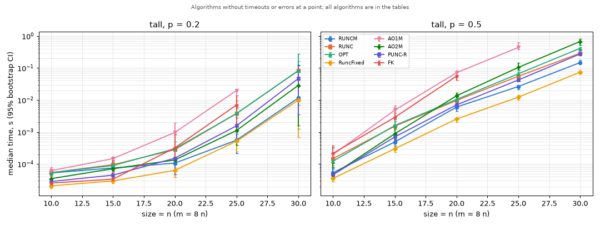
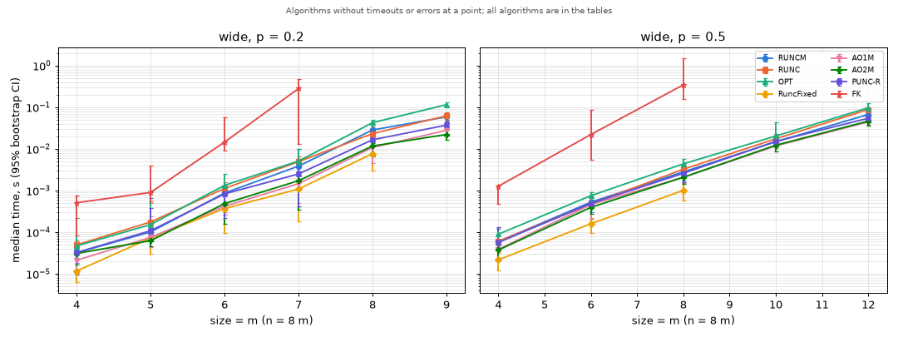
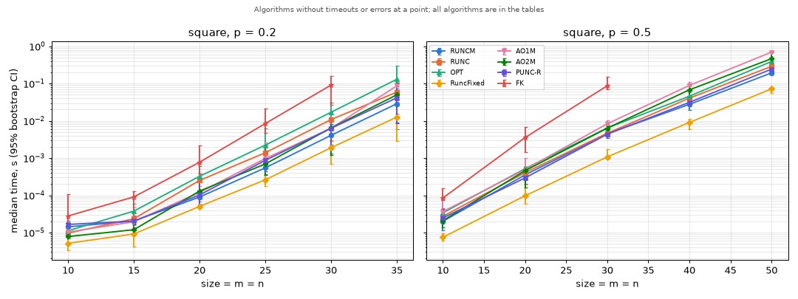

# Benchmark report 2026-10-26

Generated by `benchmarks/run_benchmarks.py` (see `benchmarks/README.md` for how to read it).

## Notes (written by hand after the run)

- **Regenerated after the FK speed-up (#45)** on master with #45-#49 merged; it replaces the
  2026-10-23 report, whose FK numbers predated #45. The machine was less loaded than for that run
  (load average about 5 on 8 logical CPUs, from other users), so times are lower across the board
  and the intervals narrower; the winners are the same.
- **RuncFixed wins almost everywhere it applies** (n <= 64), 2-3x ahead of the next algorithm at
  the larger sizes (240 x 30, p = 0.5: 74 ms vs RUNCM 149 ms; 50 x 50, p = 0.5: 72 ms vs RUNCM
  193 ms). Its rows are machine words, so it is out for n > 64.
- **m >> n (`tall`):** after RuncFixed, RUNCM is the best general algorithm; PUNC and the AO
  family are 2-5x slower at the largest sizes, AO1/AO1K drop out early.
- **m << n (`wide`):** beyond 64 columns the AOT1 K/M variants are fastest, about 1.5-3x ahead of
  RUNCM (9 x 72, p = 0.2: AO1K 21 ms, AO2M 22 ms, PUNC-RC 40 ms, RUNCM 59 ms; 12 x 96, p = 0.5:
  AO1K 44 ms, RUNCM 67 ms).
- **m ~ n (`square`):** RuncFixed, then RUNCM; PUNC-R/PUNC-RC are runner-up at small sizes.
- **Time per cover** (median over completed runs with at least 100 covers): RuncFixed 0.17 us,
  AO1K 0.21 us, RUNCM 0.41 us, AO2M 0.49 us, PUNC-R 0.52 us, RUNC 0.63 us, OPT 0.84 us, FK 8.3 us.
  All algorithms agree on the number of covers.
- **FK** is now about 20x slower per cover than RUNCM (it was 40-80x before #45) and completes
  runs with up to about 5 * 10^4 covers within the 1 s limit (before: about 10^4).

## Setup

- Machine: Intel(R) Xeon(R) CPU @ 2.20GHz, 8 logical CPUs, 64301 MiB RAM; Linux-6.8.0-1064-gcp-x86_64-with-glibc2.35
- Load average (1 min) before / after the run: 5.7 / 4.7 (other processes were running if it is well above 0)
- Build: {"compiler": "gcc 11.4.0", "assertions": "off", "pointer_bits": 64}; commit `ce1d7e5`
- Configuration `default`: 5 random matrices per point, time limit 1.0 s per run, 2000 bootstrap resamples, seed 48; runs one at a time; total wall time 2.7 min
- Matrices: every cell is 1 with probability p (a zero row gets one random 1); regimes `tall`: size = n (m = 8 n); `wide`: size = m (n = 8 m); `square`: size = m = n
- Time: median and mean over the matrices of a point with 95% percentile bootstrap CIs; a timed-out run counts with the time at which it stopped (at least the limit), so cells with timeouts (marked `>=`) are lower bounds. Once more than half of an algorithm's runs at a point time out or fail (RuncFixed takes at most 64 columns), its remaining runs there and all larger sizes of that regime and density are skipped.

All completed runs on the same matrix reported the same number of covers.

## Fastest algorithm per point

By median time over completed runs only; ties within 5% are listed together.

| regime | m | n | p | covers (median) | fastest | median time | runner-up | median time |
|---|---:|---:|---:|---:|---|---:|---|---:|
| tall | 80 | 10 | 0.2 | 1 | RuncFixed | 20.8 us | FK | 25.4 us |
| tall | 120 | 15 | 0.2 | 2 | RuncFixed | 29.6 us | FK | 33.8 us |
| tall | 160 | 20 | 0.2 | 26 | RuncFixed | 63.4 us | RUNCM | 106.9 us |
| tall | 200 | 25 | 0.2 | 631 | RuncFixed | 515.6 us | RUNCM | 556.9 us |
| tall | 240 | 30 | 0.2 | 14973 | RuncFixed | 9.9 ms | RUNCM | 11.6 ms |
| tall | 80 | 10 | 0.5 | 19 | RuncFixed | 35.6 us | PUNC-R | 46.3 us |
| tall | 120 | 15 | 0.5 | 414 | RuncFixed | 300.2 us | RUNCM | 489.9 us |
| tall | 160 | 20 | 0.5 | 4554 | RuncFixed | 2.6 ms | RUNCM | 6.0 ms |
| tall | 200 | 25 | 0.5 | 27792 | RuncFixed | 12.3 ms | RUNCM | 26.5 ms |
| tall | 240 | 30 | 0.5 | 154803 | RuncFixed | 74.3 ms | RUNCM | 148.8 ms |
| wide | 4 | 32 | 0.2 | 158 | RuncFixed | 11.7 us | AO1M | 21.2 us |
| wide | 5 | 40 | 0.2 | 423 | AO1K, AO2K | 49.5 us | AO2M | 62.7 us |
| wide | 6 | 48 | 0.2 | 4962 | RuncFixed | 369.6 us | AO1M | 420.2 us |
| wide | 7 | 56 | 0.2 | 15975 | RuncFixed | 1.1 ms | AO1M | 1.5 ms |
| wide | 8 | 64 | 0.2 | 117315 | RuncFixed | 7.7 ms | AO2K | 10.5 ms |
| wide | 9 | 72 | 0.2 | 234851 | AO1K | 21.0 ms | AO2M | 22.2 ms |
| wide | 4 | 32 | 0.5 | 375 | RuncFixed | 21.7 us | AO2M | 37.4 us |
| wide | 6 | 48 | 0.5 | 2218 | RuncFixed | 159.4 us | AO2M | 394.1 us |
| wide | 8 | 64 | 0.5 | 12301 | RuncFixed | 1.0 ms | AO1M | 2.1 ms |
| wide | 10 | 80 | 0.5 | 53016 | AO1M, AO2M | 11.8 ms | AO2K | 12.5 ms |
| wide | 12 | 96 | 0.5 | 236409 | AO2K, AO1K, AO1M | 43.3 ms | AO2M | 46.4 ms |
| square | 10 | 10 | 0.2 | 2 | RuncFixed | 5.1 us | AO2M | 7.8 us |
| square | 15 | 15 | 0.2 | 12 | RuncFixed | 9.1 us | AO2M | 11.9 us |
| square | 20 | 20 | 0.2 | 181 | RuncFixed | 50.2 us | RUNCM | 89.7 us |
| square | 25 | 25 | 0.2 | 1467 | RuncFixed | 259.8 us | RUNCM | 545.0 us |
| square | 30 | 30 | 0.2 | 9062 | RuncFixed | 1.9 ms | RUNCM | 4.1 ms |
| square | 35 | 35 | 0.2 | 67503 | RuncFixed | 12.5 ms | RUNCM | 28.6 ms |
| square | 10 | 10 | 0.5 | 17 | RuncFixed | 7.4 us | PUNC-RC | 19.6 us |
| square | 20 | 20 | 0.5 | 625 | RuncFixed | 96.6 us | PUNC-R | 293.1 us |
| square | 30 | 30 | 0.5 | 7428 | RuncFixed | 1.1 ms | PUNC-RC | 3.7 ms |
| square | 40 | 40 | 0.5 | 54727 | RuncFixed | 9.0 ms | RUNCM | 27.6 ms |
| square | 50 | 50 | 0.5 | 350175 | RuncFixed | 72.0 ms | RUNCM | 193.0 ms |

## Regime `tall`

### p = 0.2

| m | n | algorithm | runs | timeouts | errors | covers (median) | median time [95% CI] | mean time [95% CI] | median time per cover [95% CI] |
|---:|---:|---|---:|---:|---:|---:|---:|---:|---:|
| 80 | 10 | AO1 | 3 | 3 | 0 | - | >= 1.00 s [1.00 s, 1.00 s] | >= 1.00 s [1.00 s, 1.00 s] | - |
| 80 | 10 | AO1K | 5 | 0 | 0 | 1 | 17.2 ms [2.9 ms, 134.6 ms] | 38.0 ms [8.8 ms, 86.5 ms] | 17.2 ms [2.9 ms, 134.6 ms] |
| 80 | 10 | AO1M | 5 | 0 | 0 | 1 | 62.2 us [58.7 us, 78.9 us] | 66.6 us [59.8 us, 74.5 us] | 62.2 us [58.7 us, 78.9 us] |
| 80 | 10 | AO2 | 5 | 0 | 0 | 1 | 51.6 us [49.9 us, 65.0 us] | 53.7 us [50.2 us, 59.7 us] | 51.6 us [49.9 us, 65.0 us] |
| 80 | 10 | AO2K | 5 | 0 | 0 | 1 | 33.3 us [32.6 us, 35.0 us] | 33.5 us [32.8 us, 34.4 us] | 33.3 us [32.6 us, 35.0 us] |
| 80 | 10 | AO2M | 5 | 0 | 0 | 1 | 35.0 us [34.7 us, 47.1 us] | 38.8 us [34.8 us, 43.7 us] | 35.0 us [34.7 us, 47.1 us] |
| 80 | 10 | FK | 5 | 0 | 0 | 1 | 25.4 us [24.6 us, 42.3 us] | 28.7 us [24.8 us, 35.6 us] | 25.4 us [24.6 us, 42.3 us] |
| 80 | 10 | OPT | 5 | 0 | 0 | 1 | 53.7 us [45.7 us, 68.3 us] | 55.1 us [48.5 us, 62.5 us] | 53.7 us [45.7 us, 68.3 us] |
| 80 | 10 | PUNC | 5 | 0 | 0 | 1 | 43.7 us [36.5 us, 72.9 us] | 48.2 us [39.5 us, 60.7 us] | 43.7 us [36.5 us, 72.9 us] |
| 80 | 10 | PUNC-R | 5 | 0 | 0 | 1 | 28.5 us [24.1 us, 42.6 us] | 29.8 us [25.2 us, 36.3 us] | 28.5 us [24.1 us, 42.6 us] |
| 80 | 10 | PUNC-RC | 5 | 0 | 0 | 1 | 25.5 us [23.9 us, 27.6 us] | 25.5 us [24.2 us, 26.7 us] | 25.5 us [23.9 us, 27.6 us] |
| 80 | 10 | RUNC | 5 | 0 | 0 | 1 | 53.8 us [52.7 us, 54.9 us] | 53.7 us [52.9 us, 54.5 us] | 53.8 us [52.7 us, 54.9 us] |
| 80 | 10 | RUNCM | 5 | 0 | 0 | 1 | 52.6 us [52.2 us, 57.1 us] | 53.5 us [52.3 us, 55.4 us] | 52.6 us [52.2 us, 57.1 us] |
| 80 | 10 | RuncFixed | 5 | 0 | 0 | 1 | 20.8 us [17.5 us, 23.7 us] | 20.5 us [18.1 us, 23.0 us] | 20.8 us [17.5 us, 23.7 us] |
| 120 | 15 | AO1K | 3 | 3 | 0 | - | >= 1.00 s [1.00 s, 1.00 s] | >= 1.00 s [1.00 s, 1.00 s] | - |
| 120 | 15 | AO1M | 5 | 0 | 0 | 2 | 147.7 us [129.9 us, 150.5 us] | 142.9 us [135.2 us, 149.6 us] | 68.4 us [26.0 us, 149.5 us] |
| 120 | 15 | AO2 | 5 | 0 | 0 | 2 | 139.5 us [93.5 us, 357.6 us] | 169.6 us [107.6 us, 265.8 us] | 69.8 us [31.2 us, 140.7 us] |
| 120 | 15 | AO2K | 5 | 0 | 0 | 2 | 68.1 us [58.2 us, 110.8 us] | 73.8 us [61.9 us, 92.6 us] | 31.3 us [19.4 us, 69.3 us] |
| 120 | 15 | AO2M | 5 | 0 | 0 | 2 | 71.4 us [63.5 us, 116.4 us] | 79.8 us [67.6 us, 99.4 us] | 31.7 us [14.3 us, 116.4 us] |
| 120 | 15 | FK | 5 | 0 | 0 | 2 | 33.8 us [29.5 us, 163.5 us] | 69.9 us [31.9 us, 122.7 us] | 29.5 us [16.7 us, 32.7 us] |
| 120 | 15 | OPT | 5 | 0 | 0 | 2 | 89.8 us [79.0 us, 103.4 us] | 92.1 us [84.5 us, 99.7 us] | 39.5 us [20.7 us, 89.8 us] |
| 120 | 15 | PUNC | 5 | 0 | 0 | 2 | 165.7 us [130.8 us, 247.3 us] | 174.4 us [144.1 us, 214.0 us] | 89.0 us [26.2 us, 149.9 us] |
| 120 | 15 | PUNC-R | 5 | 0 | 0 | 2 | 45.0 us [39.1 us, 54.4 us] | 45.5 us [40.7 us, 50.6 us] | 19.5 us [9.9 us, 45.0 us] |
| 120 | 15 | PUNC-RC | 5 | 0 | 0 | 2 | 40.4 us [38.5 us, 56.1 us] | 43.6 us [39.2 us, 50.1 us] | 19.3 us [11.2 us, 40.4 us] |
| 120 | 15 | RUNC | 5 | 0 | 0 | 2 | 95.2 us [71.8 us, 172.9 us] | 103.7 us [77.4 us, 139.4 us] | 35.9 us [24.7 us, 95.2 us] |
| 120 | 15 | RUNCM | 5 | 0 | 0 | 2 | 75.2 us [60.6 us, 131.7 us] | 87.5 us [65.6 us, 113.0 us] | 32.9 us [20.2 us, 75.2 us] |
| 120 | 15 | RuncFixed | 5 | 0 | 0 | 2 | 29.6 us [25.1 us, 47.1 us] | 31.9 us [26.6 us, 39.8 us] | 13.5 us [6.2 us, 29.6 us] |
| 160 | 20 | AO1M | 5 | 0 | 0 | 26 | 970.1 us [317.9 us, 2.0 ms] | 1.0 ms [483.1 us, 1.6 ms] | 50.6 us [26.2 us, 106.0 us] |
| 160 | 20 | AO2 | 5 | 0 | 0 | 26 | 763.7 us [212.2 us, 1.9 ms] | 876.6 us [435.4 us, 1.4 ms] | 42.4 us [26.6 us, 70.7 us] |
| 160 | 20 | AO2K | 5 | 0 | 0 | 26 | 159.4 us [109.5 us, 318.5 us] | 195.7 us [130.0 us, 269.3 us] | 7.2 us [6.1 us, 36.5 us] |
| 160 | 20 | AO2M | 5 | 0 | 0 | 26 | 133.5 us [114.9 us, 258.3 us] | 154.5 us [119.6 us, 208.4 us] | 5.9 us [4.0 us, 39.1 us] |
| 160 | 20 | FK | 5 | 0 | 0 | 26 | 318.7 us [114.4 us, 830.5 us] | 375.2 us [180.9 us, 625.8 us] | 18.9 us [11.7 us, 38.1 us] |
| 160 | 20 | OPT | 5 | 0 | 0 | 26 | 299.6 us [123.8 us, 509.7 us] | 316.4 us [201.0 us, 431.4 us] | 13.8 us [9.5 us, 41.3 us] |
| 160 | 20 | PUNC | 5 | 0 | 0 | 26 | 2.0 ms [317.1 us, 5.7 ms] | 2.6 ms [889.1 us, 4.4 ms] | 116.1 us [52.8 us, 156.5 us] |
| 160 | 20 | PUNC-R | 5 | 0 | 0 | 26 | 152.1 us [47.7 us, 162.0 us] | 128.3 us [84.8 us, 159.4 us] | 4.6 us [3.7 us, 19.0 us] |
| 160 | 20 | PUNC-RC | 5 | 0 | 0 | 26 | 120.3 us [54.6 us, 158.9 us] | 118.9 us [86.1 us, 147.4 us] | 4.4 us [3.6 us, 18.2 us] |
| 160 | 20 | RUNC | 5 | 0 | 0 | 26 | 280.4 us [119.3 us, 836.2 us] | 387.6 us [170.3 us, 656.0 us] | 20.8 us [6.4 us, 39.8 us] |
| 160 | 20 | RUNCM | 5 | 0 | 0 | 26 | 106.9 us [99.0 us, 137.5 us] | 116.1 us [103.5 us, 129.9 us] | 4.1 us [3.1 us, 33.0 us] |
| 160 | 20 | RuncFixed | 5 | 0 | 0 | 26 | 63.4 us [39.3 us, 76.2 us] | 59.9 us [46.7 us, 71.1 us] | 2.4 us [1.7 us, 13.1 us] |
| 200 | 25 | AO1M | 5 | 0 | 0 | 631 | 20.0 ms [6.0 ms, 21.4 ms] | 15.3 ms [9.6 ms, 20.8 ms] | 33.9 us [10.4 us, 44.6 us] |
| 200 | 25 | AO2 | 5 | 0 | 0 | 631 | 32.0 ms [10.6 ms, 135.0 ms] | 58.0 ms [18.9 ms, 101.4 ms] | 64.0 us [44.8 us, 157.9 us] |
| 200 | 25 | AO2K | 5 | 0 | 0 | 631 | 2.4 ms [534.8 us, 4.9 ms] | 2.7 ms [1.5 ms, 4.0 ms] | 4.4 us [3.2 us, 5.2 us] |
| 200 | 25 | AO2M | 5 | 0 | 0 | 631 | 1.1 ms [396.0 us, 1.8 ms] | 1.1 ms [662.6 us, 1.6 ms] | 1.8 us [1.6 us, 2.4 us] |
| 200 | 25 | FK | 5 | 0 | 0 | 631 | 7.0 ms [1.6 ms, 13.8 ms] | 8.2 ms [4.3 ms, 12.2 ms] | 12.0 us [9.7 us, 16.1 us] |
| 200 | 25 | OPT | 5 | 0 | 0 | 631 | 3.8 ms [1.2 ms, 5.4 ms] | 3.6 ms [2.3 ms, 4.8 ms] | 7.2 us [4.4 us, 8.6 us] |
| 200 | 25 | PUNC | 5 | 0 | 0 | 631 | 19.7 ms [6.9 ms, 34.5 ms] | 20.0 ms [11.6 ms, 28.5 ms] | 42.5 us [8.0 us, 74.9 us] |
| 200 | 25 | PUNC-R | 5 | 0 | 0 | 631 | 1.6 ms [560.6 us, 2.8 ms] | 1.7 ms [1.0 ms, 2.4 ms] | 2.9 us [2.5 us, 3.4 us] |
| 200 | 25 | PUNC-RC | 5 | 0 | 0 | 631 | 1.9 ms [898.6 us, 2.9 ms] | 1.9 ms [1.2 ms, 2.6 ms] | 3.0 us [2.6 us, 5.4 us] |
| 200 | 25 | RUNC | 5 | 0 | 0 | 631 | 3.8 ms [1.2 ms, 9.6 ms] | 4.6 ms [2.3 ms, 7.3 ms] | 7.5 us [3.2 us, 15.2 us] |
| 200 | 25 | RUNCM | 5 | 0 | 0 | 631 | 556.9 us [219.2 us, 875.6 us] | 598.4 us [354.3 us, 793.5 us] | 951 ns [836 ns, 1.3 us] |
| 200 | 25 | RuncFixed | 5 | 0 | 0 | 631 | 515.6 us [245.6 us, 1.2 ms] | 662.7 us [345.8 us, 1.0 ms] | 1.0 us [700 ns, 1.5 us] |
| 240 | 30 | AO1M | 5 | 1 | 0 | 9156.5 | >= 547.6 ms [17.4 ms, 1.00 s] | >= 491.8 ms [176.2 ms, 807.5 ms] | 40.2 us [12.2 us, 49.7 us] |
| 240 | 30 | AO2 | 4 | 3 | 0 | 3340 | >= 1.00 s [323.3 ms, 1.00 s] | >= 830.9 ms [492.5 ms, 1.00 s] | 96.8 us [96.8 us, 96.8 us] |
| 240 | 30 | AO2K | 5 | 0 | 0 | 14973 | 105.5 ms [3.3 ms, 553.9 ms] | 166.9 ms [28.6 ms, 366.7 ms] | 6.9 us [2.3 us, 14.6 us] |
| 240 | 30 | AO2M | 5 | 0 | 0 | 14973 | 28.9 ms [1.6 ms, 126.3 ms] | 39.8 ms [8.2 ms, 84.3 ms] | 1.9 us [1.1 us, 3.3 us] |
| 240 | 30 | FK | 5 | 1 | 0 | 9156.5 | >= 316.5 ms [13.0 ms, 1.04 s] | >= 361.6 ms [88.9 ms, 710.6 ms] | 17.7 us [9.1 us, 26.2 us] |
| 240 | 30 | OPT | 5 | 0 | 0 | 14973 | 83.6 ms [7.1 ms, 272.4 ms] | 96.4 ms [28.0 ms, 187.2 ms] | 5.7 us [5.0 us, 10.0 us] |
| 240 | 30 | PUNC | 5 | 0 | 0 | 14973 | 378.3 ms [73.7 ms, 885.6 ms] | 454.8 ms [232.1 ms, 682.7 ms] | 37.5 us [23.3 us, 113.3 us] |
| 240 | 30 | PUNC-R | 5 | 0 | 0 | 14973 | 46.9 ms [3.5 ms, 121.6 ms] | 48.9 ms [15.4 ms, 87.4 ms] | 3.2 us [2.5 us, 4.0 us] |
| 240 | 30 | PUNC-RC | 5 | 0 | 0 | 14973 | 44.9 ms [4.2 ms, 119.9 ms] | 48.6 ms [14.2 ms, 86.8 ms] | 3.0 us [2.6 us, 4.3 us] |
| 240 | 30 | RUNC | 5 | 0 | 0 | 14973 | 82.4 ms [8.8 ms, 163.2 ms] | 86.1 ms [40.5 ms, 129.3 ms] | 6.2 us [4.3 us, 24.7 us] |
| 240 | 30 | RUNCM | 5 | 0 | 0 | 14973 | 11.6 ms [1.3 ms, 42.4 ms] | 14.2 ms [3.7 ms, 28.3 ms] | 869 ns [692 ns, 1.1 us] |
| 240 | 30 | RuncFixed | 5 | 0 | 0 | 14973 | 9.9 ms [675.3 us, 29.9 ms] | 10.6 ms [2.9 ms, 20.4 ms] | 648 ns [475 ns, 786 ns] |

Skipped: AO1 (size 10, 15, 20, 25, 30); AO1K (size 15, 20, 25, 30); AO2 (size 30)

### p = 0.5

| m | n | algorithm | runs | timeouts | errors | covers (median) | median time [95% CI] | mean time [95% CI] | median time per cover [95% CI] |
|---:|---:|---|---:|---:|---:|---:|---:|---:|---:|
| 80 | 10 | AO1 | 5 | 0 | 0 | 19 | 62.7 ms [44.8 ms, 73.1 ms] | 61.7 ms [50.6 ms, 70.3 ms] | 2.9 ms [2.1 ms, 3.7 ms] |
| 80 | 10 | AO1K | 5 | 0 | 0 | 19 | 16.6 ms [13.9 ms, 26.2 ms] | 18.1 ms [15.2 ms, 22.3 ms] | 840.6 us [467.3 us, 1.5 ms] |
| 80 | 10 | AO1M | 5 | 0 | 0 | 19 | 197.3 us [145.5 us, 335.4 us] | 228.4 us [156.5 us, 295.7 us] | 9.4 us [7.8 us, 17.5 us] |
| 80 | 10 | AO2 | 5 | 0 | 0 | 19 | 119.8 us [103.7 us, 218.3 us] | 136.8 us [108.3 us, 178.9 us] | 6.2 us [5.1 us, 7.1 us] |
| 80 | 10 | AO2K | 5 | 0 | 0 | 19 | 48.6 us [46.5 us, 82.3 us] | 57.6 us [47.2 us, 71.4 us] | 2.6 us [2.3 us, 3.3 us] |
| 80 | 10 | AO2M | 5 | 0 | 0 | 19 | 46.6 us [40.2 us, 104.0 us] | 56.4 us [42.2 us, 80.6 us] | 2.5 us [2.2 us, 3.0 us] |
| 80 | 10 | FK | 5 | 0 | 0 | 19 | 215.1 us [166.9 us, 380.6 us] | 233.4 us [176.5 us, 309.2 us] | 10.2 us [8.8 us, 13.2 us] |
| 80 | 10 | OPT | 5 | 0 | 0 | 19 | 123.0 us [74.9 us, 317.4 us] | 147.7 us [89.5 us, 235.1 us] | 4.7 us [3.6 us, 18.7 us] |
| 80 | 10 | PUNC | 5 | 0 | 0 | 19 | 79.7 us [79.0 us, 158.6 us] | 101.9 us [79.3 us, 133.6 us] | 4.2 us [3.2 us, 8.8 us] |
| 80 | 10 | PUNC-R | 5 | 0 | 0 | 19 | 46.3 us [41.7 us, 69.6 us] | 49.9 us [43.4 us, 60.1 us] | 2.5 us [2.0 us, 2.5 us] |
| 80 | 10 | PUNC-RC | 5 | 0 | 0 | 19 | 53.6 us [43.3 us, 93.2 us] | 59.5 us [45.6 us, 75.5 us] | 2.6 us [2.3 us, 3.5 us] |
| 80 | 10 | RUNC | 5 | 0 | 0 | 19 | 147.5 us [90.8 us, 233.0 us] | 159.6 us [119.8 us, 204.6 us] | 7.8 us [4.3 us, 10.6 us] |
| 80 | 10 | RUNCM | 5 | 0 | 0 | 19 | 53.5 us [42.9 us, 78.9 us] | 57.4 us [48.1 us, 68.8 us] | 2.5 us [2.3 us, 3.4 us] |
| 80 | 10 | RuncFixed | 5 | 0 | 0 | 19 | 35.6 us [28.3 us, 49.3 us] | 36.3 us [31.2 us, 43.8 us] | 1.7 us [1.4 us, 1.9 us] |
| 120 | 15 | AO1 | 3 | 3 | 0 | - | >= 1.00 s [1.00 s, 1.00 s] | >= 1.00 s [1.00 s, 1.00 s] | - |
| 120 | 15 | AO1K | 5 | 0 | 0 | 414 | 439.3 ms [241.1 ms, 468.8 ms] | 402.9 ms [320.7 ms, 454.0 ms] | 1.0 ms [508.7 us, 1.3 ms] |
| 120 | 15 | AO1M | 5 | 0 | 0 | 414 | 4.8 ms [3.2 ms, 6.8 ms] | 4.6 ms [3.6 ms, 5.7 ms] | 10.3 us [7.7 us, 14.2 us] |
| 120 | 15 | AO2 | 5 | 0 | 0 | 414 | 4.0 ms [2.9 ms, 5.5 ms] | 4.0 ms [3.3 ms, 4.8 ms] | 9.6 us [8.1 us, 10.8 us] |
| 120 | 15 | AO2K | 5 | 0 | 0 | 414 | 1.5 ms [1.0 ms, 1.8 ms] | 1.5 ms [1.2 ms, 1.7 ms] | 3.5 us [2.9 us, 4.5 us] |
| 120 | 15 | AO2M | 5 | 0 | 0 | 414 | 884.0 us [592.7 us, 1.4 ms] | 987.2 us [767.0 us, 1.2 ms] | 2.4 us [1.7 us, 2.9 us] |
| 120 | 15 | FK | 5 | 0 | 0 | 414 | 2.9 ms [2.5 ms, 4.1 ms] | 3.1 ms [2.7 ms, 3.6 ms] | 7.1 us [6.4 us, 8.4 us] |
| 120 | 15 | OPT | 5 | 0 | 0 | 414 | 1.6 ms [1.3 ms, 2.2 ms] | 1.6 ms [1.4 ms, 1.9 ms] | 3.9 us [3.1 us, 4.6 us] |
| 120 | 15 | PUNC | 5 | 0 | 0 | 414 | 1.0 ms [905.8 us, 1.3 ms] | 1.1 ms [954.5 us, 1.2 ms] | 2.6 us [2.0 us, 3.0 us] |
| 120 | 15 | PUNC-R | 5 | 0 | 0 | 414 | 703.7 us [463.4 us, 864.0 us] | 692.9 us [564.7 us, 820.7 us] | 1.7 us [1.4 us, 1.8 us] |
| 120 | 15 | PUNC-RC | 5 | 0 | 0 | 414 | 723.1 us [457.1 us, 1.0 ms] | 742.5 us [579.7 us, 892.7 us] | 1.7 us [1.3 us, 2.1 us] |
| 120 | 15 | RUNC | 5 | 0 | 0 | 414 | 1.5 ms [1.2 ms, 5.6 ms] | 2.8 ms [1.4 ms, 4.5 ms] | 3.6 us [3.0 us, 13.6 us] |
| 120 | 15 | RUNCM | 5 | 0 | 0 | 414 | 489.9 us [365.1 us, 565.8 us] | 475.0 us [409.9 us, 530.3 us] | 1.2 us [1.0 us, 1.2 us] |
| 120 | 15 | RuncFixed | 5 | 0 | 0 | 414 | 300.2 us [235.5 us, 378.5 us] | 309.3 us [269.5 us, 348.2 us] | 725 ns [691 ns, 823 ns] |
| 160 | 20 | AO1K | 3 | 3 | 0 | - | >= 1.00 s [1.00 s, 1.00 s] | >= 1.00 s [1.00 s, 1.00 s] | - |
| 160 | 20 | AO1M | 5 | 0 | 0 | 4554 | 71.5 ms [57.7 ms, 82.5 ms] | 70.5 ms [62.8 ms, 77.7 ms] | 15.3 us [14.5 us, 17.6 us] |
| 160 | 20 | AO2 | 5 | 0 | 0 | 4554 | 80.1 ms [55.5 ms, 98.8 ms] | 78.9 ms [66.6 ms, 90.7 ms] | 17.2 us [14.7 us, 21.7 us] |
| 160 | 20 | AO2K | 5 | 0 | 0 | 4554 | 33.9 ms [26.5 ms, 42.7 ms] | 34.3 ms [29.9 ms, 39.3 ms] | 7.3 us [7.0 us, 9.1 us] |
| 160 | 20 | AO2M | 5 | 0 | 0 | 4554 | 13.6 ms [12.6 ms, 16.6 ms] | 14.5 ms [13.2 ms, 15.9 ms] | 3.5 us [2.8 us, 3.6 us] |
| 160 | 20 | FK | 5 | 0 | 0 | 4554 | 55.8 ms [42.1 ms, 60.6 ms] | 54.1 ms [47.6 ms, 58.7 ms] | 12.3 us [11.2 us, 12.9 us] |
| 160 | 20 | OPT | 5 | 0 | 0 | 4554 | 10.4 ms [8.0 ms, 12.8 ms] | 10.4 ms [9.0 ms, 11.8 ms] | 2.2 us [2.1 us, 2.7 us] |
| 160 | 20 | PUNC | 5 | 0 | 0 | 4554 | 10.6 ms [8.2 ms, 11.7 ms] | 10.3 ms [9.2 ms, 11.2 ms] | 2.3 us [2.2 us, 2.6 us] |
| 160 | 20 | PUNC-R | 5 | 0 | 0 | 4554 | 7.1 ms [5.4 ms, 8.3 ms] | 7.1 ms [6.2 ms, 8.0 ms] | 1.6 us [1.4 us, 1.8 us] |
| 160 | 20 | PUNC-RC | 5 | 0 | 0 | 4554 | 7.7 ms [5.7 ms, 8.7 ms] | 7.4 ms [6.6 ms, 8.2 ms] | 1.7 us [1.5 us, 1.9 us] |
| 160 | 20 | RUNC | 5 | 0 | 0 | 4554 | 9.7 ms [7.1 ms, 11.6 ms] | 9.5 ms [8.1 ms, 10.9 ms] | 2.1 us [1.9 us, 2.5 us] |
| 160 | 20 | RUNCM | 5 | 0 | 0 | 4554 | 6.0 ms [4.5 ms, 8.0 ms] | 6.2 ms [5.2 ms, 7.3 ms] | 1.4 us [1.2 us, 1.7 us] |
| 160 | 20 | RuncFixed | 5 | 0 | 0 | 4554 | 2.6 ms [2.0 ms, 2.7 ms] | 2.5 ms [2.2 ms, 2.6 ms] | 563 ns [536 ns, 574 ns] |
| 200 | 25 | AO1M | 5 | 0 | 0 | 27792 | 441.1 ms [375.2 ms, 652.9 ms] | 476.7 ms [400.3 ms, 574.6 ms] | 15.1 us [14.2 us, 22.3 us] |
| 200 | 25 | AO2 | 5 | 0 | 0 | 27792 | 651.5 ms [527.0 ms, 754.9 ms] | 644.2 ms [567.9 ms, 724.9 ms] | 22.3 us [20.0 us, 27.0 us] |
| 200 | 25 | AO2K | 5 | 0 | 0 | 27792 | 295.2 ms [276.9 ms, 323.0 ms] | 299.2 ms [283.3 ms, 315.2 ms] | 10.8 us [9.7 us, 11.6 us] |
| 200 | 25 | AO2M | 5 | 0 | 0 | 27792 | 105.0 ms [88.2 ms, 143.5 ms] | 109.0 ms [94.9 ms, 126.9 ms] | 4.0 us [3.2 us, 4.9 us] |
| 200 | 25 | FK | 4 | 3 | 0 | 25591 | >= 1.05 s [920.3 ms, 1.10 s] | >= 1.03 s [963.5 ms, 1.10 s] | 36.0 us [36.0 us, 36.0 us] |
| 200 | 25 | OPT | 5 | 0 | 0 | 27792 | 66.2 ms [59.2 ms, 76.8 ms] | 67.3 ms [62.6 ms, 72.4 ms] | 2.3 us [2.1 us, 2.8 us] |
| 200 | 25 | PUNC | 5 | 0 | 0 | 27792 | 63.1 ms [49.4 ms, 64.4 ms] | 58.2 ms [52.7 ms, 63.8 ms] | 2.2 us [1.8 us, 2.3 us] |
| 200 | 25 | PUNC-R | 5 | 0 | 0 | 27792 | 42.4 ms [40.4 ms, 48.0 ms] | 43.7 ms [41.5 ms, 46.0 ms] | 1.6 us [1.5 us, 1.6 us] |
| 200 | 25 | PUNC-RC | 5 | 0 | 0 | 27792 | 47.0 ms [40.5 ms, 57.2 ms] | 47.6 ms [43.2 ms, 52.7 ms] | 1.7 us [1.6 us, 2.0 us] |
| 200 | 25 | RUNC | 5 | 0 | 0 | 27792 | 55.4 ms [45.3 ms, 61.5 ms] | 54.7 ms [49.4 ms, 58.8 ms] | 2.0 us [1.6 us, 2.3 us] |
| 200 | 25 | RUNCM | 5 | 0 | 0 | 27792 | 26.5 ms [21.4 ms, 27.3 ms] | 24.9 ms [22.7 ms, 26.9 ms] | 905 ns [812 ns, 983 ns] |
| 200 | 25 | RuncFixed | 5 | 0 | 0 | 27792 | 12.3 ms [10.2 ms, 14.5 ms] | 12.4 ms [11.2 ms, 13.6 ms] | 457 ns [378 ns, 494 ns] |
| 240 | 30 | AO1M | 3 | 3 | 0 | - | >= 1.00 s [1.00 s, 1.00 s] | >= 1.00 s [1.00 s, 1.00 s] | - |
| 240 | 30 | AO2 | 3 | 3 | 0 | - | >= 1.00 s [1.00 s, 1.00 s] | >= 1.00 s [1.00 s, 1.00 s] | - |
| 240 | 30 | AO2K | 3 | 3 | 0 | - | >= 1.00 s [1.00 s, 1.00 s] | >= 1.00 s [1.00 s, 1.00 s] | - |
| 240 | 30 | AO2M | 5 | 0 | 0 | 154803 | 678.2 ms [525.1 ms, 811.4 ms] | 664.1 ms [570.3 ms, 757.9 ms] | 4.2 us [3.7 us, 5.2 us] |
| 240 | 30 | OPT | 5 | 0 | 0 | 154803 | 414.7 ms [386.7 ms, 446.5 ms] | 417.4 ms [396.7 ms, 438.1 ms] | 2.8 us [2.5 us, 2.8 us] |
| 240 | 30 | PUNC | 5 | 0 | 0 | 154803 | 320.8 ms [300.5 ms, 336.8 ms] | 321.0 ms [308.9 ms, 333.2 ms] | 2.1 us [1.9 us, 2.2 us] |
| 240 | 30 | PUNC-R | 5 | 0 | 0 | 154803 | 276.6 ms [253.3 ms, 353.9 ms] | 294.7 ms [264.7 ms, 330.2 ms] | 1.8 us [1.7 us, 2.2 us] |
| 240 | 30 | PUNC-RC | 5 | 0 | 0 | 154803 | 295.0 ms [280.4 ms, 334.6 ms] | 298.9 ms [285.8 ms, 317.2 ms] | 1.9 us [1.8 us, 2.1 us] |
| 240 | 30 | RUNC | 5 | 0 | 0 | 154803 | 291.2 ms [250.5 ms, 372.2 ms] | 299.5 ms [267.0 ms, 336.8 ms] | 1.9 us [1.6 us, 2.3 us] |
| 240 | 30 | RUNCM | 5 | 0 | 0 | 154803 | 148.8 ms [144.2 ms, 178.8 ms] | 156.7 ms [145.8 ms, 169.7 ms] | 1.0 us [943 ns, 1.1 us] |
| 240 | 30 | RuncFixed | 5 | 0 | 0 | 154803 | 74.3 ms [66.7 ms, 80.8 ms] | 74.5 ms [70.3 ms, 78.2 ms] | 490 ns [460 ns, 514 ns] |

Skipped: AO1 (size 15, 20, 25, 30); AO1K (size 20, 25, 30); AO1M (size 30); AO2 (size 30); AO2K (size 30); FK (size 25, 30)

## Regime `wide`

### p = 0.2

| m | n | algorithm | runs | timeouts | errors | covers (median) | median time [95% CI] | mean time [95% CI] | median time per cover [95% CI] |
|---:|---:|---|---:|---:|---:|---:|---:|---:|---:|
| 4 | 32 | AO1 | 5 | 0 | 0 | 158 | 56.2 us [23.4 us, 69.0 us] | 47.8 us [32.3 us, 63.4 us] | 364 ns [178 ns, 689 ns] |
| 4 | 32 | AO1K | 5 | 0 | 0 | 158 | 29.7 us [6.2 us, 140.9 us] | 46.3 us [13.5 us, 93.1 us] | 181 ns [124 ns, 363 ns] |
| 4 | 32 | AO1M | 5 | 0 | 0 | 158 | 21.2 us [11.2 us, 31.8 us] | 20.4 us [13.4 us, 27.5 us] | 134 ns [82 ns, 330 ns] |
| 4 | 32 | AO2 | 5 | 0 | 0 | 158 | 59.3 us [17.6 us, 73.9 us] | 52.3 us [33.5 us, 69.4 us] | 468 ns [180 ns, 519 ns] |
| 4 | 32 | AO2K | 5 | 0 | 0 | 158 | 27.1 us [6.5 us, 56.4 us] | 28.0 us [14.8 us, 43.9 us] | 192 ns [81 ns, 235 ns] |
| 4 | 32 | AO2M | 5 | 0 | 0 | 158 | 31.0 us [16.9 us, 48.3 us] | 32.0 us [23.1 us, 41.4 us] | 196 ns [125 ns, 799 ns] |
| 4 | 32 | FK | 5 | 0 | 0 | 158 | 508.8 us [84.7 us, 757.6 us] | 437.0 us [217.6 us, 642.1 us] | 2.5 us [1.5 us, 4.8 us] |
| 4 | 32 | OPT | 5 | 0 | 0 | 158 | 46.9 us [24.1 us, 223.8 us] | 79.4 us [32.4 us, 154.7 us] | 417 ns [287 ns, 709 ns] |
| 4 | 32 | PUNC | 5 | 0 | 0 | 158 | 73.8 us [29.6 us, 304.6 us] | 108.5 us [44.3 us, 206.7 us] | 552 ns [376 ns, 870 ns] |
| 4 | 32 | PUNC-R | 5 | 0 | 0 | 158 | 32.5 us [18.2 us, 55.9 us] | 34.8 us [24.5 us, 47.0 us] | 201 ns [144 ns, 535 ns] |
| 4 | 32 | PUNC-RC | 5 | 0 | 0 | 158 | 53.5 us [14.2 us, 71.0 us] | 43.4 us [24.1 us, 61.4 us] | 296 ns [138 ns, 416 ns] |
| 4 | 32 | RUNC | 5 | 0 | 0 | 158 | 49.5 us [10.2 us, 63.1 us] | 38.8 us [21.6 us, 55.9 us] | 263 ns [134 ns, 313 ns] |
| 4 | 32 | RUNCM | 5 | 0 | 0 | 158 | 32.1 us [9.7 us, 52.9 us] | 31.8 us [18.7 us, 44.6 us] | 203 ns [136 ns, 307 ns] |
| 4 | 32 | RuncFixed | 5 | 0 | 0 | 158 | 11.7 us [6.4 us, 20.6 us] | 11.8 us [7.9 us, 16.2 us] | 74 ns [52 ns, 188 ns] |
| 5 | 40 | AO1 | 5 | 0 | 0 | 423 | 202.0 us [153.6 us, 487.1 us] | 294.7 us [171.7 us, 420.4 us] | 413 ns [217 ns, 729 ns] |
| 5 | 40 | AO1K | 5 | 0 | 0 | 423 | 49.5 us [37.3 us, 222.7 us] | 108.3 us [43.8 us, 180.0 us] | 135 ns [99 ns, 148 ns] |
| 5 | 40 | AO1M | 5 | 0 | 0 | 423 | 75.4 us [43.0 us, 245.4 us] | 111.2 us [49.6 us, 185.7 us] | 120 ns [102 ns, 219 ns] |
| 5 | 40 | AO2 | 5 | 0 | 0 | 423 | 210.6 us [126.8 us, 454.1 us] | 261.8 us [165.9 us, 364.8 us] | 458 ns [202 ns, 531 ns] |
| 5 | 40 | AO2K | 5 | 0 | 0 | 423 | 49.6 us [39.4 us, 331.3 us] | 122.3 us [45.1 us, 237.0 us] | 142 ns [115 ns, 147 ns] |
| 5 | 40 | AO2M | 5 | 0 | 0 | 423 | 62.7 us [46.4 us, 163.1 us] | 84.6 us [52.3 us, 126.7 us] | 125 ns [73 ns, 226 ns] |
| 5 | 40 | FK | 5 | 0 | 0 | 423 | 900.0 us [537.7 us, 4.0 ms] | 1.8 ms [712.2 us, 3.0 ms] | 1.9 us [1.8 us, 2.6 us] |
| 5 | 40 | OPT | 5 | 0 | 0 | 423 | 152.1 us [103.7 us, 912.5 us] | 340.4 us [119.6 us, 654.3 us] | 360 ns [333 ns, 406 ns] |
| 5 | 40 | PUNC | 5 | 0 | 0 | 423 | 132.1 us [70.6 us, 316.4 us] | 182.8 us [94.5 us, 273.0 us] | 255 ns [131 ns, 312 ns] |
| 5 | 40 | PUNC-R | 5 | 0 | 0 | 423 | 108.4 us [59.6 us, 382.6 us] | 154.8 us [71.1 us, 272.9 us] | 186 ns [128 ns, 256 ns] |
| 5 | 40 | PUNC-RC | 5 | 0 | 0 | 423 | 90.8 us [61.0 us, 292.7 us] | 139.8 us [76.0 us, 222.8 us] | 177 ns [130 ns, 328 ns] |
| 5 | 40 | RUNC | 5 | 0 | 0 | 423 | 176.4 us [122.2 us, 502.9 us] | 245.5 us [146.0 us, 367.9 us] | 365 ns [218 ns, 513 ns] |
| 5 | 40 | RUNCM | 5 | 0 | 0 | 423 | 101.4 us [72.8 us, 674.2 us] | 264.5 us [79.3 us, 499.3 us] | 270 ns [212 ns, 320 ns] |
| 5 | 40 | RuncFixed | 5 | 0 | 0 | 423 | 72.4 us [30.3 us, 127.2 us] | 70.8 us [43.0 us, 102.3 us] | 72 ns [57 ns, 249 ns] |
| 6 | 48 | AO1 | 5 | 0 | 0 | 4962 | 2.0 ms [1.5 ms, 4.7 ms] | 2.5 ms [1.6 ms, 3.7 ms] | 553 ns [363 ns, 1.1 us] |
| 6 | 48 | AO1K | 5 | 0 | 0 | 4962 | 597.6 us [293.9 us, 861.9 us] | 613.6 us [439.3 us, 780.1 us] | 135 ns [120 ns, 198 ns] |
| 6 | 48 | AO1M | 5 | 0 | 0 | 4962 | 420.2 us [257.9 us, 830.3 us] | 502.6 us [347.4 us, 694.7 us] | 98 ns [85 ns, 173 ns] |
| 6 | 48 | AO2 | 5 | 0 | 0 | 4962 | 1.7 ms [727.1 us, 3.2 ms] | 2.0 ms [1.3 ms, 2.7 ms] | 458 ns [328 ns, 508 ns] |
| 6 | 48 | AO2K | 5 | 0 | 0 | 4962 | 572.9 us [173.4 us, 702.7 us] | 490.3 us [304.6 us, 661.1 us] | 114 ns [83 ns, 142 ns] |
| 6 | 48 | AO2M | 5 | 0 | 0 | 4962 | 485.5 us [160.1 us, 536.0 us] | 431.3 us [291.5 us, 525.0 us] | 108 ns [77 ns, 119 ns] |
| 6 | 48 | FK | 5 | 0 | 0 | 4962 | 14.6 ms [9.1 ms, 57.8 ms] | 23.8 ms [11.3 ms, 42.2 ms] | 5.2 us [2.9 us, 8.2 us] |
| 6 | 48 | OPT | 5 | 0 | 0 | 4962 | 1.3 ms [536.0 us, 2.5 ms] | 1.5 ms [983.3 us, 2.1 ms] | 356 ns [259 ns, 401 ns] |
| 6 | 48 | PUNC | 5 | 0 | 0 | 4962 | 1.3 ms [357.9 us, 1.5 ms] | 1.1 ms [708.7 us, 1.5 ms] | 241 ns [190 ns, 328 ns] |
| 6 | 48 | PUNC-R | 5 | 0 | 0 | 4962 | 831.3 us [219.8 us, 1.3 ms] | 835.6 us [489.5 us, 1.1 ms] | 150 ns [148 ns, 265 ns] |
| 6 | 48 | PUNC-RC | 5 | 0 | 0 | 4962 | 1.1 ms [211.4 us, 1.2 ms] | 922.6 us [557.4 us, 1.1 ms] | 206 ns [142 ns, 268 ns] |
| 6 | 48 | RUNC | 5 | 0 | 0 | 4962 | 1.1 ms [300.0 us, 1.6 ms] | 1.0 ms [629.8 us, 1.4 ms] | 223 ns [189 ns, 283 ns] |
| 6 | 48 | RUNCM | 5 | 0 | 0 | 4962 | 869.8 us [260.4 us, 1.2 ms] | 836.4 us [527.1 us, 1.1 ms] | 175 ns [171 ns, 226 ns] |
| 6 | 48 | RuncFixed | 5 | 0 | 0 | 4962 | 369.6 us [97.7 us, 454.8 us] | 335.9 us [210.1 us, 424.2 us] | 80 ns [53 ns, 92 ns] |
| 7 | 56 | AO1 | 5 | 0 | 0 | 15975 | 10.3 ms [3.8 ms, 16.5 ms] | 9.6 ms [5.6 ms, 13.9 ms] | 647 ns [579 ns, 1.1 us] |
| 7 | 56 | AO1K | 5 | 0 | 0 | 15975 | 1.8 ms [652.4 us, 2.7 ms] | 1.7 ms [1.0 ms, 2.3 ms] | 125 ns [68 ns, 194 ns] |
| 7 | 56 | AO1M | 5 | 0 | 0 | 15975 | 1.5 ms [511.2 us, 2.4 ms] | 1.5 ms [962.8 us, 2.0 ms] | 124 ns [83 ns, 152 ns] |
| 7 | 56 | AO2 | 5 | 0 | 0 | 15975 | 9.3 ms [3.2 ms, 13.6 ms] | 8.9 ms [5.6 ms, 11.8 ms] | 553 ns [478 ns, 957 ns] |
| 7 | 56 | AO2K | 5 | 0 | 0 | 15975 | 1.6 ms [647.7 us, 2.6 ms] | 1.7 ms [1.1 ms, 2.3 ms] | 160 ns [80 ns, 193 ns] |
| 7 | 56 | AO2M | 5 | 0 | 0 | 15975 | 1.7 ms [352.1 us, 2.8 ms] | 1.8 ms [1.0 ms, 2.5 ms] | 105 ns [99 ns, 163 ns] |
| 7 | 56 | FK | 5 | 0 | 0 | 15975 | 279.4 ms [13.2 ms, 484.7 ms] | 246.0 ms [105.0 ms, 387.1 ms] | 17.1 us [3.9 us, 20.4 us] |
| 7 | 56 | OPT | 5 | 0 | 0 | 15975 | 5.1 ms [1.6 ms, 10.0 ms] | 5.2 ms [3.1 ms, 7.9 ms] | 351 ns [319 ns, 478 ns] |
| 7 | 56 | PUNC | 5 | 0 | 0 | 15975 | 3.2 ms [1.1 ms, 4.7 ms] | 3.0 ms [1.9 ms, 4.1 ms] | 218 ns [165 ns, 319 ns] |
| 7 | 56 | PUNC-R | 5 | 0 | 0 | 15975 | 2.5 ms [421.6 us, 4.2 ms] | 2.3 ms [1.3 ms, 3.3 ms] | 155 ns [125 ns, 162 ns] |
| 7 | 56 | PUNC-RC | 5 | 0 | 0 | 15975 | 2.7 ms [455.4 us, 5.4 ms] | 2.7 ms [1.2 ms, 4.2 ms] | 162 ns [136 ns, 193 ns] |
| 7 | 56 | RUNC | 5 | 0 | 0 | 15975 | 4.9 ms [1.7 ms, 6.6 ms] | 4.4 ms [3.0 ms, 5.7 ms] | 415 ns [173 ns, 518 ns] |
| 7 | 56 | RUNCM | 5 | 0 | 0 | 15975 | 3.9 ms [1.2 ms, 9.8 ms] | 4.6 ms [2.2 ms, 7.4 ms] | 343 ns [240 ns, 357 ns] |
| 7 | 56 | RuncFixed | 5 | 0 | 0 | 15975 | 1.1 ms [181.2 us, 1.5 ms] | 902.2 us [458.7 us, 1.3 ms] | 61 ns [53 ns, 68 ns] |
| 8 | 64 | AO1 | 5 | 0 | 0 | 117315 | 72.6 ms [41.3 ms, 102.9 ms] | 74.2 ms [55.6 ms, 92.6 ms] | 755 ns [619 ns, 876 ns] |
| 8 | 64 | AO1K | 5 | 0 | 0 | 117315 | 11.5 ms [4.5 ms, 14.1 ms] | 9.9 ms [6.6 ms, 13.1 ms] | 95 ns [82 ns, 110 ns] |
| 8 | 64 | AO1M | 5 | 0 | 0 | 117315 | 10.8 ms [4.5 ms, 11.9 ms] | 9.2 ms [6.7 ms, 11.3 ms] | 96 ns [79 ns, 97 ns] |
| 8 | 64 | AO2 | 5 | 0 | 0 | 117315 | 48.8 ms [35.2 ms, 78.2 ms] | 53.6 ms [42.3 ms, 68.1 ms] | 574 ns [395 ns, 747 ns] |
| 8 | 64 | AO2K | 5 | 0 | 0 | 117315 | 10.5 ms [5.1 ms, 12.3 ms] | 9.3 ms [6.9 ms, 11.4 ms] | 91 ns [85 ns, 108 ns] |
| 8 | 64 | AO2M | 5 | 0 | 0 | 117315 | 11.7 ms [6.7 ms, 13.7 ms] | 10.8 ms [8.6 ms, 12.7 ms] | 102 ns [100 ns, 142 ns] |
| 8 | 64 | FK | 3 | 3 | 0 | - | >= 1.05 s [1.03 s, 1.06 s] | >= 1.05 s [1.03 s, 1.06 s] | - |
| 8 | 64 | OPT | 5 | 0 | 0 | 117315 | 42.5 ms [24.1 ms, 49.9 ms] | 41.1 ms [32.3 ms, 48.3 ms] | 366 ns [319 ns, 610 ns] |
| 8 | 64 | PUNC | 5 | 0 | 0 | 117315 | 19.6 ms [9.5 ms, 21.4 ms] | 17.0 ms [12.6 ms, 20.8 ms] | 169 ns [157 ns, 201 ns] |
| 8 | 64 | PUNC-R | 5 | 0 | 0 | 117315 | 16.5 ms [6.9 ms, 24.7 ms] | 17.3 ms [11.8 ms, 22.5 ms] | 181 ns [134 ns, 197 ns] |
| 8 | 64 | PUNC-RC | 5 | 0 | 0 | 117315 | 17.9 ms [8.4 ms, 24.8 ms] | 16.7 ms [11.7 ms, 21.3 ms] | 166 ns [145 ns, 182 ns] |
| 8 | 64 | RUNC | 5 | 0 | 0 | 117315 | 23.2 ms [12.2 ms, 35.3 ms] | 24.1 ms [16.3 ms, 32.4 ms] | 242 ns [188 ns, 301 ns] |
| 8 | 64 | RUNCM | 5 | 0 | 0 | 117315 | 28.4 ms [15.9 ms, 32.0 ms] | 25.1 ms [19.4 ms, 30.4 ms] | 273 ns [159 ns, 366 ns] |
| 8 | 64 | RuncFixed | 5 | 0 | 0 | 117315 | 7.7 ms [3.0 ms, 11.4 ms] | 7.7 ms [4.8 ms, 10.1 ms] | 71 ns [62 ns, 97 ns] |
| 9 | 72 | AO1 | 5 | 0 | 0 | 234851 | 244.8 ms [233.9 ms, 287.4 ms] | 255.8 ms [240.1 ms, 275.0 ms] | 1.0 us [962 ns, 1.4 us] |
| 9 | 72 | AO1K | 5 | 0 | 0 | 234851 | 21.0 ms [15.4 ms, 29.7 ms] | 22.2 ms [18.3 ms, 26.6 ms] | 86 ns [78 ns, 130 ns] |
| 9 | 72 | AO1M | 5 | 0 | 0 | 234851 | 27.9 ms [22.7 ms, 35.6 ms] | 28.3 ms [24.4 ms, 32.5 ms] | 124 ns [95 ns, 140 ns] |
| 9 | 72 | AO2 | 5 | 0 | 0 | 234851 | 187.3 ms [174.2 ms, 223.5 ms] | 194.3 ms [177.3 ms, 211.4 ms] | 880 ns [689 ns, 978 ns] |
| 9 | 72 | AO2K | 5 | 0 | 0 | 234851 | 23.0 ms [19.0 ms, 30.7 ms] | 24.9 ms [20.9 ms, 28.9 ms] | 97 ns [86 ns, 131 ns] |
| 9 | 72 | AO2M | 5 | 0 | 0 | 234851 | 22.2 ms [16.3 ms, 28.5 ms] | 22.1 ms [18.6 ms, 25.9 ms] | 90 ns [82 ns, 120 ns] |
| 9 | 72 | OPT | 5 | 0 | 0 | 234851 | 115.4 ms [101.9 ms, 129.4 ms] | 116.1 ms [107.9 ms, 123.8 ms] | 505 ns [448 ns, 551 ns] |
| 9 | 72 | PUNC | 5 | 0 | 0 | 234851 | 43.7 ms [33.1 ms, 51.7 ms] | 44.7 ms [38.8 ms, 50.1 ms] | 184 ns [167 ns, 226 ns] |
| 9 | 72 | PUNC-R | 5 | 0 | 0 | 234851 | 37.1 ms [29.1 ms, 44.7 ms] | 37.9 ms [32.9 ms, 42.9 ms] | 158 ns [147 ns, 188 ns] |
| 9 | 72 | PUNC-RC | 5 | 0 | 0 | 234851 | 39.5 ms [32.4 ms, 45.3 ms] | 39.2 ms [35.2 ms, 43.2 ms] | 168 ns [157 ns, 180 ns] |
| 9 | 72 | RUNC | 5 | 0 | 0 | 234851 | 62.0 ms [49.0 ms, 75.2 ms] | 64.2 ms [56.4 ms, 72.0 ms] | 259 ns [244 ns, 329 ns] |
| 9 | 72 | RUNCM | 5 | 0 | 0 | 234851 | 58.5 ms [46.9 ms, 62.8 ms] | 56.5 ms [51.0 ms, 61.3 ms] | 249 ns [205 ns, 268 ns] |
| 9 | 72 | RuncFixed | 3 | 0 | 3 | - | - | - | - |

Skipped: FK (size 8, 9); RuncFixed (size 9)

### p = 0.5

| m | n | algorithm | runs | timeouts | errors | covers (median) | median time [95% CI] | mean time [95% CI] | median time per cover [95% CI] |
|---:|---:|---|---:|---:|---:|---:|---:|---:|---:|
| 4 | 32 | AO1 | 5 | 0 | 0 | 375 | 77.7 us [63.3 us, 116.8 us] | 83.5 us [69.9 us, 101.2 us] | 293 ns [194 ns, 399 ns] |
| 4 | 32 | AO1K | 5 | 0 | 0 | 375 | 40.1 us [21.1 us, 49.9 us] | 35.5 us [26.3 us, 44.8 us] | 109 ns [98 ns, 133 ns] |
| 4 | 32 | AO1M | 5 | 0 | 0 | 375 | 38.7 us [24.0 us, 59.3 us] | 39.3 us [30.4 us, 50.5 us] | 111 ns [103 ns, 154 ns] |
| 4 | 32 | AO2 | 5 | 0 | 0 | 375 | 75.8 us [45.7 us, 118.3 us] | 76.0 us [55.5 us, 97.7 us] | 209 ns [202 ns, 308 ns] |
| 4 | 32 | AO2K | 5 | 0 | 0 | 375 | 40.4 us [23.4 us, 43.8 us] | 34.9 us [27.5 us, 42.4 us] | 112 ns [102 ns, 114 ns] |
| 4 | 32 | AO2M | 5 | 0 | 0 | 375 | 37.4 us [22.0 us, 48.6 us] | 35.8 us [26.9 us, 44.8 us] | 119 ns [97 ns, 123 ns] |
| 4 | 32 | FK | 5 | 0 | 0 | 375 | 1.3 ms [479.1 us, 1.3 ms] | 1.0 ms [716.0 us, 1.3 ms] | 3.4 us [2.2 us, 5.9 us] |
| 4 | 32 | OPT | 5 | 0 | 0 | 375 | 89.5 us [61.9 us, 122.2 us] | 89.9 us [74.3 us, 107.1 us] | 252 ns [211 ns, 566 ns] |
| 4 | 32 | PUNC | 5 | 0 | 0 | 375 | 93.8 us [43.7 us, 147.7 us] | 88.8 us [60.9 us, 120.4 us] | 250 ns [156 ns, 443 ns] |
| 4 | 32 | PUNC-R | 5 | 0 | 0 | 375 | 56.7 us [37.9 us, 130.7 us] | 65.4 us [42.1 us, 98.5 us] | 175 ns [148 ns, 330 ns] |
| 4 | 32 | PUNC-RC | 5 | 0 | 0 | 375 | 60.2 us [46.7 us, 85.9 us] | 61.9 us [52.1 us, 74.9 us] | 213 ns [153 ns, 262 ns] |
| 4 | 32 | RUNC | 5 | 0 | 0 | 375 | 60.6 us [34.9 us, 129.8 us] | 66.4 us [41.3 us, 99.2 us] | 174 ns [158 ns, 328 ns] |
| 4 | 32 | RUNCM | 5 | 0 | 0 | 375 | 59.7 us [35.7 us, 120.0 us] | 68.3 us [41.0 us, 97.2 us] | 169 ns [151 ns, 320 ns] |
| 4 | 32 | RuncFixed | 5 | 0 | 0 | 375 | 21.7 us [12.0 us, 32.1 us] | 20.5 us [14.2 us, 26.9 us] | 58 ns [55 ns, 84 ns] |
| 6 | 48 | AO1 | 5 | 0 | 0 | 2218 | 784.8 us [430.9 us, 1.3 ms] | 801.8 us [580.0 us, 1.1 ms] | 310 ns [270 ns, 450 ns] |
| 6 | 48 | AO1K | 5 | 0 | 0 | 2218 | 510.1 us [204.4 us, 520.3 us] | 411.9 us [287.6 us, 515.4 us] | 195 ns [112 ns, 230 ns] |
| 6 | 48 | AO1M | 5 | 0 | 0 | 2218 | 459.9 us [210.0 us, 658.9 us] | 439.1 us [295.0 us, 583.2 us] | 194 ns [115 ns, 288 ns] |
| 6 | 48 | AO2 | 5 | 0 | 0 | 2218 | 709.4 us [486.4 us, 1.1 ms] | 745.3 us [589.7 us, 918.2 us] | 311 ns [301 ns, 388 ns] |
| 6 | 48 | AO2K | 5 | 0 | 0 | 2218 | 493.7 us [211.4 us, 508.0 us] | 423.7 us [309.1 us, 502.8 us] | 194 ns [116 ns, 253 ns] |
| 6 | 48 | AO2M | 5 | 0 | 0 | 2218 | 394.1 us [272.7 us, 598.7 us] | 410.3 us [320.8 us, 511.3 us] | 171 ns [129 ns, 270 ns] |
| 6 | 48 | FK | 5 | 0 | 0 | 2218 | 22.1 ms [5.4 ms, 84.9 ms] | 35.7 ms [13.9 ms, 64.2 ms] | 13.9 us [3.0 us, 25.0 us] |
| 6 | 48 | OPT | 5 | 0 | 0 | 2218 | 752.6 us [397.1 us, 899.5 us] | 683.7 us [538.0 us, 818.3 us] | 298 ns [249 ns, 339 ns] |
| 6 | 48 | PUNC | 5 | 0 | 0 | 2218 | 616.2 us [413.1 us, 1.4 ms] | 739.1 us [473.9 us, 1.1 ms] | 207 ns [186 ns, 908 ns] |
| 6 | 48 | PUNC-R | 5 | 0 | 0 | 2218 | 489.5 us [443.1 us, 569.7 us] | 500.2 us [461.7 us, 537.6 us] | 204 ns [168 ns, 295 ns] |
| 6 | 48 | PUNC-RC | 5 | 0 | 0 | 2218 | 412.7 us [342.0 us, 859.4 us] | 532.4 us [370.2 us, 725.3 us] | 226 ns [167 ns, 262 ns] |
| 6 | 48 | RUNC | 5 | 0 | 0 | 2218 | 475.9 us [374.7 us, 901.2 us] | 581.8 us [407.8 us, 767.9 us] | 235 ns [215 ns, 294 ns] |
| 6 | 48 | RUNCM | 5 | 0 | 0 | 2218 | 525.9 us [308.6 us, 659.5 us] | 496.2 us [384.2 us, 593.1 us] | 214 ns [193 ns, 238 ns] |
| 6 | 48 | RuncFixed | 5 | 0 | 0 | 2218 | 159.4 us [94.1 us, 217.3 us] | 161.0 us [125.5 us, 194.1 us] | 64 ns [59 ns, 102 ns] |
| 8 | 64 | AO1 | 5 | 0 | 0 | 12301 | 7.7 ms [3.9 ms, 8.6 ms] | 7.1 ms [5.5 ms, 8.2 ms] | 553 ns [463 ns, 698 ns] |
| 8 | 64 | AO1K | 5 | 0 | 0 | 12301 | 3.0 ms [1.7 ms, 3.2 ms] | 2.6 ms [2.1 ms, 3.1 ms] | 209 ns [180 ns, 242 ns] |
| 8 | 64 | AO1M | 5 | 0 | 0 | 12301 | 2.1 ms [1.5 ms, 2.7 ms] | 2.1 ms [1.7 ms, 2.4 ms] | 175 ns [137 ns, 187 ns] |
| 8 | 64 | AO2 | 5 | 0 | 0 | 12301 | 4.9 ms [3.2 ms, 7.2 ms] | 5.2 ms [4.1 ms, 6.5 ms] | 416 ns [383 ns, 438 ns] |
| 8 | 64 | AO2K | 5 | 0 | 0 | 12301 | 2.2 ms [1.7 ms, 3.5 ms] | 2.5 ms [2.0 ms, 3.1 ms] | 207 ns [153 ns, 218 ns] |
| 8 | 64 | AO2M | 5 | 0 | 0 | 12301 | 2.1 ms [1.4 ms, 2.7 ms] | 2.1 ms [1.7 ms, 2.4 ms] | 174 ns [134 ns, 192 ns] |
| 8 | 64 | FK | 5 | 0 | 0 | 12301 | 343.8 ms [155.0 ms, 1.49 s] | 563.6 ms [241.9 ms, 1.03 s] | 22.6 us [11.2 us, 125.4 us] |
| 8 | 64 | OPT | 5 | 0 | 0 | 12301 | 4.4 ms [2.4 ms, 5.8 ms] | 4.2 ms [3.2 ms, 5.1 ms] | 340 ns [293 ns, 355 ns] |
| 8 | 64 | PUNC | 5 | 0 | 0 | 12301 | 2.5 ms [1.6 ms, 3.3 ms] | 2.6 ms [2.1 ms, 3.0 ms] | 200 ns [191 ns, 219 ns] |
| 8 | 64 | PUNC-R | 5 | 0 | 0 | 12301 | 2.6 ms [1.6 ms, 3.5 ms] | 2.5 ms [2.0 ms, 3.1 ms] | 194 ns [188 ns, 224 ns] |
| 8 | 64 | PUNC-RC | 5 | 0 | 0 | 12301 | 3.2 ms [1.8 ms, 3.6 ms] | 3.0 ms [2.3 ms, 3.5 ms] | 222 ns [209 ns, 301 ns] |
| 8 | 64 | RUNC | 5 | 0 | 0 | 12301 | 3.2 ms [2.1 ms, 4.4 ms] | 3.2 ms [2.5 ms, 3.9 ms] | 256 ns [235 ns, 273 ns] |
| 8 | 64 | RUNCM | 5 | 0 | 0 | 12301 | 2.8 ms [1.7 ms, 4.0 ms] | 2.9 ms [2.3 ms, 3.6 ms] | 228 ns [210 ns, 254 ns] |
| 8 | 64 | RuncFixed | 5 | 0 | 0 | 12301 | 1.0 ms [572.5 us, 2.0 ms] | 1.1 ms [751.4 us, 1.6 ms] | 73 ns [65 ns, 118 ns] |
| 10 | 80 | AO1 | 5 | 0 | 0 | 53016 | 35.4 ms [33.9 ms, 45.3 ms] | 37.1 ms [34.3 ms, 41.3 ms] | 645 ns [529 ns, 684 ns] |
| 10 | 80 | AO1K | 5 | 0 | 0 | 53016 | 13.0 ms [10.6 ms, 13.7 ms] | 12.2 ms [11.1 ms, 13.4 ms] | 199 ns [183 ns, 255 ns] |
| 10 | 80 | AO1M | 5 | 0 | 0 | 53016 | 11.8 ms [10.5 ms, 15.1 ms] | 12.5 ms [10.8 ms, 14.1 ms] | 208 ns [202 ns, 222 ns] |
| 10 | 80 | AO2 | 5 | 0 | 0 | 53016 | 30.2 ms [27.8 ms, 40.2 ms] | 32.0 ms [28.8 ms, 36.5 ms] | 563 ns [474 ns, 585 ns] |
| 10 | 80 | AO2K | 5 | 0 | 0 | 53016 | 12.5 ms [8.7 ms, 14.9 ms] | 12.1 ms [10.1 ms, 13.9 ms] | 209 ns [168 ns, 236 ns] |
| 10 | 80 | AO2M | 5 | 0 | 0 | 53016 | 12.2 ms [8.8 ms, 17.0 ms] | 12.6 ms [9.9 ms, 15.2 ms] | 216 ns [170 ns, 241 ns] |
| 10 | 80 | FK | 3 | 3 | 0 | - | >= 1.05 s [1.02 s, 1.08 s] | >= 1.05 s [1.02 s, 1.08 s] | - |
| 10 | 80 | OPT | 5 | 0 | 0 | 53016 | 20.3 ms [18.9 ms, 44.2 ms] | 26.3 ms [19.4 ms, 36.0 ms] | 393 ns [356 ns, 625 ns] |
| 10 | 80 | PUNC | 5 | 0 | 0 | 53016 | 13.7 ms [12.2 ms, 22.6 ms] | 16.5 ms [12.6 ms, 20.4 ms] | 258 ns [236 ns, 320 ns] |
| 10 | 80 | PUNC-R | 5 | 0 | 0 | 53016 | 15.2 ms [12.0 ms, 23.0 ms] | 16.8 ms [13.0 ms, 20.6 ms] | 293 ns [227 ns, 325 ns] |
| 10 | 80 | PUNC-RC | 5 | 0 | 0 | 53016 | 13.8 ms [12.1 ms, 24.5 ms] | 16.5 ms [12.7 ms, 21.1 ms] | 266 ns [235 ns, 346 ns] |
| 10 | 80 | RUNC | 5 | 0 | 0 | 53016 | 17.4 ms [15.2 ms, 22.0 ms] | 17.8 ms [15.8 ms, 20.0 ms] | 295 ns [272 ns, 337 ns] |
| 10 | 80 | RUNCM | 5 | 0 | 0 | 53016 | 14.8 ms [13.5 ms, 21.6 ms] | 16.8 ms [14.1 ms, 19.9 ms] | 280 ns [260 ns, 313 ns] |
| 10 | 80 | RuncFixed | 3 | 0 | 3 | - | - | - | - |
| 12 | 96 | AO1 | 5 | 0 | 0 | 236409 | 161.7 ms [137.4 ms, 221.7 ms] | 172.5 ms [142.8 ms, 202.1 ms] | 744 ns [642 ns, 831 ns] |
| 12 | 96 | AO1K | 5 | 0 | 0 | 236409 | 44.2 ms [37.1 ms, 54.0 ms] | 45.5 ms [39.9 ms, 51.5 ms] | 198 ns [183 ns, 201 ns] |
| 12 | 96 | AO1M | 5 | 0 | 0 | 236409 | 44.4 ms [37.6 ms, 51.4 ms] | 44.1 ms [39.2 ms, 48.9 ms] | 188 ns [176 ns, 204 ns] |
| 12 | 96 | AO2 | 5 | 0 | 0 | 236409 | 141.4 ms [117.0 ms, 195.1 ms] | 146.6 ms [122.3 ms, 174.8 ms] | 600 ns [546 ns, 731 ns] |
| 12 | 96 | AO2K | 5 | 0 | 0 | 236409 | 43.3 ms [37.2 ms, 60.0 ms] | 47.9 ms [39.5 ms, 56.4 ms] | 216 ns [172 ns, 223 ns] |
| 12 | 96 | AO2M | 5 | 0 | 0 | 236409 | 46.4 ms [36.8 ms, 48.7 ms] | 43.8 ms [39.5 ms, 47.9 ms] | 182 ns [170 ns, 210 ns] |
| 12 | 96 | OPT | 5 | 0 | 0 | 236409 | 96.8 ms [78.7 ms, 124.4 ms] | 97.5 ms [83.2 ms, 112.1 ms] | 410 ns [375 ns, 463 ns] |
| 12 | 96 | PUNC | 5 | 0 | 0 | 236409 | 54.5 ms [44.6 ms, 79.7 ms] | 57.2 ms [47.6 ms, 69.2 ms] | 230 ns [218 ns, 298 ns] |
| 12 | 96 | PUNC-R | 5 | 0 | 0 | 236409 | 54.4 ms [42.8 ms, 73.9 ms] | 55.5 ms [47.7 ms, 65.7 ms] | 232 ns [208 ns, 275 ns] |
| 12 | 96 | PUNC-RC | 5 | 0 | 0 | 236409 | 60.4 ms [51.7 ms, 63.5 ms] | 58.9 ms [55.2 ms, 62.0 ms] | 239 ns [228 ns, 327 ns] |
| 12 | 96 | RUNC | 5 | 0 | 0 | 236409 | 88.2 ms [59.7 ms, 95.4 ms] | 82.5 ms [69.7 ms, 92.8 ms] | 350 ns [323 ns, 396 ns] |
| 12 | 96 | RUNCM | 5 | 0 | 0 | 236409 | 67.0 ms [54.9 ms, 79.8 ms] | 67.2 ms [58.9 ms, 75.5 ms] | 283 ns [272 ns, 297 ns] |

Skipped: FK (size 10, 12); RuncFixed (size 10, 12)

## Regime `square`

### p = 0.2

| m | n | algorithm | runs | timeouts | errors | covers (median) | median time [95% CI] | mean time [95% CI] | median time per cover [95% CI] |
|---:|---:|---|---:|---:|---:|---:|---:|---:|---:|
| 10 | 10 | AO1 | 5 | 0 | 0 | 2 | 78.7 us [28.0 us, 163.5 us] | 98.8 us [56.6 us, 142.9 us] | 39.3 us [9.5 us, 163.5 us] |
| 10 | 10 | AO1K | 5 | 0 | 0 | 2 | 9.8 us [8.3 us, 12.0 us] | 10.2 us [9.0 us, 11.4 us] | 4.6 us [1.4 us, 9.8 us] |
| 10 | 10 | AO1M | 5 | 0 | 0 | 2 | 10.3 us [10.0 us, 11.7 us] | 10.7 us [10.2 us, 11.3 us] | 5.0 us [1.4 us, 11.7 us] |
| 10 | 10 | AO2 | 5 | 0 | 0 | 2 | 11.6 us [9.9 us, 24.5 us] | 14.1 us [10.8 us, 19.3 us] | 5.8 us [3.1 us, 11.3 us] |
| 10 | 10 | AO2K | 5 | 0 | 0 | 2 | 8.8 us [7.0 us, 11.2 us] | 8.8 us [7.7 us, 10.0 us] | 3.9 us [1.4 us, 9.1 us] |
| 10 | 10 | AO2M | 5 | 0 | 0 | 2 | 7.8 us [7.1 us, 11.6 us] | 8.6 us [7.5 us, 10.2 us] | 3.9 us [1.4 us, 7.7 us] |
| 10 | 10 | FK | 5 | 0 | 0 | 2 | 27.8 us [13.3 us, 107.5 us] | 51.8 us [16.3 us, 87.2 us] | 13.4 us [6.8 us, 32.2 us] |
| 10 | 10 | OPT | 5 | 0 | 0 | 2 | 11.1 us [9.6 us, 17.5 us] | 12.3 us [10.4 us, 15.0 us] | 5.6 us [2.2 us, 10.8 us] |
| 10 | 10 | PUNC | 5 | 0 | 0 | 2 | 19.5 us [18.8 us, 25.4 us] | 21.5 us [19.0 us, 24.0 us] | 9.4 us [3.1 us, 25.4 us] |
| 10 | 10 | PUNC-R | 5 | 0 | 0 | 2 | 16.5 us [12.2 us, 17.9 us] | 15.5 us [13.4 us, 17.1 us] | 8.9 us [2.1 us, 16.7 us] |
| 10 | 10 | PUNC-RC | 5 | 0 | 0 | 2 | 16.0 us [13.0 us, 19.9 us] | 15.9 us [13.7 us, 18.1 us] | 6.5 us [2.5 us, 16.0 us] |
| 10 | 10 | RUNC | 5 | 0 | 0 | 2 | 9.6 us [8.1 us, 14.2 us] | 10.6 us [8.7 us, 12.5 us] | 4.8 us [1.5 us, 8.9 us] |
| 10 | 10 | RUNCM | 5 | 0 | 0 | 2 | 14.2 us [8.9 us, 20.9 us] | 14.1 us [10.1 us, 18.6 us] | 7.1 us [2.1 us, 9.3 us] |
| 10 | 10 | RuncFixed | 5 | 0 | 0 | 2 | 5.1 us [3.4 us, 7.7 us] | 5.5 us [4.0 us, 7.0 us] | 2.6 us [904 ns, 7.7 us] |
| 15 | 15 | AO1 | 5 | 0 | 0 | 12 | 2.2 ms [911.2 us, 3.9 ms] | 2.5 ms [1.5 ms, 3.4 ms] | 198.6 us [142.6 us, 483.1 us] |
| 15 | 15 | AO1K | 5 | 0 | 0 | 12 | 27.8 us [10.7 us, 104.1 us] | 40.2 us [18.1 us, 73.6 us] | 2.3 us [1.9 us, 13.0 us] |
| 15 | 15 | AO1M | 5 | 0 | 0 | 12 | 19.4 us [10.8 us, 46.4 us] | 23.8 us [15.0 us, 35.3 us] | 2.2 us [1.6 us, 5.4 us] |
| 15 | 15 | AO2 | 5 | 0 | 0 | 12 | 39.7 us [17.4 us, 103.1 us] | 50.4 us [26.3 us, 80.2 us] | 5.2 us [3.3 us, 8.7 us] |
| 15 | 15 | AO2K | 5 | 0 | 0 | 12 | 13.3 us [10.6 us, 18.0 us] | 13.8 us [11.8 us, 16.0 us] | 1.2 us [1.0 us, 5.3 us] |
| 15 | 15 | AO2M | 5 | 0 | 0 | 12 | 11.9 us [9.3 us, 16.2 us] | 12.4 us [10.7 us, 14.7 us] | 1.1 us [902 ns, 4.6 us] |
| 15 | 15 | FK | 5 | 0 | 0 | 12 | 90.3 us [20.7 us, 127.6 us] | 84.6 us [49.3 us, 112.7 us] | 7.5 us [5.8 us, 15.9 us] |
| 15 | 15 | OPT | 5 | 0 | 0 | 12 | 37.5 us [22.8 us, 58.7 us] | 40.6 us [29.3 us, 51.9 us] | 3.3 us [2.9 us, 15.8 us] |
| 15 | 15 | PUNC | 5 | 0 | 0 | 12 | 36.9 us [19.0 us, 46.9 us] | 34.4 us [26.7 us, 42.0 us] | 3.9 us [1.6 us, 9.5 us] |
| 15 | 15 | PUNC-R | 5 | 0 | 0 | 12 | 20.3 us [13.2 us, 22.6 us] | 19.1 us [16.1 us, 21.5 us] | 1.7 us [1.3 us, 6.6 us] |
| 15 | 15 | PUNC-RC | 5 | 0 | 0 | 12 | 21.3 us [18.4 us, 32.1 us] | 24.2 us [19.2 us, 29.2 us] | 1.8 us [1.6 us, 9.2 us] |
| 15 | 15 | RUNC | 5 | 0 | 0 | 12 | 23.4 us [13.7 us, 28.0 us] | 21.8 us [17.0 us, 26.2 us] | 2.2 us [1.6 us, 6.8 us] |
| 15 | 15 | RUNCM | 5 | 0 | 0 | 12 | 20.4 us [17.6 us, 23.2 us] | 20.4 us [18.5 us, 22.1 us] | 1.9 us [1.0 us, 10.2 us] |
| 15 | 15 | RuncFixed | 5 | 0 | 0 | 12 | 9.1 us [4.3 us, 15.5 us] | 10.4 us [7.0 us, 13.7 us] | 859 ns [731 ns, 2.1 us] |
| 20 | 20 | AO1 | 5 | 0 | 0 | 181 | 54.9 ms [29.8 ms, 74.4 ms] | 53.4 ms [39.9 ms, 66.1 ms] | 411.1 us [96.6 us, 659.9 us] |
| 20 | 20 | AO1K | 5 | 0 | 0 | 181 | 788.4 us [331.7 us, 1.0 ms] | 691.4 us [434.0 us, 948.8 us] | 4.0 us [1.8 us, 5.7 us] |
| 20 | 20 | AO1M | 5 | 0 | 0 | 181 | 118.9 us [67.2 us, 360.1 us] | 161.4 us [80.7 us, 267.2 us] | 663 ns [589 ns, 947 ns] |
| 20 | 20 | AO2 | 5 | 0 | 0 | 181 | 1.3 ms [461.9 us, 3.5 ms] | 1.5 ms [705.8 us, 2.5 ms] | 6.4 us [4.1 us, 8.1 us] |
| 20 | 20 | AO2K | 5 | 0 | 0 | 181 | 137.8 us [70.0 us, 257.1 us] | 143.7 us [90.0 us, 205.0 us] | 692 ns [474 ns, 1.0 us] |
| 20 | 20 | AO2M | 5 | 0 | 0 | 181 | 129.4 us [97.2 us, 260.3 us] | 159.8 us [112.0 us, 220.7 us] | 976 ns [479 ns, 1.4 us] |
| 20 | 20 | FK | 5 | 0 | 0 | 181 | 770.3 us [380.1 us, 2.2 ms] | 1.0 ms [465.4 us, 1.7 ms] | 4.1 us [3.5 us, 7.0 us] |
| 20 | 20 | OPT | 5 | 0 | 0 | 181 | 323.6 us [124.0 us, 618.9 us] | 324.8 us [181.9 us, 482.8 us] | 1.5 us [1.1 us, 2.0 us] |
| 20 | 20 | PUNC | 5 | 0 | 0 | 181 | 342.0 us [96.5 us, 547.3 us] | 312.1 us [170.4 us, 453.9 us] | 1.4 us [1.0 us, 2.1 us] |
| 20 | 20 | PUNC-R | 5 | 0 | 0 | 181 | 102.0 us [57.4 us, 249.0 us] | 131.3 us [73.6 us, 199.0 us] | 664 ns [459 ns, 866 ns] |
| 20 | 20 | PUNC-RC | 5 | 0 | 0 | 181 | 173.0 us [66.5 us, 249.6 us] | 150.7 us [92.8 us, 205.5 us] | 791 ns [460 ns, 1.0 us] |
| 20 | 20 | RUNC | 5 | 0 | 0 | 181 | 250.0 us [78.5 us, 322.2 us] | 204.7 us [121.7 us, 284.4 us] | 957 ns [593 ns, 1.5 us] |
| 20 | 20 | RUNCM | 5 | 0 | 0 | 181 | 89.7 us [55.8 us, 239.4 us] | 123.1 us [66.3 us, 189.7 us] | 543 ns [441 ns, 931 ns] |
| 20 | 20 | RuncFixed | 5 | 0 | 0 | 181 | 50.2 us [45.0 us, 180.2 us] | 78.6 us [47.6 us, 131.1 us] | 332 ns [240 ns, 612 ns] |
| 25 | 25 | AO1 | 5 | 0 | 0 | 1467 | 840.0 ms [712.3 ms, 969.7 ms] | 842.6 ms [758.8 ms, 920.0 ms] | 521.3 us [238.1 us, 821.9 us] |
| 25 | 25 | AO1K | 5 | 0 | 0 | 1467 | 6.8 ms [4.2 ms, 13.2 ms] | 8.5 ms [5.5 ms, 11.6 ms] | 4.4 us [4.1 us, 4.6 us] |
| 25 | 25 | AO1M | 5 | 0 | 0 | 1467 | 971.8 us [525.8 us, 2.6 ms] | 1.5 ms [699.7 us, 2.2 ms] | 662 ns [514 ns, 859 ns] |
| 25 | 25 | AO2 | 5 | 0 | 0 | 1467 | 8.3 ms [6.2 ms, 36.0 ms] | 16.9 ms [7.3 ms, 28.4 ms] | 8.2 us [4.2 us, 12.2 us] |
| 25 | 25 | AO2K | 5 | 0 | 0 | 1467 | 834.8 us [423.5 us, 3.1 ms] | 1.4 ms [624.9 us, 2.4 ms] | 569 ns [414 ns, 1.0 us] |
| 25 | 25 | AO2M | 5 | 0 | 0 | 1467 | 693.4 us [353.2 us, 2.2 ms] | 1.0 ms [457.5 us, 1.7 ms] | 473 ns [305 ns, 736 ns] |
| 25 | 25 | FK | 5 | 0 | 0 | 1467 | 8.4 ms [4.8 ms, 21.1 ms] | 12.3 ms [6.6 ms, 18.1 ms] | 5.7 us [4.7 us, 7.1 us] |
| 25 | 25 | OPT | 5 | 0 | 0 | 1467 | 2.2 ms [1.6 ms, 6.1 ms] | 3.3 ms [1.9 ms, 4.9 ms] | 1.6 us [1.1 us, 2.2 us] |
| 25 | 25 | PUNC | 5 | 0 | 0 | 1467 | 2.5 ms [981.6 us, 3.2 ms] | 2.1 ms [1.3 ms, 3.0 ms] | 1.0 us [729 ns, 1.7 us] |
| 25 | 25 | PUNC-R | 5 | 0 | 0 | 1467 | 864.8 us [448.8 us, 1.5 ms] | 1.0 ms [637.1 us, 1.4 ms] | 518 ns [439 ns, 639 ns] |
| 25 | 25 | PUNC-RC | 5 | 0 | 0 | 1467 | 934.1 us [644.7 us, 1.7 ms] | 1.2 ms [772.9 us, 1.5 ms] | 606 ns [545 ns, 637 ns] |
| 25 | 25 | RUNC | 5 | 0 | 0 | 1467 | 1.4 ms [796.4 us, 2.3 ms] | 1.5 ms [966.4 us, 2.1 ms] | 771 ns [652 ns, 945 ns] |
| 25 | 25 | RUNCM | 5 | 0 | 0 | 1467 | 545.0 us [374.9 us, 1.5 ms] | 810.3 us [442.9 us, 1.2 ms] | 372 ns [320 ns, 502 ns] |
| 25 | 25 | RuncFixed | 5 | 0 | 0 | 1467 | 259.8 us [179.3 us, 667.9 us] | 397.4 us [211.5 us, 585.6 us] | 177 ns [158 ns, 225 ns] |
| 30 | 30 | AO1 | 3 | 3 | 0 | - | >= 1.00 s [1.00 s, 1.00 s] | >= 1.00 s [1.00 s, 1.00 s] | - |
| 30 | 30 | AO1K | 5 | 0 | 0 | 9062 | 58.2 ms [23.0 ms, 135.9 ms] | 70.5 ms [36.6 ms, 108.6 ms] | 11.3 us [1.3 us, 20.0 us] |
| 30 | 30 | AO1M | 5 | 0 | 0 | 9062 | 6.3 ms [1.7 ms, 11.0 ms] | 6.0 ms [3.5 ms, 8.9 ms] | 744 ns [350 ns, 921 ns] |
| 30 | 30 | AO2 | 5 | 0 | 0 | 9062 | 96.6 ms [19.8 ms, 227.5 ms] | 101.6 ms [35.7 ms, 169.3 ms] | 10.7 us [4.4 us, 12.7 us] |
| 30 | 30 | AO2K | 5 | 0 | 0 | 9062 | 5.5 ms [1.9 ms, 8.9 ms] | 5.3 ms [2.8 ms, 7.8 ms] | 512 ns [434 ns, 739 ns] |
| 30 | 30 | AO2M | 5 | 0 | 0 | 9062 | 6.4 ms [1.2 ms, 8.3 ms] | 4.8 ms [2.3 ms, 7.2 ms] | 461 ns [301 ns, 708 ns] |
| 30 | 30 | FK | 5 | 0 | 0 | 9062 | 90.8 ms [26.3 ms, 159.1 ms] | 89.5 ms [40.2 ms, 138.8 ms] | 8.9 us [6.0 us, 11.9 us] |
| 30 | 30 | OPT | 5 | 0 | 0 | 9062 | 16.9 ms [6.4 ms, 30.5 ms] | 17.8 ms [9.4 ms, 26.2 ms] | 1.8 us [1.7 us, 2.2 us] |
| 30 | 30 | PUNC | 5 | 0 | 0 | 9062 | 16.8 ms [5.2 ms, 23.6 ms] | 14.9 ms [8.9 ms, 19.9 ms] | 1.4 us [1.3 us, 3.5 us] |
| 30 | 30 | PUNC-R | 5 | 0 | 0 | 9062 | 6.3 ms [2.3 ms, 11.2 ms] | 6.2 ms [3.8 ms, 9.0 ms] | 627 ns [579 ns, 861 ns] |
| 30 | 30 | PUNC-RC | 5 | 0 | 0 | 9062 | 6.6 ms [2.5 ms, 10.0 ms] | 5.8 ms [3.6 ms, 8.0 ms] | 658 ns [559 ns, 727 ns] |
| 30 | 30 | RUNC | 5 | 0 | 0 | 9062 | 10.8 ms [2.9 ms, 11.1 ms] | 8.0 ms [4.8 ms, 11.0 ms] | 929 ns [600 ns, 1.2 us] |
| 30 | 30 | RUNCM | 5 | 0 | 0 | 9062 | 4.1 ms [1.3 ms, 6.6 ms] | 3.8 ms [2.0 ms, 5.7 ms] | 367 ns [347 ns, 462 ns] |
| 30 | 30 | RuncFixed | 5 | 0 | 0 | 9062 | 1.9 ms [691.7 us, 3.0 ms] | 1.8 ms [961.3 us, 2.6 ms] | 202 ns [144 ns, 208 ns] |
| 35 | 35 | AO1K | 5 | 1 | 0 | 60281 | >= 603.4 ms [354.7 ms, 1.00 s] | >= 636.5 ms [454.2 ms, 844.1 ms] | 9.3 us [6.3 us, 21.0 us] |
| 35 | 35 | AO1M | 5 | 0 | 0 | 67503 | 86.5 ms [13.2 ms, 103.7 ms] | 69.6 ms [38.8 ms, 96.5 ms] | 878 ns [780 ns, 1.3 us] |
| 35 | 35 | AO2 | 5 | 3 | 0 | 34973.5 | >= 1.00 s [283.1 ms, 1.00 s] | >= 781.3 ms [494.5 ms, 1.00 s] | 14.3 us [11.7 us, 16.8 us] |
| 35 | 35 | AO2K | 5 | 0 | 0 | 67503 | 69.7 ms [23.0 ms, 140.6 ms] | 82.2 ms [39.9 ms, 123.5 ms] | 1.1 us [788 ns, 1.4 us] |
| 35 | 35 | AO2M | 5 | 0 | 0 | 67503 | 49.6 ms [8.9 ms, 104.1 ms] | 58.8 ms [28.8 ms, 88.8 ms] | 735 ns [525 ns, 900 ns] |
| 35 | 35 | FK | 5 | 3 | 0 | 34973.5 | >= 1.04 s [250.5 ms, 1.28 s] | >= 935.8 ms [590.3 ms, 1.19 s] | 16.3 us [14.8 us, 17.8 us] |
| 35 | 35 | OPT | 5 | 0 | 0 | 67503 | 129.7 ms [26.9 ms, 300.2 ms] | 155.2 ms [70.7 ms, 244.0 ms] | 1.9 us [1.6 us, 2.6 us] |
| 35 | 35 | PUNC | 5 | 0 | 0 | 67503 | 101.5 ms [25.2 ms, 123.0 ms] | 86.8 ms [56.2 ms, 111.0 ms] | 1.5 us [695 ns, 2.3 us] |
| 35 | 35 | PUNC-R | 5 | 0 | 0 | 67503 | 41.3 ms [8.5 ms, 84.6 ms] | 49.6 ms [27.8 ms, 73.5 ms] | 635 ns [505 ns, 777 ns] |
| 35 | 35 | PUNC-RC | 5 | 0 | 0 | 67503 | 40.7 ms [9.2 ms, 81.1 ms] | 50.1 ms [28.0 ms, 72.5 ms] | 681 ns [543 ns, 764 ns] |
| 35 | 35 | RUNC | 5 | 0 | 0 | 67503 | 58.7 ms [15.1 ms, 104.8 ms] | 62.7 ms [39.9 ms, 89.8 ms] | 897 ns [675 ns, 1.1 us] |
| 35 | 35 | RUNCM | 5 | 0 | 0 | 67503 | 28.6 ms [5.9 ms, 73.6 ms] | 37.6 ms [17.2 ms, 60.1 ms] | 429 ns [347 ns, 636 ns] |
| 35 | 35 | RuncFixed | 5 | 0 | 0 | 67503 | 12.5 ms [2.9 ms, 25.2 ms] | 15.3 ms [8.4 ms, 22.3 ms] | 208 ns [171 ns, 224 ns] |

Skipped: AO1 (size 30, 35)

### p = 0.5

| m | n | algorithm | runs | timeouts | errors | covers (median) | median time [95% CI] | mean time [95% CI] | median time per cover [95% CI] |
|---:|---:|---|---:|---:|---:|---:|---:|---:|---:|
| 10 | 10 | AO1 | 5 | 0 | 0 | 17 | 108.9 us [87.4 us, 121.1 us] | 105.1 us [94.0 us, 114.9 us] | 5.5 us [3.3 us, 10.7 us] |
| 10 | 10 | AO1K | 5 | 0 | 0 | 17 | 50.3 us [23.8 us, 188.3 us] | 70.1 us [31.9 us, 130.6 us] | 2.1 us [1.4 us, 20.9 us] |
| 10 | 10 | AO1M | 5 | 0 | 0 | 17 | 36.4 us [17.1 us, 80.5 us] | 41.0 us [23.0 us, 61.6 us] | 1.9 us [922 ns, 5.0 us] |
| 10 | 10 | AO2 | 5 | 0 | 0 | 17 | 29.7 us [25.4 us, 43.7 us] | 33.0 us [26.6 us, 39.4 us] | 1.6 us [1.3 us, 3.3 us] |
| 10 | 10 | AO2K | 5 | 0 | 0 | 17 | 20.5 us [14.8 us, 45.4 us] | 26.0 us [16.1 us, 37.1 us] | 1.4 us [871 ns, 1.7 us] |
| 10 | 10 | AO2M | 5 | 0 | 0 | 17 | 20.8 us [14.0 us, 24.9 us] | 20.5 us [16.9 us, 24.0 us] | 1.1 us [751 ns, 1.6 us] |
| 10 | 10 | FK | 5 | 0 | 0 | 17 | 84.4 us [75.1 us, 152.5 us] | 99.7 us [80.5 us, 125.1 us] | 5.0 us [4.3 us, 8.3 us] |
| 10 | 10 | OPT | 5 | 0 | 0 | 17 | 33.8 us [24.4 us, 80.3 us] | 43.7 us [29.0 us, 62.8 us] | 1.5 us [1.4 us, 8.9 us] |
| 10 | 10 | PUNC | 5 | 0 | 0 | 17 | 40.4 us [34.2 us, 62.1 us] | 43.0 us [36.0 us, 52.9 us] | 2.0 us [1.3 us, 4.0 us] |
| 10 | 10 | PUNC-R | 5 | 0 | 0 | 17 | 24.6 us [19.1 us, 43.8 us] | 27.3 us [21.3 us, 36.1 us] | 1.5 us [746 ns, 2.7 us] |
| 10 | 10 | PUNC-RC | 5 | 0 | 0 | 17 | 19.6 us [16.6 us, 25.4 us] | 20.7 us [18.1 us, 23.6 us] | 1.1 us [770 ns, 1.8 us] |
| 10 | 10 | RUNC | 5 | 0 | 0 | 17 | 27.3 us [19.8 us, 44.9 us] | 30.9 us [23.9 us, 39.4 us] | 1.5 us [1.2 us, 2.9 us] |
| 10 | 10 | RUNCM | 5 | 0 | 0 | 17 | 20.0 us [11.4 us, 28.0 us] | 19.2 us [14.1 us, 24.2 us] | 873 ns [679 ns, 1.6 us] |
| 10 | 10 | RuncFixed | 5 | 0 | 0 | 17 | 7.4 us [6.0 us, 9.6 us] | 7.6 us [6.6 us, 8.8 us] | 438 ns [291 ns, 668 ns] |
| 20 | 20 | AO1 | 5 | 0 | 0 | 625 | 4.7 ms [3.1 ms, 6.9 ms] | 4.7 ms [3.5 ms, 5.9 ms] | 7.5 us [7.2 us, 9.8 us] |
| 20 | 20 | AO1K | 5 | 0 | 0 | 625 | 1.3 ms [457.7 us, 1.9 ms] | 1.3 ms [725.3 us, 1.8 ms] | 2.1 us [1.2 us, 2.7 us] |
| 20 | 20 | AO1M | 5 | 0 | 0 | 625 | 491.6 us [294.9 us, 1.0 ms] | 621.3 us [379.3 us, 879.3 us] | 882 ns [694 ns, 1.4 us] |
| 20 | 20 | AO2 | 5 | 0 | 0 | 625 | 1.5 ms [613.3 us, 2.0 ms] | 1.3 ms [854.7 us, 1.8 ms] | 2.3 us [1.3 us, 2.9 us] |
| 20 | 20 | AO2K | 5 | 0 | 0 | 625 | 723.1 us [384.7 us, 1.0 ms] | 686.6 us [454.1 us, 919.2 us] | 1.2 us [833 ns, 1.3 us] |
| 20 | 20 | AO2M | 5 | 0 | 0 | 625 | 457.0 us [158.2 us, 571.9 us] | 433.1 us [291.2 us, 547.7 us] | 760 ns [415 ns, 989 ns] |
| 20 | 20 | FK | 5 | 0 | 0 | 625 | 3.5 ms [1.4 ms, 6.8 ms] | 3.8 ms [2.3 ms, 5.5 ms] | 6.4 us [3.8 us, 9.6 us] |
| 20 | 20 | OPT | 5 | 0 | 0 | 625 | 518.2 us [389.4 us, 584.5 us] | 500.0 us [435.2 us, 546.3 us] | 780 ns [732 ns, 1.4 us] |
| 20 | 20 | PUNC | 5 | 0 | 0 | 625 | 508.2 us [266.1 us, 590.4 us] | 476.7 us [365.0 us, 555.9 us] | 788 ns [699 ns, 1.1 us] |
| 20 | 20 | PUNC-R | 5 | 0 | 0 | 625 | 293.1 us [265.2 us, 416.6 us] | 331.8 us [277.4 us, 388.0 us] | 600 ns [391 ns, 696 ns] |
| 20 | 20 | PUNC-RC | 5 | 0 | 0 | 625 | 444.6 us [246.5 us, 543.2 us] | 412.6 us [313.6 us, 501.0 us] | 725 ns [628 ns, 770 ns] |
| 20 | 20 | RUNC | 5 | 0 | 0 | 625 | 404.4 us [258.8 us, 425.9 us] | 373.8 us [315.2 us, 413.7 us] | 647 ns [528 ns, 922 ns] |
| 20 | 20 | RUNCM | 5 | 0 | 0 | 625 | 352.0 us [202.9 us, 455.6 us] | 331.9 us [245.0 us, 418.7 us] | 532 ns [497 ns, 664 ns] |
| 20 | 20 | RuncFixed | 5 | 0 | 0 | 625 | 96.6 us [58.2 us, 197.5 us] | 109.0 us [72.3 us, 157.0 us] | 158 ns [153 ns, 279 ns] |
| 30 | 30 | AO1 | 5 | 0 | 0 | 7428 | 96.1 ms [90.5 ms, 120.0 ms] | 99.9 ms [92.6 ms, 110.4 ms] | 12.9 us [10.5 us, 14.4 us] |
| 30 | 30 | AO1K | 5 | 0 | 0 | 7428 | 26.1 ms [17.5 ms, 38.7 ms] | 26.7 ms [20.8 ms, 32.4 ms] | 3.2 us [2.1 us, 5.2 us] |
| 30 | 30 | AO1M | 5 | 0 | 0 | 7428 | 8.3 ms [7.4 ms, 10.4 ms] | 8.8 ms [7.7 ms, 9.8 ms] | 1.1 us [895 ns, 1.4 us] |
| 30 | 30 | AO2 | 5 | 0 | 0 | 7428 | 21.4 ms [19.0 ms, 34.9 ms] | 24.3 ms [19.9 ms, 30.0 ms] | 3.0 us [2.7 us, 3.8 us] |
| 30 | 30 | AO2K | 5 | 0 | 0 | 7428 | 7.8 ms [7.1 ms, 10.2 ms] | 8.3 ms [7.4 ms, 9.3 ms] | 985 ns [931 ns, 1.4 us] |
| 30 | 30 | AO2M | 5 | 0 | 0 | 7428 | 6.3 ms [5.6 ms, 7.4 ms] | 6.4 ms [5.8 ms, 7.1 ms] | 808 ns [675 ns, 961 ns] |
| 30 | 30 | FK | 5 | 0 | 0 | 7428 | 86.9 ms [68.7 ms, 153.6 ms] | 107.5 ms [76.3 ms, 138.7 ms] | 12.4 us [9.5 us, 18.0 us] |
| 30 | 30 | OPT | 5 | 0 | 0 | 7428 | 6.4 ms [5.9 ms, 8.0 ms] | 6.8 ms [6.1 ms, 7.6 ms] | 845 ns [829 ns, 966 ns] |
| 30 | 30 | PUNC | 5 | 0 | 0 | 7428 | 5.1 ms [4.0 ms, 6.5 ms] | 5.2 ms [4.5 ms, 6.0 ms] | 611 ns [555 ns, 876 ns] |
| 30 | 30 | PUNC-R | 5 | 0 | 0 | 7428 | 4.4 ms [3.5 ms, 4.6 ms] | 4.2 ms [3.8 ms, 4.6 ms] | 532 ns [476 ns, 662 ns] |
| 30 | 30 | PUNC-RC | 5 | 0 | 0 | 7428 | 3.7 ms [3.0 ms, 4.3 ms] | 3.7 ms [3.3 ms, 4.1 ms] | 472 ns [426 ns, 499 ns] |
| 30 | 30 | RUNC | 5 | 0 | 0 | 7428 | 4.6 ms [4.4 ms, 5.4 ms] | 4.8 ms [4.5 ms, 5.1 ms] | 629 ns [534 ns, 666 ns] |
| 30 | 30 | RUNCM | 5 | 0 | 0 | 7428 | 4.5 ms [3.7 ms, 4.9 ms] | 4.4 ms [4.0 ms, 4.7 ms] | 616 ns [448 ns, 680 ns] |
| 30 | 30 | RuncFixed | 5 | 0 | 0 | 7428 | 1.1 ms [956.7 us, 1.7 ms] | 1.2 ms [1.0 ms, 1.5 ms] | 144 ns [136 ns, 190 ns] |
| 40 | 40 | AO1 | 5 | 2 | 0 | 54379 | >= 928.6 ms [711.4 ms, 1.00 s] | >= 892.8 ms [791.6 ms, 985.8 ms] | 15.2 us [13.0 us, 19.8 us] |
| 40 | 40 | AO1K | 5 | 0 | 0 | 54727 | 337.0 ms [194.7 ms, 375.3 ms] | 312.7 ms [251.6 ms, 359.1 ms] | 5.7 us [3.6 us, 7.4 us] |
| 40 | 40 | AO1M | 5 | 0 | 0 | 54727 | 88.8 ms [59.0 ms, 111.5 ms] | 83.9 ms [66.8 ms, 99.1 ms] | 1.4 us [1.2 us, 1.7 us] |
| 40 | 40 | AO2 | 5 | 0 | 0 | 54727 | 202.5 ms [174.7 ms, 255.3 ms] | 216.7 ms [189.4 ms, 244.1 ms] | 3.7 us [3.6 us, 4.0 us] |
| 40 | 40 | AO2K | 5 | 0 | 0 | 54727 | 107.5 ms [69.1 ms, 130.2 ms] | 97.9 ms [77.5 ms, 118.3 ms] | 1.6 us [1.3 us, 2.1 us] |
| 40 | 40 | AO2M | 5 | 0 | 0 | 54727 | 67.7 ms [45.9 ms, 87.3 ms] | 67.3 ms [53.3 ms, 80.8 ms] | 1.1 us [965 ns, 1.5 us] |
| 40 | 40 | FK | 3 | 3 | 0 | - | >= 1.02 s [1.02 s, 1.13 s] | >= 1.05 s [1.02 s, 1.13 s] | - |
| 40 | 40 | OPT | 5 | 0 | 0 | 54727 | 45.6 ms [43.8 ms, 66.7 ms] | 52.6 ms [44.7 ms, 61.4 ms] | 931 ns [830 ns, 1.0 us] |
| 40 | 40 | PUNC | 5 | 0 | 0 | 54727 | 34.7 ms [32.5 ms, 39.4 ms] | 35.7 ms [33.0 ms, 38.4 ms] | 615 ns [593 ns, 691 ns] |
| 40 | 40 | PUNC-R | 5 | 0 | 0 | 54727 | 31.3 ms [24.2 ms, 38.8 ms] | 31.9 ms [27.5 ms, 35.8 ms] | 560 ns [514 ns, 583 ns] |
| 40 | 40 | PUNC-RC | 5 | 0 | 0 | 54727 | 36.9 ms [27.1 ms, 41.7 ms] | 35.2 ms [30.2 ms, 40.2 ms] | 607 ns [548 ns, 678 ns] |
| 40 | 40 | RUNC | 5 | 0 | 0 | 54727 | 40.4 ms [35.1 ms, 46.8 ms] | 40.6 ms [37.1 ms, 44.2 ms] | 703 ns [677 ns, 746 ns] |
| 40 | 40 | RUNCM | 5 | 0 | 0 | 54727 | 27.6 ms [19.8 ms, 34.2 ms] | 27.3 ms [22.8 ms, 31.5 ms] | 470 ns [421 ns, 515 ns] |
| 40 | 40 | RuncFixed | 5 | 0 | 0 | 54727 | 9.0 ms [6.0 ms, 11.5 ms] | 8.8 ms [7.1 ms, 10.4 ms] | 150 ns [127 ns, 173 ns] |
| 50 | 50 | AO1 | 3 | 3 | 0 | - | >= 1.00 s [1.00 s, 1.00 s] | >= 1.00 s [1.00 s, 1.00 s] | - |
| 50 | 50 | AO1K | 3 | 3 | 0 | - | >= 1.00 s [1.00 s, 1.00 s] | >= 1.00 s [1.00 s, 1.00 s] | - |
| 50 | 50 | AO1M | 5 | 0 | 0 | 350175 | 696.7 ms [462.8 ms, 720.5 ms] | 639.4 ms [541.0 ms, 707.4 ms] | 1.9 us [1.6 us, 2.3 us] |
| 50 | 50 | AO2 | 3 | 3 | 0 | - | >= 1.00 s [1.00 s, 1.00 s] | >= 1.00 s [1.00 s, 1.00 s] | - |
| 50 | 50 | AO2K | 5 | 1 | 0 | 328328 | >= 764.4 ms [574.4 ms, 1.00 s] | >= 774.6 ms [640.5 ms, 908.7 ms] | 2.2 us [1.9 us, 2.5 us] |
| 50 | 50 | AO2M | 5 | 0 | 0 | 350175 | 464.9 ms [387.9 ms, 670.8 ms] | 495.2 ms [416.8 ms, 588.4 ms] | 1.4 us [1.3 us, 1.8 us] |
| 50 | 50 | OPT | 5 | 0 | 0 | 350175 | 391.4 ms [328.1 ms, 434.5 ms] | 387.4 ms [353.4 ms, 415.8 ms] | 1.1 us [1.1 us, 1.4 us] |
| 50 | 50 | PUNC | 5 | 0 | 0 | 350175 | 231.4 ms [196.1 ms, 292.1 ms] | 235.4 ms [205.0 ms, 266.8 ms] | 693 ns [640 ns, 770 ns] |
| 50 | 50 | PUNC-R | 5 | 0 | 0 | 350175 | 243.5 ms [227.7 ms, 264.1 ms] | 243.5 ms [234.0 ms, 254.8 ms] | 697 ns [653 ns, 851 ns] |
| 50 | 50 | PUNC-RC | 5 | 0 | 0 | 350175 | 239.5 ms [195.2 ms, 291.3 ms] | 237.6 ms [206.2 ms, 268.9 ms] | 684 ns [654 ns, 768 ns] |
| 50 | 50 | RUNC | 5 | 0 | 0 | 350175 | 289.6 ms [244.2 ms, 335.2 ms] | 291.5 ms [258.3 ms, 324.7 ms] | 852 ns [827 ns, 899 ns] |
| 50 | 50 | RUNCM | 5 | 0 | 0 | 350175 | 193.0 ms [180.4 ms, 213.2 ms] | 194.6 ms [186.0 ms, 205.2 ms] | 562 ns [518 ns, 640 ns] |
| 50 | 50 | RuncFixed | 5 | 0 | 0 | 350175 | 72.0 ms [55.3 ms, 81.8 ms] | 71.0 ms [62.4 ms, 78.5 ms] | 207 ns [193 ns, 221 ns] |

Skipped: AO1 (size 50); AO1K (size 50); AO2 (size 50); FK (size 40, 50)

